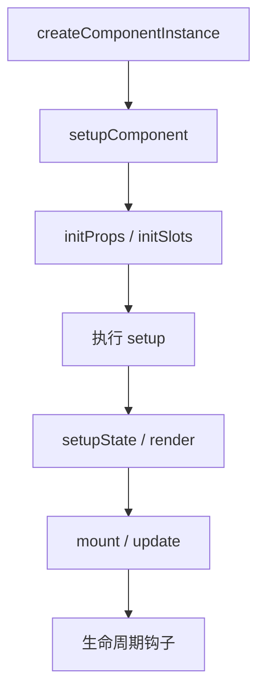

组件在运行时是一个对象实例：有状态、有生命周期、有父子和插槽关系。`setup` 是组合式 API 的入口，它返回的绑定与 `props`、`emit` 一起构成组件的上下文。



## 组件实例

`component.ts` 中的实例包含：

```ts
interface ComponentInternalInstance {
  type: Component
  parent: ComponentInternalInstance | null
  props: Data
  attrs: Data
  slots: Slots
  setupState: Data
  ctx: ComponentPublicInstance
  isMounted: boolean
  subTree: VNode | null
  update: () => void
}
```

- `props` 是父组件传入的声明属性；
- `attrs` 是未声明为 props 的属性与事件；
- `setupState` 是 setup 返回的绑定；
- `subTree` 是组件渲染出的 vnode 树；
- `update` 是触发组件更新的入口。

## props 只读

父传子的 props 被包成浅层只读代理：

```ts
instance.props = shallowReadonly(props)
```

- 子组件不能直接修改 props，修改会警告；
- `shallowReadonly` 只限制第一层，嵌套对象仍可能被改；
- 需要本地可变副本时，在 setup 里 `const local = ref(props.value)`。

未声明的属性进入 `attrs`，可通过 `v-bind="$attrs"` 透传。`inheritAttrs: false` 可以阻止自动落到根节点。

## setup 执行

```ts
function setupStatefulComponent(instance) {
  const { setup } = instance.type
  if (setup) {
    const setupResult = setup(
      shallowReadonly(instance.props),
      setupContext,
    )
    handleSetupResult(instance, setupResult)
  }
}
```

`setupContext` 提供 `attrs`、`slots`、`emit`、`expose`：

- `emit` 触发父组件监听的事件；
- `expose` 控制父组件通过模板 ref 能访问哪些内容；
- setup 只在挂载前执行一次，返回对象或渲染函数。

## 生命周期

`onMounted` 等钩子依赖“当前实例”：

```ts
export function onMounted(hook) {
  injectHook(LifecycleHooks.MOUNTED, hook, currentInstance)
}
```

- `currentInstance` 在 setup 执行期间被设置；
- 钩子被 push 到实例的 `m` 数组；
- 挂载/更新时按顺序执行；
- 在 setup 之外调用会警告“no active component instance”。

## 组件更新

```ts
function shouldUpdateComponent(prevVNode, nextVNode) {
  return (
    prevVNode.props !== nextVNode.props ||
    prevVNode.children !== nextVNode.children ||
    hasPropsChanged(prevVNode.props, nextVNode.props)
  )
}
```

- 父组件重渲染时，子组件是否更新取决于 props 与 children 是否变化；
- `v-once`、`v-memo` 可以跳过更新；
- 子组件内部状态变化通过自己的 `update` 触发。

## 常见问题

- **直接改 props**：警告且不可预测；
- **在 setup 外注册钩子**：拿不到实例；
- **attrs 透传丢失**：根节点不是单个元素或设置了 `inheritAttrs: false`；
- **emit 未声明**：事件名大小写与模板监听不一致；
- **组件重复创建**：每次 render 生成新组件 type。

## 小结

- 组件实例持有 props、attrs、slots、setupState 与 subTree；
- props 是只读代理，未声明属性进 attrs；
- setup 在挂载前执行一次，返回绑定或渲染函数；
- 生命周期钩子依赖当前实例，必须在 setup 内注册；
- 子组件是否更新由 props 与 children 变化决定。
