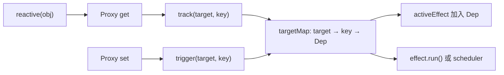

`reactive(obj)` 返回的是 Proxy，不是深拷贝。真正让视图更新的不是 Proxy 本身，而是“读的时候把当前 effect 记下来，写的时候把记下的 effect 重新跑一遍”。这两步分别叫 track 与 trigger。



## Proxy 拦截

源码在 `packages/reactivity/src/baseHandlers.ts`：

```ts
const mutableHandlers = {
  get(target, key, receiver) {
    const res = Reflect.get(target, key, receiver)
    track(target, TrackOpTypes.GET, key)
    return isObject(res) ? reactive(res) : res
  },
  set(target, key, value, receiver) {
    const oldValue = target[key]
    const result = Reflect.set(target, key, value, receiver)
    if (hasChanged(value, oldValue)) {
      trigger(target, TriggerOpTypes.SET, key)
    }
    return result
  },
}
```

两个细节：

- `get` 里对对象结果再次 `reactive`，实现惰性深层代理；
- `set` 里先比较新旧值，相同值不触发，避免无意义的重跑。

## 依赖表

`effect.ts` 中的核心结构：

```ts
type Dep = Set<ReactiveEffect>
const targetMap = new WeakMap<object, Map<PropertyKey, Dep>>()
let activeEffect: ReactiveEffect | undefined
```

- `targetMap` 用 WeakMap 以对象为键，不阻止垃圾回收；
- 每个属性一个 Dep，Dep 里存依赖它的 effect；
- `activeEffect` 指向当前正在执行的 effect，是 track 能“知道该记谁”的前提。

## track 与 trigger

```ts
function track(target, key) {
  if (!activeEffect) return
  let depsMap = targetMap.get(target)
  if (!depsMap) targetMap.set(target, (depsMap = new Map()))
  let dep = depsMap.get(key)
  if (!dep) depsMap.set(key, (dep = new Set()))
  dep.add(activeEffect)
}

function trigger(target, key) {
  const depsMap = targetMap.get(target)
  if (!depsMap) return
  const dep = depsMap.get(key)
  dep?.forEach((effect) => {
    if (effect.scheduler) effect.scheduler()
    else effect.run()
  })
}
```

`trigger` 优先调用 `scheduler`，组件更新就是把渲染 effect 的 scheduler 指向队列调度，而不是同步重跑。

## effect 的生命周期

```ts
class ReactiveEffect {
  deps: Dep[] = []
  active = true

  run() {
    if (!this.active) return this.fn()
    cleanupEffect(this)          // 先清掉旧依赖
    const prev = activeEffect
    activeEffect = this
    try {
      return this.fn()
    } finally {
      activeEffect = prev
    }
  }

  stop() {
    cleanupEffect(this)
    this.active = false
  }
}
```

每次执行前清空旧依赖，再按本次实际读取重新收集，避免条件分支变化后残留无效依赖。

## 简化版实现

```js
const targetMap = new WeakMap()
let activeEffect = null

function effect(fn) {
  const e = { fn, deps: [] }
  const run = () => {
    activeEffect = e
    fn()
    activeEffect = null
  }
  e.run = run
  run()
  return e
}

function track(target, key) {
  if (!activeEffect) return
  let depsMap = targetMap.get(target)
  if (!depsMap) targetMap.set(target, (depsMap = new Map()))
  let dep = depsMap.get(key)
  if (!dep) depsMap.set(key, (dep = new Set()))
  dep.add(activeEffect)
}

function trigger(target, key) {
  const dep = targetMap.get(target)?.get(key)
  dep?.forEach((e) => e.run())
}

function reactive(obj) {
  return new Proxy(obj, {
    get(t, k, r) {
      track(t, k)
      return Reflect.get(t, k, r)
    },
    set(t, k, v, r) {
      const ok = Reflect.set(t, k, v, r)
      trigger(t, k)
      return ok
    },
  })
}
```

这段代码没有调度、嵌套与清理，但已经能解释“改数据为什么视图会变”。

## 常见失效场景

- **解构**：`const { count } = state` 取到的是普通值，后续读不再经过 Proxy；
- **整体替换**：`state = reactive({})` 只改了变量，旧代理的依赖仍在旧对象上；
- **新增属性**：Vue 3 的 Proxy 能捕获新增，但 `Object.defineProperty` 时代不行；
- **异步丢失**：`await` 之后 `activeEffect` 已恢复，函数外的读取不会收集依赖。

## 小结

- `reactive` 返回 Proxy，get 时 track，set 时 trigger；
- 依赖表是 `targetMap: target → key → Set<effect>`；
- `activeEffect` 让 track 知道当前是谁在读；
- effect 每次执行前清理旧依赖，避免残留；
- 组件更新通过 scheduler 进入队列，而不是同步重跑。
