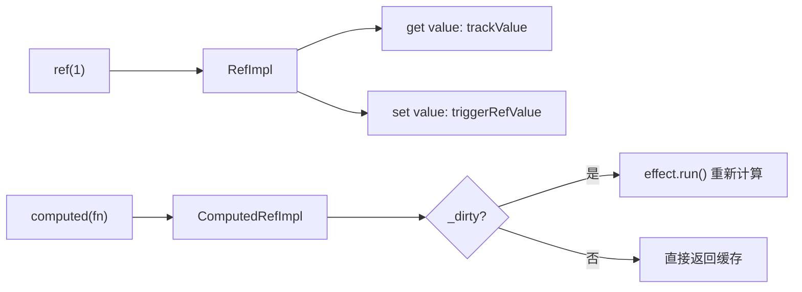

Proxy 只能代理对象，数字、字符串这类基本类型拿不到引用。`ref` 用 `{ value }` 的访问器把基本类型包起来，读 `value` 时收集依赖，写 `value` 时触发更新。`computed` 则在这个机制上加了一层缓存。



## RefImpl

`packages/reactivity/src/ref.ts` 的核心简化：

```ts
class RefImpl<T> {
  private _value: T
  public readonly dep: Dep = new Dep()

  constructor(value: T) {
    this._value = isObject(value) ? reactive(value) : value
  }

  get value() {
    trackValue(this)
    return this._value
  }

  set value(newVal) {
    if (hasChanged(newVal, this._value)) {
      this._value = isObject(newVal) ? reactive(newVal) : newVal
      triggerRefValue(this)
    }
  }
}
```

两个行为：

- 传入对象时，内部转成 `reactive`，所以 `ref({}).value.count` 仍是响应式；
- `dep` 挂在 ref 实例上，get/set 直接 track/trigger 这个 dep，不需要 targetMap。

## computed 的脏标记

`ComputedRefImpl` 不直接存计算结果，而是维护一个 effect 与 `_dirty`：

```ts
class ComputedRefImpl<T> {
  private _value!: T
  private _dirty = true
  public readonly effect: ReactiveEffect

  constructor(getter) {
    this.effect = new ReactiveEffect(getter, () => {
      if (!this._dirty) {
        this._dirty = true
        triggerRefValue(this)
      }
    })
  }

  get value() {
    trackRefValue(this)
    if (this._dirty) {
      this._dirty = false
      this._value = this.effect.run()
    }
    return this._value
  }
}
```

- 第一次读取才计算，之后命中缓存；
- 依赖变化时 scheduler 只把 `_dirty` 置真，不立即重算；
- 真正读取时才重算，这就是“惰性求值”。

## effectScope

组件卸载时要停掉一组 effect：

```ts
const scope = effectScope()
scope.run(() => {
  const a = ref(0)
  const double = computed(() => a.value * 2)
  watchEffect(() => console.log(double.value))
})
scope.stop()   // 统一停止内部所有 effect
```

`effectScope` 用栈管理当前作用域，`run` 时把新建的 effect 收集到 `effects` 数组，`stop` 时批量清理。组件实例本身就是一个 scope。

## 简化实现

```js
class Ref {
  constructor(value) {
    this._value = value
    this.dep = new Set()
  }
  get value() {
    if (activeEffect) this.dep.add(activeEffect)
    return this._value
  }
  set value(v) {
    if (v !== this._value) {
      this._value = v
      this.dep.forEach((e) => e.run())
    }
  }
}

function ref(v) {
  return new Ref(v)
}

function computed(getter) {
  let dirty = true
  let cached
  const e = effect(() => {
    dirty = true
    cached = getter()
  })
  return {
    get value() {
      if (dirty) {
        dirty = false
        cached = getter()
      }
      return cached
    },
  }
}
```

真实实现还要处理依赖清理、调度器与嵌套 scope，但缓存与惰性的骨架就在这里。

## 常见问题

- **`ref` 与 `reactive` 混用**：`reactive` 解构会丢响应式，`ref` 不会；
- **computed 里做副作用**：计算属性应只读，副作用放 watch；
- **computed 依赖未变却重算**：检查 getter 是否读了无关的响应式数据；
- **scope 未停止**：组件外的 effect 泄漏，手动 `scope.stop()`。

## 小结

- `ref` 用 value 访问器收集依赖，基本类型也能响应；
- 对象值内部转 `reactive`，深层仍是代理；
- `computed` 用脏标记与缓存，读取时才计算；
- `effectScope` 批量管理 effect 生命周期；
- 源码阅读顺序：ref.ts → computed.ts → effectScope.ts。
