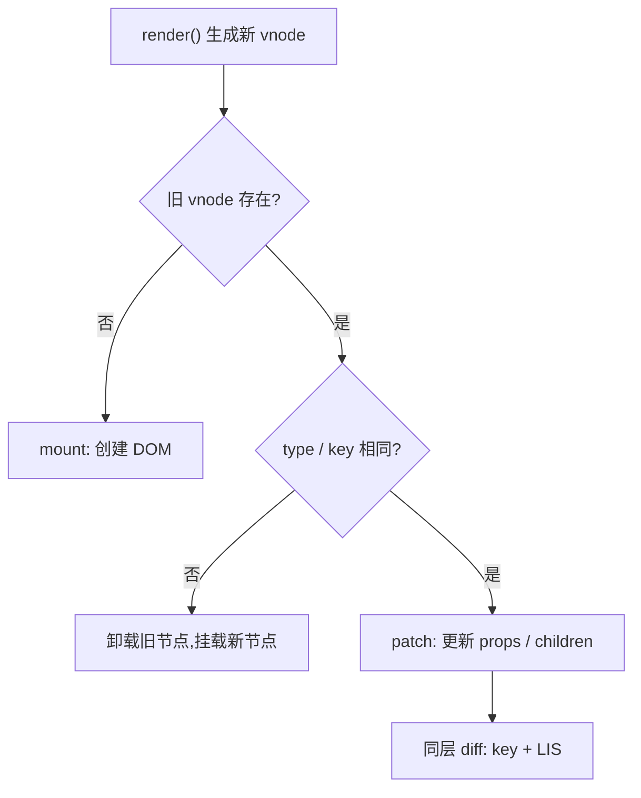

模板先编译成渲染函数，渲染函数返回 vnode 树。渲染器负责把 vnode 变成 DOM，并在数据变化后用新旧 vnode 对比，只改真正变化的部分。



## VNode 结构

```ts
interface VNode {
  type: string | Component
  props: Record<string, any> | null
  children: VNode[] | string | null
  el: Node | null
  key: string | number | null
  shapeFlag: number
}
```

- `type` 是标签名或组件对象；
- `el` 指向真实 DOM，patch 后复用；
- `key` 用于同层节点识别；
- `shapeFlag` 用位运算标记类型，减少分支判断。

## patch 主干

`renderer.ts` 的核心分支可以简化为：

```ts
function patch(n1, n2, container) {
  if (n1 && !isSameVNodeType(n1, n2)) {
    unmount(n1)
    n1 = null
  }
  if (!n1) {
    mount(n2, container)
  } else {
    update(n1, n2)
  }
}

function isSameVNodeType(a, b) {
  return a.type === b.type && a.key === b.key
}
```

- 没有旧节点：挂载；
- type 或 key 不同：卸载旧的，挂载新的；
- 都相同：进入更新，递归 patch 子节点。

## 同层 diff

`patchKeyedChildren` 处理带 key 的列表，分五步：

1. 从头部同步，相同 key 直接 patch；
2. 从尾部同步；
3. 处理新增与删除；
4. 建立旧节点 key 到索引的映射；
5. 用最长递增子序列（LIS）确定哪些节点不用移动。

```ts
// 伪代码：LIS 决定最小移动集合
const increasing = getSequence(newIndexToOldIndex)
const toBePatched = new Set()
for (let i = increasing.length - 1; i >= 0; i--) {
  if (increasing[i] > 0) toBePatched.add(increasing[i])
}
```

LIS 的意义：保留相对顺序不变的一批节点，只移动其余节点，移动次数最少。

## 无 key 与有 key

- 无 key 时按位置复用，列表插入/删除会导致后续节点全部更新；
- 有 key 时按 key 匹配，复用正确节点，减少 DOM 操作；
- key 不稳定（用 index）等同于无 key，甚至更差；
- key 只在同一层比较，跨层级不参与 diff。

## 简化实现

```js
function patch(n1, n2, parent) {
  if (!n1) {
    const el = document.createElement(n2.type)
    n2.children?.forEach((c) => patch(null, c, el))
    parent.appendChild(el)
    n2.el = el
    return
  }
  if (n1.type !== n2.type || n1.key !== n2.key) {
    parent.removeChild(n1.el)
    patch(null, n2, parent)
    return
  }
  const el = (n2.el = n1.el)
  if (typeof n2.children === 'string') {
    if (n1.children !== n2.children) el.textContent = n2.children
  } else {
    n2.children.forEach((c, i) => patch(n1.children?.[i], c, el))
  }
}
```

这段代码没有 LIS 与 props 更新，但展示了“同类型复用、异类型替换”的核心。

## 常见问题

- **列表用 index 做 key**：删除中间项后状态错位；
- **key 重复**：diff 结果不可预测；
- **频繁创建组件**：每次 render 生成新 type，导致整棵替换；
- **在同一层混用有 key 与无 key**：性能退化。

## 小结

- 渲染器负责 vnode 到 DOM 的挂载与更新；
- `isSameVNodeType` 用 type 与 key 判断能否复用；
- 同层 diff 分头尾同步、建映射、LIS 移动；
- key 决定列表复用是否正确；
- 编译时优化会减少需要 diff 的范围。
