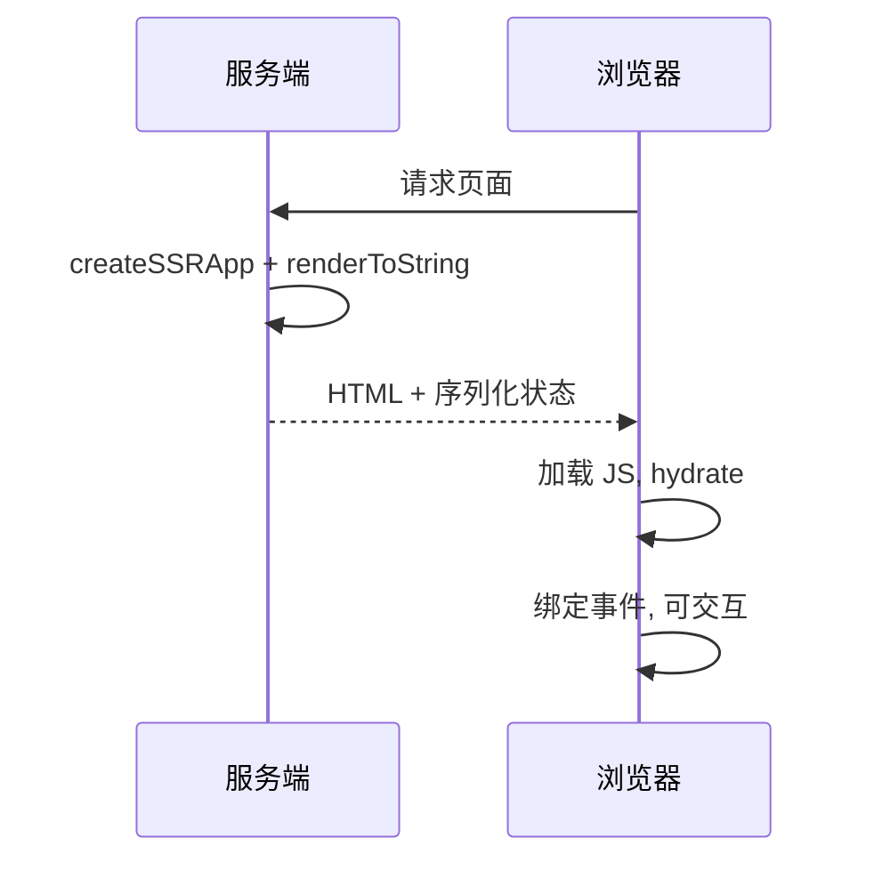

SSR 解决首屏与 SEO：服务端直接返回带内容的 HTML，浏览器不必等 JS 才看到页面。代价是同一套组件要在两种环境运行，且客户端接手时必须与服务端结果一致。



## 服务端渲染

```ts
import { createSSRApp } from 'vue'
import { renderToString } from 'vue/server-renderer'

const app = createSSRApp(App)
const html = await renderToString(app)
```

- `createSSRApp` 创建同构应用；
- `renderToString` 把组件树渲染成字符串；
- 数据预取在渲染前完成，结果序列化到 HTML；
- 客户端用同一份状态初始化，避免重复请求。

## hydration

客户端不是重新渲染，而是“接管”服务端 HTML：

```ts
const app = createSSRApp(App)
app.mount('#app')   // 内部走 hydrate
```

- 遍历 DOM 与 vnode，绑定事件与响应式；
- 节点结构必须与服务端一致，否则 mismatch；
- mismatch 会导致 DOM 被替换、事件丢失或警告；
- 开发环境会给出具体的节点位置。

## mismatch 的常见原因

- 服务端与客户端渲染结果不同（时间、随机数、窗口大小）；
- 条件渲染依赖只能在浏览器拿到的数据；
- 服务端 HTML 被中间层修改（压缩、注入）；
- 异步数据在两端到达顺序不同；
- 使用 `Teleport`、`Suspense` 时目标容器不一致。

处理方式：把浏览器专属逻辑放进 `onMounted`，或用 `<ClientOnly>` 包裹。

## SSR 下的编译优化

- 静态提升在 SSR 中同样生效，但服务端只渲染一次；
- `renderToString` 不产生 DOM，`PatchFlag` 对首屏无意义；
- 客户端 hydration 仍使用编译标记减少比对；
- 代码分割要避免服务端与客户端入口不一致。

## 工程化

- Vite 提供 SSR 构建入口与 dev server；
- Nuxt 封装路由、数据预取、SSG 与部署；
- 缓存：页面级缓存、组件级缓存（`<KeepAlive>` 在 SSR 不适用）；
- 流式渲染（`renderToPipeableStream`）降低 TTFB。

## 常见问题

- **hydration 警告**：先排查时间/随机数/浏览器 API；
- **服务端内存泄漏**：每个请求创建 app，避免共享全局状态；
- **状态序列化不安全**：不要把敏感数据写进 HTML；
- **SSR 与 CSR 路由不一致**：首屏路由要由服务端决定；
- **过度 SSR**：静态页用 SSG，纯后台用 CSR 更简单。

## 小结

- SSR 先 renderToString，再在客户端 hydrate；
- 两端渲染结果必须一致，否则 mismatch；
- 浏览器专属逻辑放 onMounted 或 ClientOnly；
- SSR 下编译优化主要服务 hydration；
- 静态内容优先 SSG，交互密集再考虑 SSR。
