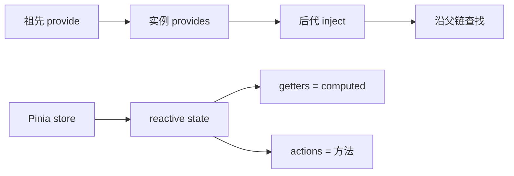

组件层级变深后，props 逐层传递会污染中间组件。`provide/inject` 让祖先直接向后代提供依赖；Pinia 则把跨页面共享的状态抽成独立 store，二者解决的不是同一层问题。



## provide/inject

```ts
// 祖先
provide('theme', ref('dark'))

// 后代
const theme = inject('theme', 'light')
```

源码在 `apiInject.ts`：

```ts
export function provide(key, value) {
  const instance = currentInstance
  if (!instance) return
  let provides = instance.provides
  const parentProvides = instance.parent?.provides
  if (provides === parentProvides) {
    provides = instance.provides = Object.create(parentProvides)
  }
  provides[key] = value
}

export function inject(key, defaultValue) {
  const instance = currentInstance
  if (!instance) return defaultValue
  const provides = instance.parent?.provides
  if (provides && key in provides) return provides[key]
  return defaultValue
}
```

- `provides` 用原型链继承父组件的 provides，查找天然向上；
- 每个组件第一次 provide 时创建自己的对象，避免污染父级；
- provide 的值不会自动解包 ref，注入方拿到的仍是 ref；
- 注入的响应式依赖仍受组件 scope 管理。

## Pinia

Pinia 的 store 本质是一个 `reactive` 对象加上 getters/actions：

```ts
export const useCart = defineStore('cart', {
  state: () => ({ items: [] }),
  getters: {
    count: (state) => state.items.length,
  },
  actions: {
    add(item) {
      this.items.push(item)
    },
  },
})
```

源码要点：

- `state` 是函数，每次创建独立状态；
- `reactive` 包装 state，getters 用 `computed` 缓存；
- actions 是普通方法，`this` 指向 store；
- store 实例缓存在 `pinia._s`，同名只创建一次；
- 插件可以拦截 action、订阅 state 变化。

Setup 风格：

```ts
export const useCart = defineStore('cart', () => {
  const items = ref([])
  const count = computed(() => items.value.length)
  function add(item) {
    items.value.push(item)
  }
  return { items, count, add }
})
```

两种写法最终都返回一个响应式 store。

## 选型

| 场景 | 方案 |
| --- | --- |
| 单个组件内部 | ref / reactive |
| 父子/隔代少量共享 | props 或 provide/inject |
| 跨页面、跨组件共享 | Pinia |
| 服务端请求缓存 | TanStack Query 等 |

不要把所有状态都塞进全局 store。局部状态留在组件里，跨页面共享再抽 store。

## 常见问题

- **inject 拿不到**：在 setup 外调用，或祖先没有 provide；
- **provide 了普通值**：后续变化不会触发后代更新；
- **store 解构丢响应式**：用 `storeToRefs`；
- **store 里直接替换 state**：`$reset` 或 action 内更新；
- **循环依赖**：store 之间互相引用，改为在 action 内延迟调用。

## 小结

- provide/inject 用原型链把依赖向下传递；
- 注入 ref 才能保持响应式；
- Pinia 的 state 是 reactive，getters 是 computed，actions 是方法；
- store 同名只创建一次，可插件扩展；
- 局部状态优先，跨页面共享再用 Pinia。
