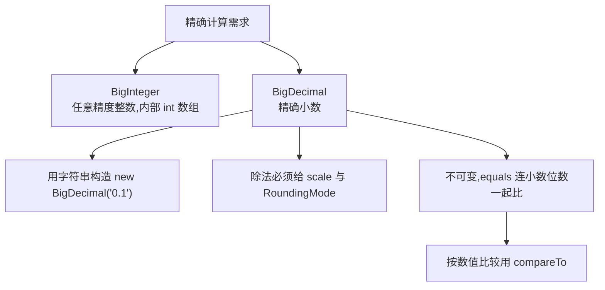

第 2 章说过，long 最大 922 亿亿，再大就溢出；double 算 0.1 + 0.2 得不到 0.3。密码学要几百位的整数，财务要一分不差的金额，这两个场景标准库给了专门的类：BigInteger 和 BigDecimal。

## BigInteger:任意大的整数



BigInteger 内部用 int 数组模拟任意长度的整数，没有上限(只受内存限制):

```java
BigInteger a = new BigInteger("123456789012345678901234567890");
BigInteger b = BigInteger.valueOf(999);
System.out.println(a.multiply(b));
// 123333333222333333321... 多大都算得动
```

运算全是方法，没有运算符：

```java
a.add(b);        // 加
a.subtract(b);   // 减
a.multiply(b);   // 乘
a.divide(b);     // 除(整除)
a.mod(b);        // 取余
a.pow(10);       // 10 次方
```

valueOf 接收 long，更大的数用字符串构造。BigInteger 也是不可变类：每个运算返回新对象，原对象不动。和包装类型一样，别用 == 比，用 equals(或 compareTo)。

## BigDecimal:精确小数

double 的问题根源是二进制表示不了 0.1 这类十进制小数。BigDecimal 换思路：用「任意精度整数 + 小数位数(scale)」表示小数，0.1 就是整数 1 配 scale 1，精确无误。

**构造必须用字符串**:

```java
BigDecimal a = new BigDecimal("0.1");
BigDecimal b = new BigDecimal("0.2");
System.out.println(a.add(b));   // 0.3,精确
```

用 double 构造会怎样？

```java
new BigDecimal(0.1);
// 0.1000000000000000055511151231257827021181583404541015625
```

double 的 0.1 本来就不精确，BigDecimal 忠实地把那个不精确的值原样搬了进来，问题出在 double 本身。`BigDecimal.valueOf(0.1)` 可以救场——它内部先 Double.toString 转成 "0.1" 再构造，但既然手里有字符串，直接字符串构造最稳。

## 运算与舍入

加减乘照旧，除法要特别对待：

```java
BigDecimal x = new BigDecimal("10");
BigDecimal y = new BigDecimal("3");
x.divide(y);   // ArithmeticException!10/3 除不尽
```

除不尽时，BigDecimal 拒绝给一个「无限位」的结果，直接抛异常。必须指定保留几位、怎么舍入：

```java
x.divide(y, 2, RoundingMode.HALF_UP);   // 3.33,四舍五入保留 2 位
```

RoundingMode 常用 HALF_UP(四舍五入)、HALF_EVEN(银行家舍入，统计场景减少累计偏差)、DOWN(直接截断)。财务默认 HALF_UP，跟着业务规则走。

调整小数位数用 setScale:

```java
new BigDecimal("3.14159").setScale(2, RoundingMode.HALF_UP);   // 3.14
```

所有运算都返回新对象。`a.add(b);` 不接返回值等于白算——这是初学者最常犯的错，和 String 一个道理。

## equals 的易错点：连位数一起比

BigDecimal 的 equals 同时比数值和 scale:

```java
new BigDecimal("1.0").equals(new BigDecimal("1.00"));   // false!
new BigDecimal("1.0").compareTo(new BigDecimal("1.00")); // 0,数值相等
```

1.0 和 1.00 数值一样，但 scale 不同，equals 判不等。所以**按数值比较用 compareTo(...) == 0**，别用 equals。这也意味着 BigDecimal 当 HashSet 元素、HashMap key 时要小心：1.0 和 1.00 会被当成两个 key。

输出时，toPlainString 保证不出科学计数法(toString 在 scale 很小时会输出 1E+2 这类形式):

```java
new BigDecimal("100").stripTrailingZeros().toPlainString();   // "100"
```

stripTrailingZeros 去掉多余的尾零，展示金额时常用。

## 金额怎么存

两条主流方案：

- BigDecimal:直观，运算自带精度控制，注意上面的构造与比较规则；
- long 存「分」:12.34 元存成 1234，整数运算零误差，显示时再除 100。数据库字段用整型，聚合求和都快。

两者都对，团队统一一种就行。唯独不能用 double 存钱——0.1 + 0.2 的误差累积起来，对账时会哭。

## 小结

- BigInteger 任意精度整数，运算走方法，不可变；
- BigDecimal 用字符串构造，double 构造会带入二进制误差；valueOf 是折中；
- 除法必须给 scale + RoundingMode，否则除不尽抛异常；运算返回新对象；
- equals 连 scale 一起比，数值比较用 compareTo == 0；输出用 toPlainString;
- 金额用 BigDecimal 或 long 存分，别用 double。
