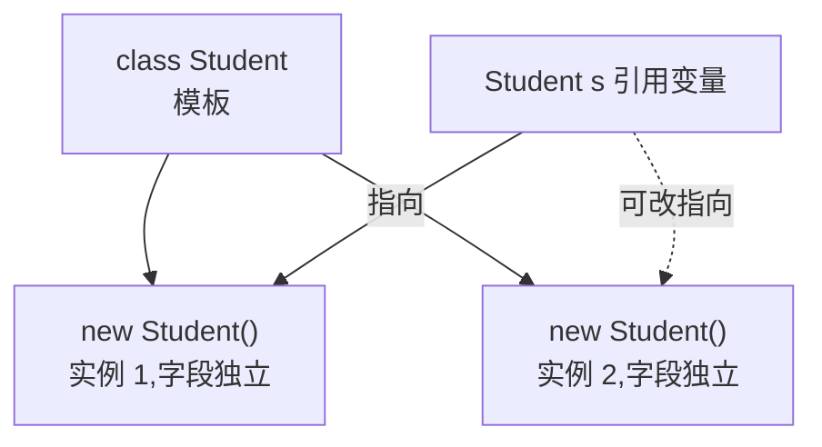

上一章写程序，是一个 static 方法接一个 static 方法，数据靠参数递来递去。程序小的时候没问题，大了就乱：一个学生的名字、年龄、成绩散落在各处，改一个字段要翻好几个方法。

面向对象换一种组织方式：把数据和处理数据的方法绑在一起，做成一个个「对象」。程序不再是一串过程，而是一群对象各管各的事、互相协作。这一篇先弄清两个最基本的词：class 和 instance。

## class 是模板，instance 是实物



要描述一个学生，先定义一个类：

```java
class Student {
    String name;
    int age;
    int score;
}
```

class 就是模板：它规定了「学生」这种东西有哪些字段(name、age、score)，但本身不是任何一个具体的学生。按模板造出来的具体对象，叫实例(instance):

```java
Student s1 = new Student();
s1.name = "小明";
s1.age = 12;
s1.score = 89;

Student s2 = new Student();
s2.name = "小红";
s2.age = 13;
s2.score = 95;
```

`new Student()` 每执行一次，就在内存里造出一个新实例。s1 和 s2 是两个独立对象，改 s1.age 不影响 s2.age。模板只有一份，实例想造多少造多少。

拆开看这条语句：

- `Student s1`:声明一个 Student 类型的变量 s1;
- `new Student()`:造一个 Student 实例；
- `=`:把实例的引用交给变量 s1。

注意最后一句的措辞：变量里装的**是指向对象的引用**。对象在堆内存里，变量里只保存指向它的引用。这个区别后面讲相等比较、讲传参时会反复用到，先记住。

## 字段有默认值，局部变量没有

实例的字段不赋值也能用，Java 会给默认值：

```java
Student s = new Student();
System.out.println(s.name);   // null
System.out.println(s.age);    // 0
System.out.println(s.score);  // 0
```

规则和第 2 章数组一样：数值类型是 0,boolean 是 false，引用类型是 null。但方法里的局部变量没有这个待遇，不赋值就用会报编译错误。字段是对象的状态，对象造出来总得有个初始状态；局部变量是临时草稿，Java 不允许你用没写过的草稿。

## 方法：让对象自己干活

光有字段，对象只是个数据袋子。把方法加进去，对象才会干活：

```java
class Student {
    String name;
    int age;
    int score;

    boolean isPassed() {
        return score >= 60;
    }

    void printInfo() {
        System.out.println(name + ", " + age + "岁, " + score + "分");
    }
}
```

调用时通过实例来调：

```java
Student s = new Student();
s.name = "小明";
s.score = 89;
System.out.println(s.isPassed());   // true
s.printInfo();                      // 小明, 0岁, 89分
```

`s.isPassed()` 里的方法体用的 score，就是 s 这个实例自己的 score。同一个方法，换 s2 去调，用的就是 s2 的字段。方法代码只有一份，数据各用各的——这就是把数据和逻辑绑在一起的好处。

方法里还有一个隐含的变量 `this`，指向「正在调用这个方法的那个实例」。上面的 isPassed 写成 `return this.score >= 60;` 效果完全一样。this 的更多用法下一篇讲。

## 封装：字段藏起来，方法露出来

上面的例子谁都能写 `s.score = -100`，一个不合理的值就进了对象。实际写代码，字段一般用 private 藏起来，只通过方法暴露有限的操作：

```java
class Student {
    private String name;
    private int score;

    public String getName() {
        return name;
    }

    public void setName(String name) {
        this.name = name;
    }

    public int getScore() {
        return score;
    }

    public void setScore(int score) {
        if (score < 0 || score > 100) {
            throw new IllegalArgumentException("分数必须在 0~100 之间");
        }
        this.score = score;
    }
}
```

private 的字段，类外面访问不到，编译直接报错。外面想读，走 getName；想改，走 setScore——而 setScore 里可以加检查，拒绝不合理的值。这叫封装：对象的状态由对象自己维护，外部只能通过它公开的方法访问。

注意 setName 里的 `this.name = name`:等号左边的 this.name 是字段，右边的 name 是参数，两者同名，靠 this 区分。这是 this 最常见的用途。

getter/setter 不是必须成对出现。有的字段只读不给 setter，有的内部状态根本不暴露。原则是：能少暴露就少暴露。

## 引用赋值与 null

两个变量可以指向同一个实例：

```java
Student s1 = new Student();
s1.name = "小明";
Student s2 = s1;      // s2 和 s1 指向同一个对象
s2.name = "小红";
System.out.println(s1.name);   // 小红
```

`s2 = s1` 复制的是引用，不是对象。改 s2.name,s1 那边看得见，因为本来就是同一个对象。第 2 章数组的 `b = a` 是一回事。

引用还可以是 null，表示「什么都没指」:

```java
Student s = null;
System.out.println(s.name);   // NullPointerException
```

对着 null 调方法、取字段，当场抛 NullPointerException。这是 Java 里最常见的运行时错误，第 4 章异常处理会专门讲它。现在记住一条：用一个引用之前，先想清楚它有没有可能是 null。

## 一个文件一个 public 类

最后补一条工程规则：一个 .java 文件里可以写多个 class，但 public 类只能有一个，且文件名必须和它同名。`public class Student` 就得放在 Student.java 里。编译后每个 class 各得一个 .class 文件，Student.class、Teacher.class 互不相干。IDE 里新建类时自动按这个规则建文件，手写代码时别违反。

## 小结

- class 是模板，instance 是按模板 new 出来的具体对象；一份模板可以造无数个实例，字段各自独立；
- 引用变量里装的是指向对象的引用，不是对象本身；赋值复制的是引用；
- 字段有默认值(0 / false / null)，局部变量没有；
- 方法通过实例调用，用的是该实例自己的字段；this 指向当前实例；
- 封装：字段 private，操作走 public 方法，检查逻辑写在方法里；
- 对 null 取字段或调方法会抛 NullPointerException。

下一篇讲方法在面向对象里的完整形态：实例方法、this、可变参数。
