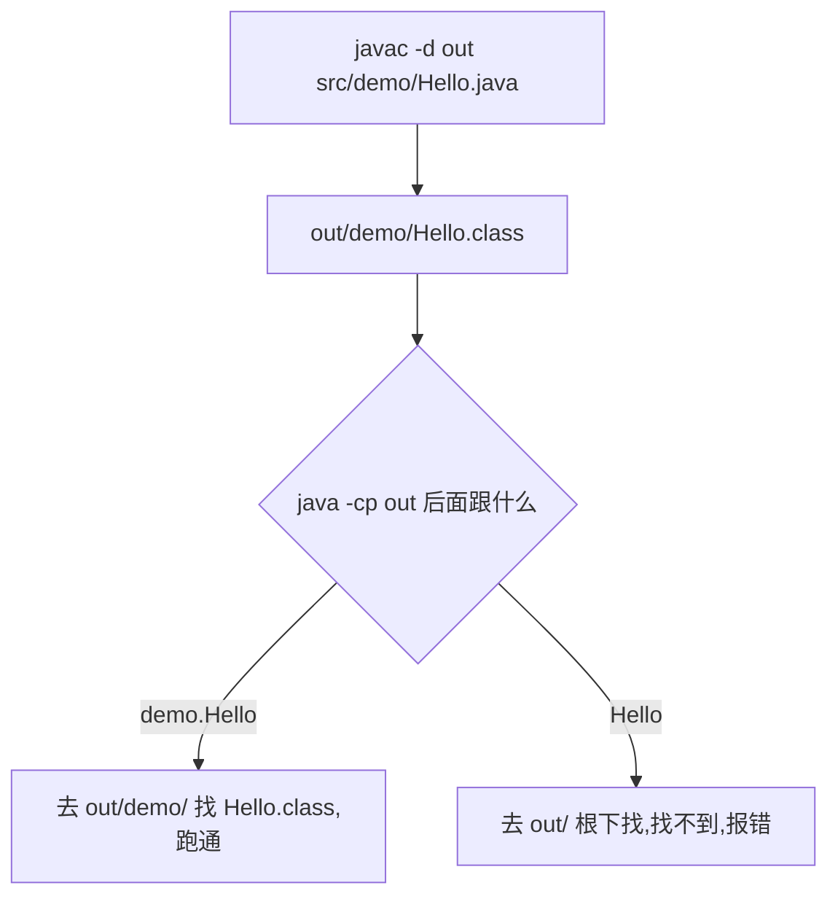

实际工作中没人天天敲 `javac`,大家都用 IDE,点一下运行按钮就完事。但还是建议花十分钟,在命令行把编译和运行亲手做一遍。原因很简单:IDE 的运行按钮背后就是这两条命令,亲手跑过,以后报错你才知道是编译的问题还是运行的问题,该查哪一步。

## 两步:先编译,再运行

接着上一篇的 `Hello.java`,这次不用 `java Hello.java` 直跑,规规矩矩走两步:

```bash
javac -d out Hello.java   # 第一步:编译,生成 out/Hello.class
java -cp out Hello        # 第二步:运行,告诉 JVM 去 out 目录找类
```

两个参数各管一件事:

- `-d out`:指定编译产物放哪。不加的话 `.class` 会生成在源码旁边,和 `.java` 混在一起,加 `-d` 让产物单独放一个目录;
- `-cp out`:告诉 JVM 去 `out` 目录找 `.class` 文件。`-cp` 是 `-classpath` 的缩写,下面细说。

编译成功时 `javac` 没有任何输出,这是 Unix 工具的习惯:没消息就是好消息。

## classpath 是什么

JVM 加载一个类的时候,得知道去哪个目录找对应的 `.class` 文件。classpath 就是这份「去哪找类」的目录清单。

不传 `-cp` 时,classpath 默认是 `.`,即当前目录。所以上一篇里 `java Hello` 能跑,是因为 `Hello.class` 就在当前目录。这次产物在 `out` 里,所以要 `-cp out`。

多个目录用分隔符连起来:Windows 用 `;`,Linux 和 macOS 用 `:`。JVM 按顺序逐个找,找到就停,全找不到才报错。

注意两点,都是老教程留下的坑:

- 不要在系统环境变量里设全局 `CLASSPATH`,那样会影响机器上所有 Java 程序。需要指定就在启动时用 `-cp`,用完即走;
- 不要把 Java 核心库加进 classpath。`String`、`ArrayList` 这些类 JVM 自己知道去哪找,不用你操心。

## 包名就是目录层级

实际项目里类都有包名。假设源码是 `src/demo/Hello.java`,开头多了一行:

```java
package demo;

public class Hello {
    public static void main(String[] args) {
        System.out.println("Hello, world!");
    }
}
```

编译和运行变成:

```bash
javac -d out src/demo/Hello.java   # 生成 out/demo/Hello.class
java -cp out demo.Hello            # 类名要带包名
```

规则是:包名对应目录层级。`demo.Hello` 这个类,JVM 一定去 classpath 下的 `demo/Hello.class` 找。包名和目录对不上,就报找不到类。



以后看到 `ClassNotFoundException`,第一件事就是核对:classpath 指对了吗?目录层级和包名一致吗?

## java 后面跟的是类名,不是文件名

这是新手最常撞的一个错:

```text
错误: 找不到或无法加载主类 Hello.java
```

原因:`java` 命令的参数是类名。写 `java Hello.class` 或 `java out/demo/Hello.class`,JVM 会把整个字符串当成类名去找,当然找不到。对照一下:

| 你敲的 | JVM 的理解 | 结果 |
| --- | --- | --- |
| `java Hello` | 找名为 `Hello` 的类 | classpath 里有就能跑 |
| `java demo.Hello` | 找 `demo` 包下的 `Hello` 类 | 带包名时的正确写法 |
| `java Hello.java` | 当前目录有这个源码文件就直跑 | 文件不在就当成类名,报错 |
| `java Hello.class` | 找名为 `Hello.class` 的类 | 必然报错 |

唯一的例外是上一篇的源码直跑:`java Hello.java` 要求文件真的在当前目录。这个模式 JDK 11 引入(JEP 330),JDK 22 起还支持多文件(JEP 458),入口文件引用到的其他 `.java` 会一并编译。

直跑适合练习和写小脚本,不适合交付:每次运行都重新编译,文件多了慢;产物不落盘,没法把编译结果交给别人。所以练习用直跑,理解原理用两步,交付打包成 jar。

## 打包成 jar

`.class` 文件多了,散在各层目录里不好管理,打成一个 jar 包就是一个文件。jar 就是 zip 压缩包,把整个目录结构装了进去。

把 `out` 里的产物打成一个可执行 jar:

```bash
jar --create --file app.jar --main-class demo.Hello -C out .
java -jar app.jar
```

`--main-class` 把入口类写进 jar 的清单文件(manifest),`java -jar` 时 JVM 读它决定从哪个类开始执行。

这里有个真坑:用了 `-jar`,命令行上的 `-cp` 就会被忽略,classpath 改由 manifest 里的 `Class-Path` 决定。所以 `java -cp lib/* -jar app.jar` 找不到依赖不是 bug,是规则如此。两个解决办法:把依赖写进 manifest,或者不用 `-jar`,改回普通方式:

```bash
java -cp "app.jar;lib/*" demo.Hello   # Windows 用 ; 分隔,Linux/macOS 用 :
```

## jshell:试 API 不用建文件

JDK 自带一个交互式工具 jshell,敲一行执行一行,学新类的时候特别顺手:

```text
$ jshell
jshell> List.of(1, 2, 3).stream().map(x -> x * 2).toList()
$1 ==> [2, 4, 6]
jshell> /exit
```

不用建文件、不用写 class、不用编译,想验证一个方法返回什么,敲进去立刻看到。后面第 7 章练 Stream 还会用到它。

## 几个值得记住的参数

| 参数 | 属于 | 作用 |
| --- | --- | --- |
| `--release 21` | javac | 按 21 的语法和 API 编译,产物能在 21 的 JVM 上跑 |
| `-encoding UTF-8` | javac | 指定源码编码,Windows 上防中文乱码 |
| `-Xlint:all` | javac | 打开全部警告,学习期建议常开 |
| `-g` | javac | 保留调试信息,断点调试需要 |
| `-Xmx512m` | java | 限制堆内存上限 |
| `--enable-preview` | 两者 | 启用预览特性,编译和运行都要加,少一边就报错 |

`--release` 多说一句:它同时锁定语法、类库和字节码版本三个东西。老的 `-source` / `-target` 组合只管语法和字节码,可能让你用上新 API 却编出旧 JVM 跑不了的产物,所以现在统一用 `--release`。

## IDE 做了什么

IDE 是集成开发环境(Integrated Development Environment),把写代码、编译、运行、调试放进一个界面里。效率提升主要来自三件事:自动补全、改完代码自动重新编译、方便的断点调试。

Java 的 IDE 现在主要三个选择:

- IntelliJ IDEA:2025.3 起社区版和旗舰版合并成一个发行版,Java / Kotlin 核心开发功能免费(含商用),Spring 深度支持、数据库工具等高级功能走 Ultimate 订阅。学 Java 装它就够;
- VS Code + Extension Pack for Java:轻量,适合本来就住在 VS Code 里的人;
- Eclipse:老牌免费,公司里存量不少。

IDE 没有发明新步骤,它做的还是 `javac` 和 `java` 那两件事,只是自动化了。对照一下:

| 动作 | 命令行 | IDEA 里对应什么 |
| --- | --- | --- |
| 编译 | `javac -d out ...` | Build Project(增量自动) |
| 运行 | `java -cp out demo.Hello` | 点 main 方法旁的运行按钮 |
| 指定 JDK | `JAVA_HOME` / PATH | Project Structure → SDK |
| 指定语言级别 | `--release 21` | Project Structure → Language Level |
| 加依赖 jar | `-cp` | 库配置 / Maven 依赖 |

注意:IDE 里项目的 SDK 和语言级别,要和命令行用的一致。两边不一致,就会出现「IDE 能跑、命令行跑不了」的怪事,反过来也一样。

最后列几个命令行阶段常见的问题,遇到了对号入座:

- 中文乱码:Windows 默认编码是 GBK,源码存成 UTF-8 而编译时没指定编码,中文就花了。编译统一加 `-encoding UTF-8`,编辑器也设成 UTF-8;
- 改了代码,运行结果没变:命令行模式下 `.class` 不会自己更新,改完源码要重新 `javac`。IDE 里则是检查自动构建有没有开;
- IDE 能跑,命令行不能:多半是 classpath 不一致,IDE 替你加了依赖或模块路径,回到命令行把 `-cp` 写全。

## 小结

- `javac` 编译,`java` 运行,`java` 的参数是类名不是文件名;
- classpath 是 JVM 找类的目录清单,默认当前目录,用 `-cp` 指定,不要设全局 CLASSPATH;
- 包名对应目录层级,`demo.Hello` 必须在 classpath 下的 `demo/Hello.class`;
- jar 就是 zip,`java -jar` 会忽略 `-cp`,依赖要么进 manifest 要么改用 `-cp` 启动;
- IDE 只是把编译运行自动化了,项目 SDK 和语言级别要与命令行对齐。

下一篇是本章最后一篇,讲讲这 17 章的目录怎么用、按你的目标从哪进入。