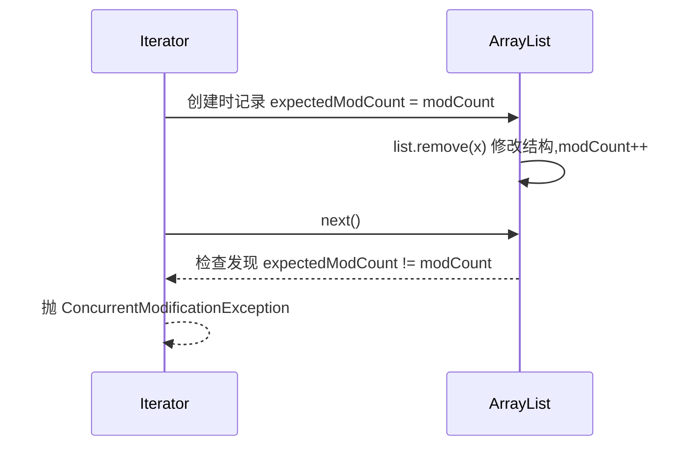

上一篇提到"遍历中直接 list.remove 会出问题"。这一篇解释那个问题是什么：fail-fast 机制，以及正确的删除姿势。

## 现象：遍历中修改抛异常



```java
List<String> list = new ArrayList<>(List.of("a", "b", "c"));
for (String s : list) {
    if (s.equals("b")) list.remove(s);   // 抛 ConcurrentModificationException
}
```

for-each 底层是 Iterator。异常不是"并发"才有的——单线程这样写同样抛。名字里的 Concurrent 指"修改与迭代并发进行"，不限于多线程。

## 机制：modCount 与 expectedModCount

集合内部维护一个计数器 **modCount**，记录**结构修改**(structural modification:增删元素、改变容量等；仅 set 替换值不算)的次数。

创建迭代器时，把当时的 modCount 快照为迭代器自己的 **expectedModCount**。每次 next() 都检查两者是否相等：

```java
// ArrayList.Itr 简化逻辑
final void checkForComodification() {
    if (modCount != expectedModCount)
        throw new ConcurrentModificationException();
}
```

直接 list.remove 使 modCount +1，而迭代器的 expectedModCount 没更新，下一次 next 检查不等即抛异常。这就是 **fail-fast**:一旦检测到迭代期间集合被外部结构修改，立即失败，而不是带着不一致的状态继续遍历(那可能漏元素、重复元素或越界)。

## fail-fast 是尽力检测，不是保证

javadoc 明确：fail-fast 迭代器**尽力**抛 ConcurrentModificationException，但不能保证一定检测到(例如修改发生在检查之后)。因此**不要依赖这个异常做程序逻辑**，它只是 bug 的早期信号。

## 正确删除：iterator.remove 或 removeIf

iterator.remove 在删除元素的同时同步 expectedModCount，因此不会触发 fail-fast:

```java
Iterator<String> it = list.iterator();
while (it.hasNext()) {
    if (it.next().equals("b")) it.remove();   // 安全
}
```

JDK8 起更简洁的写法是 removeIf:

```java
list.removeIf(s -> s.equals("b"));
```

注意：iterator.remove 删除的是**上一次 next 返回**的元素；连续两次 remove 或没 next 就 remove 会抛 IllegalStateException。

## 多线程：用并发集合

fail-fast 只检测单迭代器视角的修改，多线程下既不可靠也不安全。多线程共享集合应改用并发实现(第 10 章):

- ConcurrentHashMap / CopyOnWriteArrayList 等，其迭代器是**弱一致**或 **fail-safe**(遍历快照)，不抛 ConcurrentModificationException;
- 或外部加锁保证迭代与修改互斥。

CopyOnWriteArrayList 的迭代器遍历创建时的数组快照，修改发生在副本上，故称 fail-safe；代价是写操作复制整个数组，适合读多写少。

## 小结

- modCount 记录结构修改；迭代器快照为 expectedModCount,next 时比对；
- 遍历中直接集合.remove 使两者不等，抛 ConcurrentModificationException;
- fail-fast 是尽力检测，不作逻辑保证；
- 单线程删除用 iterator.remove / removeIf;
- 多线程用并发集合(弱一致/fail-safe 迭代器)或外部加锁。

下一篇讲不可变集合与 Collections 工具。
