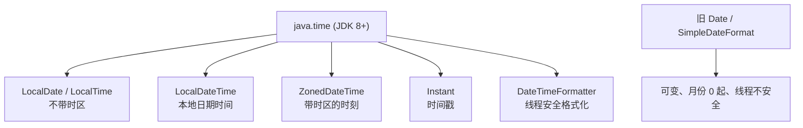

日期时间是业务里绕不开的：创建时间、生日、定时任务。Java 在这块有过一次大换血——JDK 8 的 java.time 包取代了老的 Date/Calendar。新代码一律用新 API，这一篇讲它怎么用，以及为什么老的不能碰。

## 旧 API 的问题



java.util.Date 和 SimpleDateFormat 有几个硬伤：

- Date 是**可变**的，setTime 能改，多线程共享要加锁；
- 月份从 0 开始： new Date(2026, 10, 18) 其实是 11 月，年份还要减 1900，反人类；
- SimpleDateFormat **线程不安全**，多线程共用一个实例会解析出乱七八糟的结果，这是线上事故常客。

java.time 把这些问题一次修掉：类型几乎全不可变，月份 1~12，星期 1~7 表示周一到周日，DateTimeFormatter 线程安全。

## LocalDate / LocalTime / LocalDateTime

三个本地类型，按需要的粒度选：

```java
LocalDate d = LocalDate.now();          // 2026-11-18
LocalTime t = LocalTime.now();          // 15:30:45.123
LocalDateTime dt = LocalDateTime.now(); // 2026-11-18T15:30:45.123
```

now() 按系统默认时区取当前时间。三个 now 分别调，毫秒可能对不上；要同一时刻，取一个再拆：

```java
LocalDateTime dt = LocalDateTime.now();
LocalDate d = dt.toLocalDate();
LocalTime t = dt.toLocalTime();
```

指定值用 of，解析字符串用 parse:

```java
LocalDate d = LocalDate.of(2026, 11, 18);   // 11 就是 11 月
LocalDateTime dt = LocalDateTime.of(2026, 11, 18, 15, 30, 0);
LocalDateTime dt2 = LocalDateTime.parse("2026-11-18T15:30:00");
```

注意中间那个 **T**:ISO 8601 规定的日期时间分隔符。直接打印这些类型，输出的就是 ISO 格式，日志里很整齐。

## 加减与调整

链式调用，返回新对象(不可变):

```java
LocalDateTime dt = LocalDateTime.of(2026, 11, 18, 15, 30, 0);
dt.plusDays(5).minusHours(3);   // 2026-11-23T12:30
dt.plusMonths(1);               // 2026-12-18T15:30
dt.withHour(9).withMinute(0);   // 2026-11-18T09:00
```

月末自动调整：10 月 31 日减一个月得 9 月 30 日，因为 9 月没有 31 号。这类边界旧 API 要自己算，新 API 内置了。

比较用 isBefore / isAfter / isEqual，别自己拼字符串比。

## DateTimeFormatter:自定义格式

ISO 格式之外的显示与解析，用 DateTimeFormatter:

```java
DateTimeFormatter fmt = DateTimeFormatter.ofPattern("yyyy-MM-dd HH:mm:ss");
String s = fmt.format(LocalDateTime.now());       // "2026-11-18 15:30:45"
LocalDateTime dt = LocalDateTime.parse("2026-11-18 15:30:45", fmt);
```

模式字母认准这几个：yyyy 年，MM 月，dd 日，HH 时(24 小时制),mm 分，ss 秒。两个高频写错：

- `hh` 是 12 小时制，下午 3 点显示 03，要 24 小时制用 HH;
- `YYYY` 是「基于周的年」，跨年那几天会差一年，老老实实写小写 yyyy。

DateTimeFormatter 不可变、线程安全，定义成 static final 常量全程序共用，不用像 SimpleDateFormat 那样每线程一份。

## 时区：LocalDateTime 的盲区

LocalDateTime 不带时区——「2026-11-18 15:30」在北京和伦敦是两个不同的时刻。涉及跨时区，用 ZonedDateTime:

```java
ZonedDateTime zdt = ZonedDateTime.now();                      // 带系统默认时区
ZonedDateTime bj = ZonedDateTime.now(ZoneId.of("Asia/Shanghai"));
ZonedDateTime ld = bj.withZoneSameInstant(ZoneId.of("Europe/London"));
// 同一时刻,伦敦的钟点
```

withZoneSameInstant 是「换时区不换时刻」，钟点跟着变；还有个 withZoneSameLocal 是「换时区不换钟点」，时刻变了，别用混。

LocalDateTime 加上时区就变 ZonedDateTime:

```java
ZonedDateTime z = dt.atZone(ZoneId.of("Asia/Shanghai"));
```

时区 ID 用「洲/城市」格式，别用 CST 这类缩写，有歧义(CST 能指四个时区)。

## Instant:时间线上的一个点

Instant 表示 UTC 时间线上的一个时刻，内部是从 1970-01-01T00:00:00Z 起的秒数加纳秒：

```java
Instant now = Instant.now();
long epochSec = now.getEpochSecond();
Instant from = Instant.ofEpochSecond(1763451045);
```

它和时区无关，全球任何地方调 Instant.now() 拿到的是同一个时刻。**存储与传输用 Instant(或 epoch 毫秒)，展示时再转成用户时区的 ZonedDateTime**——这是日期时间的最佳实践，数据库存 UTC，前端按本地时区渲染，服务器迁移、用户出国都不乱。

两个时刻之间的间隔用 Duration(秒、纳秒级)，两个日期之间的间隔用 Period(年、月、日级):

```java
Duration d = Duration.between(t1, t2);
d.toMinutes();
Period p = Period.between(d1, d2);
p.getMonths();
```

## 小结

- 新代码用 java.time:不可变、月份 1~12、格式化线程安全；旧 Date/Calendar 别碰；
- LocalDate / LocalTime / LocalDateTime 按粒度选，of 创建、parse 解析、plus/minus/with 运算；
- 格式化 ofPattern("yyyy-MM-dd HH:mm:ss"),HH 是 24 小时制，yyyy 别写成 YYYY;
- LocalDateTime 无时区；跨时区用 ZonedDateTime.withZoneSameInstant;
- 存储传输用 Instant / epoch，展示转用户时区；间隔用 Duration / Period。
