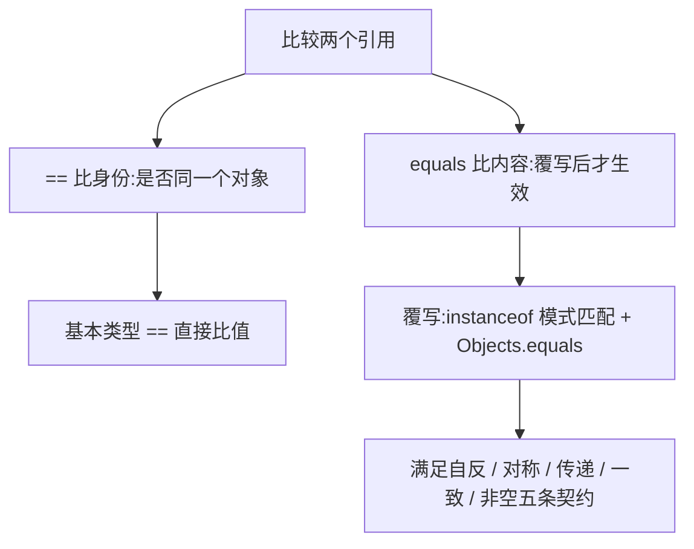

第 2 章说过，引用变量里装的是指向对象的引用。那么两个引用「相等」是什么意思？是引用相同(指向同一个对象)，还是对象内容相同？Java 把这两件事分给了两个工具：== 和 equals。这一篇讲清分工，再学怎么正确覆写 equals。

## ==:比的是身份



对基本类型，== 比值，没有歧义：

```java
int a = 100, b = 100;
System.out.println(a == b);   // true
```

对引用类型，== 比的是**两个引用是否指向同一个对象**，不管内容：

```java
String s1 = new String("hello");
String s2 = new String("hello");
System.out.println(s1 == s2);      // false,两个对象
System.out.println(s1.equals(s2)); // true,内容相同

String s3 = s1;
System.out.println(s1 == s3);      // true,同一个对象
```

s1 和 s2 内容一模一样，但 new 了两次就是两个对象，== 判 false。这个语义叫引用相等，比的是身份，不是内容。

## equals:默认也是 ==，覆写后才比内容

equals 是 Object 定义的方法，所有类都有。但它的默认实现就是：

```java
public boolean equals(Object obj) {
    return this == obj;
}
```

**不覆写的话，equals 和 == 完全等价**。很多人以为 equals 天生比内容，这是最常见的误会。String、Integer 这些类之所以 equals 比内容，是因为它们覆写了。

自己写的类不覆写 equals，放进集合就查不到：

```java
List<Person> list = List.of(new Person("小明"), new Person("小红"));
System.out.println(list.contains(new Person("小红")));   // false!
```

List.contains 内部是用 equals 逐个比较的。Person 没覆写 equals，比的是身份，新 new 的「小红」和列表里那个不是同一个对象，自然找不到。

## 覆写 equals:三步

先定义「相等」的逻辑含义：Person 的 name 和 age 都相同，就算相等。然后：

```java
class Person {
    String name;
    int age;

    @Override
    public boolean equals(Object o) {
        if (o instanceof Person p) {
            return Objects.equals(this.name, p.name) && this.age == p.age;
        }
        return false;
    }
}
```

拆开看：

1. `o instanceof Person p`:不是 Person(包括 null)直接 false；是的话，instanceof 的模式匹配会直接把 o 绑定为 Person 类型的 p，不用再强转；
2. 引用类型字段用 `Objects.equals` 比：它内部处理了 null——两个都 null 算相等，一个 null 算不等，不会抛 NullPointerException;
3. 基本类型字段直接 ==。

注意参数类型必须是 Object，不能写成 `equals(Person p)`——那是重载，不是覆写，集合调的还是 Object 那个版本。加 @Override 能防住这个手误。

## 五条契约

Object 的文档对 equals 定了五条规矩，覆写时必须满足：

- 自反：x.equals(x) 为 true;
- 对称：x.equals(y) 为 true 则 y.equals(x) 为 true;
- 传递：x 等于 y,y 等于 z，则 x 等于 z;
- 一致：对象状态不变，结果就不变；
- 对 null:x.equals(null) 永远 false。

上面那个写法天然满足这五条。容易破坏契约的是「子类加字段再覆写」:父类按 name 比，子类按 name+score 比，对称性就碎了(父类实例 equals 子类实例可能 true，反过来 false)。实践建议：用 instanceof 而不是 getClass 判断时，想清楚继承体系里「相等」到底该怎么定义；拿不准就让类 final，或者干脆用 record(3.3 节讲，它自动生成正确的 equals)。

## 什么时候不用覆写

不是每个类都需要 equals。如果这个类的实例从不放进 List 查找、从不作 Map 的 key、从不比较内容——比如一个只负责干活的 Service——默认的「比身份」就够用，别画蛇添足。需要「内容相等」语义时才覆写，覆写了就要连带 hashCode 一起，下一篇讲为什么。

## 小结

- == 对基本类型比值，对引用比身份(是否同一对象);
- equals 默认就是 ==，覆写后才比内容；String、Integer 是覆写过的；
- 覆写三步：instanceof 模式匹配判类型，引用字段 Objects.equals，基本字段 ==;
- 参数必须是 Object，加 @Override；五条契约(自反、对称、传递、一致、null 为 false);
- 不比较内容的类不必覆写；覆写了 equals 必须连带 hashCode。
