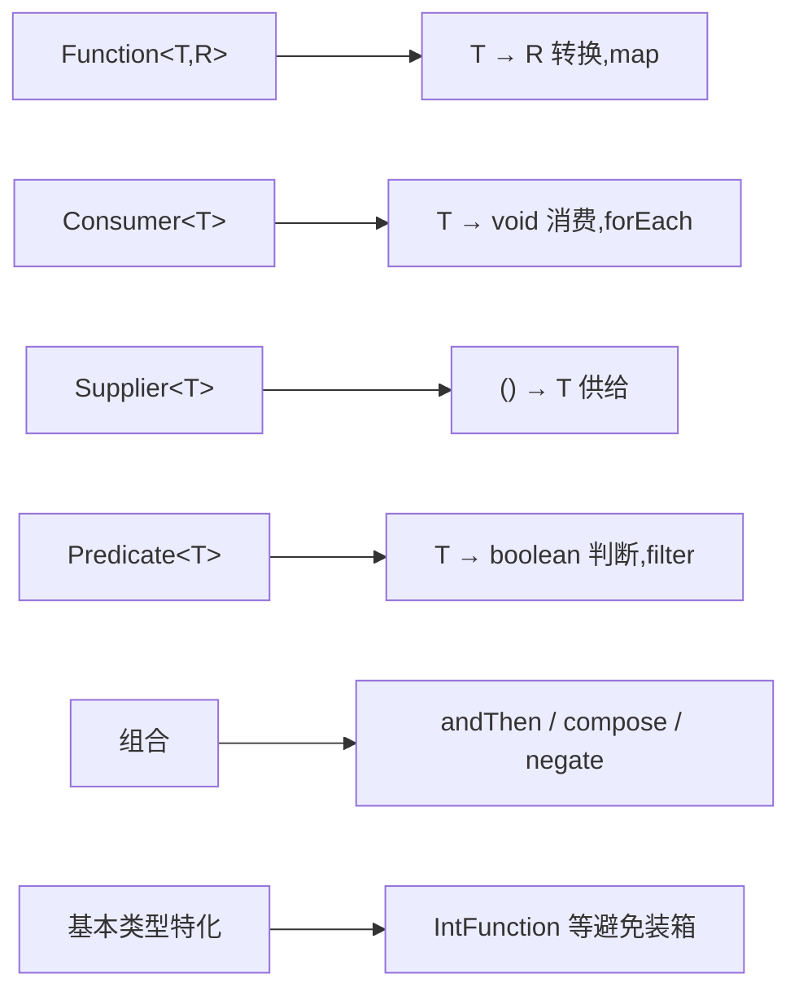

上一篇说 Lambda 的目标是函数式接口。自己定义接口当然可以，但 JDK 在 java.util.function 里预置了一组按"输入→输出"形状划分的接口，覆盖绝大多数场景，优先复用它们。

## 按形状分类



| 接口 | 抽象方法 | 形状 | 用途 |
| --- | --- | --- | --- |
| Function<T,R> | R apply(T t) | T → R | 转换 |
| Consumer<T> | void accept(T t) | T → 无 | 消费(打印、写入) |
| Supplier<T> | T get() | 无 → T | 供给(工厂、懒加载) |
| Predicate<T> | boolean test(T t) | T → boolean | 判断/过滤 |
| BiFunction<T,U,R> | R apply(T t, U u) | (T,U) → R | 双参转换 |
| UnaryOperator<T> | T apply(T t) | T → T | 同类型转换(Function 特例) |
| BinaryOperator<T> | T apply(T t, T u) | (T,T) → T | 同类型归约(reduce 用) |

```java
Function<String, Integer> len = String::length;
Consumer<String> print = System.out::println;
Supplier<List<String>> factory = ArrayList::new;
Predicate<Integer> positive = n -> n > 0;
```

记忆法：Function 有进有出、Consumer 只进不出、Supplier 只出不进、Predicate 进出 boolean。

## @FunctionalInterface 的作用

该注解是**编译期检查**:标注的接口若抽象方法不止一个，编译报错。它不改变运行时行为，也不是 Lambda 的必要条件(未标注的单抽象方法接口同样可作 Lambda 目标)。加上它是向读者与编译器声明意图。

## 组合：andThen / compose / negate

函数式接口提供 default 组合方法，把小函数拼成流水线：

```java
Function<Integer, Integer> plus1 = n -> n + 1;
Function<Integer, Integer> times2 = n -> n * 2;

plus1.andThen(times2).apply(3);   // (3+1)*2 = 8,先 plus1 后 times2
plus1.compose(times2).apply(3);   // (3*2)+1 = 7,先 times2 后 plus1

Predicate<Integer> p = positive.negate();          // 取反
Predicate<Integer> both = positive.and(n -> n < 10);  // 与
Predicate<Integer> either = positive.or(n -> n == 0); // 或
```

andThen 是"我之后接你",compose 是"我之前先你"。Consumer 也有 andThen(依次消费);Function 与 Predicate 的组合最常用。

## 基本类型特化：避免装箱

泛型接口不能用基本类型作类型参数，Function<Integer,Integer> 会装箱拆箱。JDK 提供特化版：

- IntFunction<R>、ToIntFunction<T>、IntUnaryOperator、IntPredicate、IntConsumer、IntSupplier;
- 以及 Long / Double 对应版本。

```java
IntPredicate even = n -> n % 2 == 0;      // 无装箱
ToIntFunction<String> len = String::length;
```

热点路径上优先用特化版，减少装箱开销(呼应第 3 章装箱性能提醒)。

## 自定义函数式接口

内置形状不匹配时再自定义，例如带两个输入一个输出且语义明确：

```java
@FunctionalInterface
interface TriFunction<A, B, C, R> {
    R apply(A a, B b, C c);
}
```

自定义时保持单一抽象方法，语义命名清晰；能复用内置就不要新建。

## 小结

- 按形状复用内置接口：Function/Consumer/Supplier/Predicate/BiFunction/Operator;
- @FunctionalInterface 是编译期检查，非必需；
- andThen/compose/negate/and/or 组合小函数；
- 基本类型用 Int/Long/Double 特化版避免装箱；
- 形状不匹配再自定义，保持单一抽象方法。

下一篇讲 Stream:把这些函数串成集合处理的流水线。
