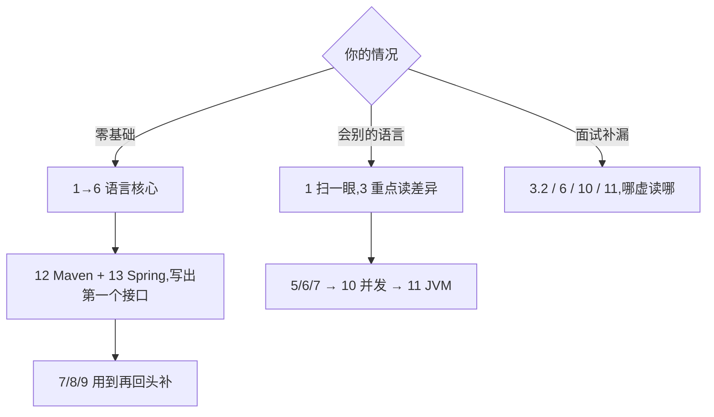

这份知识库一共 17 章,从装环境一直讲到 Spring 和数据库。先说结论:不需要从头到尾按顺序读。这章告诉你目录怎么用、按你的情况从哪进入,以及每一章大概在什么阶段读。

## 目录怎么用

侧栏的目录分四层:方向 → 章 → 节 → 小节。Java 是其中一个方向,下面挂 17 章。编号由目录树的位置自动算出来(1、3.1、3.1.1),编号就是建议的阅读顺序。

几个使用细节:

- 章节可以折叠。点章节名前的箭头收起或展开,你正在读的那条路径会自动展开,折叠状态会记住;
- 「筹备中」表示这一节还没写文章。目录树是先立起来的,内容按章填充,补上文章标记就消失。看到大片「筹备中」不是网站坏了,是还没写到;
- 正文里带下划线的词是术语,鼠标悬停有一句话解释,点进去看术语表里的完整说明;
- 每篇页脚列着参考资料,本文的说法出自哪里,想深入就顺着链接读;
- 部分文章配了知识地图(可拖拽的思维导图)和交互演示,有的话会出现在正文上方;
- 文章头部的「问这篇」按钮可以就着当前文章提问,某一段读不懂直接追问。

## 按你的情况选路线

**零基础,第一门语言就是 Java**。按编号走主线:1 → 2 → 3 → 4 → 5 → 6,把语言核心啃下来,然后直接跳 12(Maven)和 13(Spring),尽快写出一个能跑的接口。中间的 7、8、9 章不阻塞写项目,用到再回头补。

**会别的语言,转 Java**。语法不用重学,把时间花在差异上:第 1 章只看 JDK / JRE / JVM 和版本两节,第 2 章快速过,第 3 章重点读——引用与 equals、核心类,这是 Java 和多数语言最不一样的地方。然后 5 / 6 / 7,再到 10(并发)和 11(JVM)。

**准备面试,或者补漏**。高频区集中在四处:3.2 引用、相等与哈希,6 集合框架,10 多线程与并发,11 JVM 基础。哪块心虚读哪块,每篇结尾列的坑基本就是面试追问的方向。

## 17 章都在讲什么

| 章 | 主题 | 什么时候读 |
| --- | --- | --- |
| 1 | 简介与准备 | 第一天:装环境、跑通第一个程序 |
| 2 | 快速入门 | 第一周:变量、分支循环、数组与方法 |
| 3 | 面向对象编程 | 主线核心:类、引用、核心类,花时间最多的一章 |
| 4 | 异常处理 | 写第一个需要处理错误的程序时 |
| 5 | 泛型 | 读集合源码前,弄懂 `List<String>` 的尖括号 |
| 6 | 集合框架 | 天天用:List / Map / Set 怎么选 |
| 7 | 函数式编程与 Stream | 集合之后最常用的一套写法 |
| 8 | 反射与注解 | 想弄懂框架为什么能「读懂」你的类时 |
| 9 | IO 与 NIO | 要读写文件、发网络请求时 |
| 10 | 多线程与并发 | 面试高频,业务里也最容易写出 bug 的地方 |
| 11 | JVM 基础 | 面试高频;排查内存与 GC 问题前必读 |
| 12 | 工程化与构建 | 项目从一个人写变成一群人写的那一步 |
| 13 | Spring 生态 | 找 Java 后端工作绕不开的一章 |
| 14 | 持久层 | 接口要连数据库时:MyBatis 与事务 |
| 15 | 设计模式 | 有半年代码量之后再读,才看得懂「为什么」 |
| 16 | 领域建模与架构 | 开始负责一个模块的边界与分层时 |
| 17 | 数据结构与算法 | 贯穿始终的副线,刷题前读一遍方法论 |

章节划分参照了廖雪峰的 Java 教程。他的教程分 24 章,反射、注解、日期、正则、单元测试各自成章;本库合并成 17 章,编号式目录的风格就来自他。语言特性与类库的覆盖范围对照了 dev.java 的官方学习路径,工程化与生态部分参照 roadmap.sh。

## 几条学习建议

**代码要自己敲**。每篇的例子,用 jshell 或单文件直跑(第 3 篇讲过)亲手跑一遍,别只看。看懂和写对之间隔着一百个报错,敲出来的报错才是你的老师。

**不要背 API**。方法签名查文档就有,要记的是「这类问题该找哪个类」。比如知道字符串拼接找 StringBuilder、键值对找 Map,具体方法名用到再查。

**第一遍读不懂很正常**。how2j 在难懂的课后面会写一句「两周之后再来看」,这个建议很好:先往后走,带着代码量回头再读,同一页就懂了。所以卡住不要死磕,标记一下继续往下,第 10、11 章(并发和 JVM)尤其如此,没有代码量垫底,读起来像天书。

**不要追新特性**。预览语法明年可能就变,主线永远是语言核心和类库。新特性知道有这回事就够了。

读完一篇,可以去侧栏的闯关游戏做对应章节的题,卡住的题回到对应小节重读。

## 小结

- 17 章是主线,按目标选入口:零基础走 1→6 再跳 12/13,有基础重点读第 3 章差异,面试补漏看 3.2 / 6 / 10 / 11;
- 「筹备中」是还没写到;术语悬停有解释,页脚有出处,不懂就点「问这篇」;
- 代码自己敲,API 不用背,读不懂先往后走,新特性不追。

选好路线就出发。下一章从变量和分支循环开始。