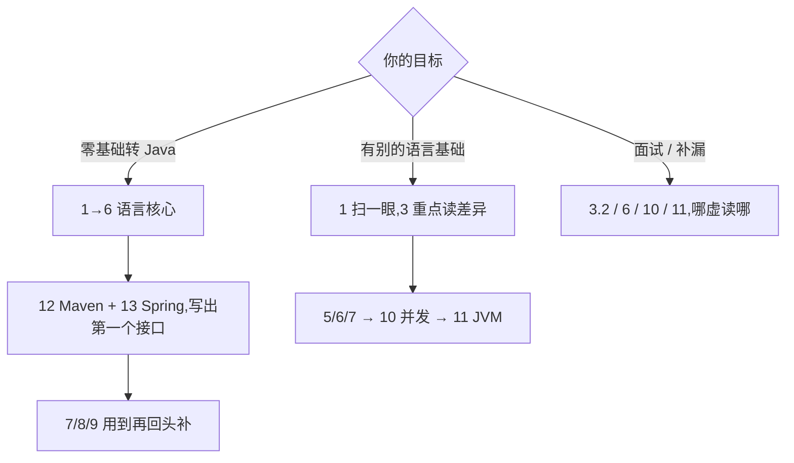

这 17 章是一条主线,但不是必须从头读到尾。按你的目标选一个入口,每章先读落地页上那句话,再决定读哪些小节,比从第一页硬啃到最后一页快得多。

## 这棵树长什么样

侧栏里的目录分四层:方向 → 章 → 节 → 小节。Java 是其中一个方向,下面挂着 17 章,章再往下分节。编号由树的位置自动推出(1、3.1、3.1.1),编号就是建议的阅读顺序。

几个使用细节:

- 章节可以收起。点章节名前面的箭头折叠 / 展开,你正在读的那条路径会自动展开,折叠状态也会记住;
- 「筹备中」表示这一节还没有文章。目录树先立起来,内容按章填充,补上文章后标记自动消失。所以看到大片「筹备中」不用慌,不是坏了,是还没写到;
- 每篇文章有正文 + 术语标注 + 参考资料三部分:正文里带下划线的词悬停有一句解释,点进术语表看全貌;页脚列着这篇的说法来自哪里;
- 部分文章还配知识地图(可拖拽的思维导图)与动手看一遍(交互演示),有就会出现在正文上方;
- 文章头部的「问这篇」按钮可以就着当前文章提问,适合读不懂某一段时直接追问。

## 三条入口路线

路线一:零基础转 Java。按编号走主线:1 → 2 → 3 → 4 → 5 → 6,把语言核心啃下来,然后直接跳 12(Maven)与 13(Spring),尽快能写出一个接口。中间 7、8、9 章用到再回头补,不阻塞你写第一个项目。

路线二:有别的语言基础。1 扫一眼(只看 JDK / JRE / JVM 与版本那两节)→ 2 快过 → 3 重点读(引用与 equals、核心类,这是 Java 跟你熟悉的语言最不一样的地方)→ 5 / 6 / 7 → 10 并发 → 11 JVM。语法不用重学,把精力花在差异上。

路线三:面试 / 补漏。高频区集中在:3.2 引用、相等与哈希,6 集合框架,10 多线程与并发,11 JVM 基础。哪块心虚读哪块,每篇结尾的坑列表就是按面试追问的方向写的。

## 17 章地图

| 章 | 主题 | 什么时候读 |
| --- | --- | --- |
| 1 | 简介与准备 | 第一天:装环境、跑通第一个程序 |
| 2 | 快速入门 | 第一周:变量、分支循环、数组与方法 |
| 3 | 面向对象编程 | 主线核心:类、引用、核心类,花时间最多的一章 |
| 4 | 异常处理 | 写第一个要处理错误的程序时 |
| 5 | 泛型 | 读集合源码前,理解 `List<String>` 的尖括号 |
| 6 | 集合框架 | 天天用:List / Map / Set 怎么选 |
| 7 | 函数式编程与 Stream | 集合之后最常用的一套写法 |
| 8 | 反射与注解 | 想弄懂框架为什么能「读懂」你的类时 |
| 9 | IO 与 NIO | 要读写文件、发网络请求时 |
| 10 | 多线程与并发 | 面试高频,也是业务里最容易写出 bug 的地方 |
| 11 | JVM 基础 | 面试高频;排查内存与 GC 问题前必读 |
| 12 | 工程化与构建 | 项目从一个人写变成一群人写的那一步 |
| 13 | Spring 生态 | 找 Java 后端工作绕不开的一章 |
| 14 | 持久层 | 接口要连数据库时:MyBatis 与事务 |
| 15 | 设计模式 | 有半年代码量之后再读,才看得懂「为什么」 |
| 16 | 领域建模与架构 | 开始负责一个模块的边界与分层时 |
| 17 | 数据结构与算法 | 贯穿始终的副线,刷题前读一遍方法论 |

章节划分参照了廖雪峰的目录:他的教程分 24 章,反射与注解各一章,日期、正则、单元测试也单独成章;本库收成 17 章,编号式目录树的风格就来自他。语言特性与类库的覆盖范围对照 dev.java 的官方学习路径,工程化与生态的覆盖面参照 roadmap.sh。

## 每一篇怎么读

1. 先读正文开头的结论段。本站每篇都把结论摆在最前面,赶时间读完结论段也算读过;
2. 代码自己敲一遍。用 `jshell` 或单文件直跑(第 3 篇教过),不要只看。敲出来的报错才是你的老师;
3. 术语点开看。带下划线的词是这篇的前置概念,悬停一句话不够就点进术语表;
4. 参考资料别跳过。想深入某个说法时,页脚的链接就是入口;
5. 读完去闯关。侧栏的闯关游戏有 Java 关卡,按章检验理解;卡住的题回到对应小节重读。

第一遍读不懂很正常。how2j 在难懂的课后面会写一句「两周之后再来看」,意思是先往后走,带着代码量回头再读,同一页就懂了。本站的节奏也一样:卡住不阻塞,用到再回头。

## 四个「不要」

1. 不要背 API。方法签名查文档就有,要记的是「这类问题该找哪个类」;
2. 不要一开始啃 JVM 与并发。没有代码量垫底,这两章读起来像天书,第 10、11 章放在主线之后;
3. 不要只看不敲。看懂和写对之间隔着一百个报错,跳过动手等于没学;
4. 不要追新特性当主线。预览语法明年可能就变,主线永远是语言核心与类库;新特性知道有这回事即可。

选一条路线,按编号走,每篇敲一遍代码,卡住就「问这篇」。下一章从变量与分支循环开始,把语言核心啃下来。