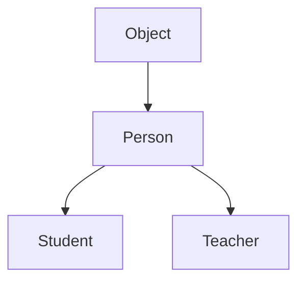

定义 Student 类时会发现,它和 Person 有大量重复:name、age 字段和对应的 getter/setter 一模一样,只是多了个 score。复制一份改改当然能跑,但父类改了子类忘改,bug 就来了。继承就是解决重复的:让 Student 直接获得 Person 的全部功能,自己只写新增部分。

## extends

```java
class Person {
    protected String name;
    protected int age;

    public String getName() { return name; }
    public void setName(String name) { this.name = name; }
}

class Student extends Person {
    private int score;

    public int getScore() { return score; }
    public void setScore(int score) { this.score = score; }
}
```

`extends Person` 一句话,Student 就拥有了 name、age 和 getName、setName,不用重写。Person 叫父类(超类、基类),Student 叫子类。

```java
Student s = new Student();
s.setName("小明");   // 父类的方法,直接用
s.setScore(89);      // 自己的方法
```

注意:子类自动获得父类的**所有**字段,包括 private 的——只是访问不到,不是不存在。严禁在子类里定义和父类同名的字段,那不会覆写,只会造出两个各自独立的字段,把自己绕晕。

## 单继承,根是 Object

Java 只允许一个类继承自一个类,没有多继承。没写 extends 的类,编译器自动加上 `extends Object`。所以任何类(除了 Object 自己)都有父类,一路往上追,根都是 Object:



Object 里定义了几个所有对象都有的方法:toString()、equals()、hashCode()。后面会逐个讲到,现在知道它们来自这个根就行。

为什么不许多继承?两个父类有同名方法时,子类该用谁的?这类歧义会让语言规则复杂一大圈。Java 用「单继承 + 多接口」绕开了这个问题,接口那篇再讲。

## protected:给子类开的门

父类的 private 字段,子类访问不到:

```java
class Person {
    private String name;
}

class Student extends Person {
    public String hello() {
        return "你好, " + name;   // 编译错误:name 是 private
    }
}
```

想让子类能用,把 private 改成 protected:

```java
class Person {
    protected String name;   // 子类可以访问
}
```

protected 的可见范围是「继承树内部」:子类、子类的子类都能访问。四种访问权限(private、默认、protected、public)的完整规则,包与作用域那篇有张表。

实际写代码,protected 字段要克制:它等于向所有子类敞开了内部状态,子类改起来没有检查。更常见的做法是字段保持 private,给子类提供 protected 的方法。

## 子类构造方法:第一行必须 super

子类**不会继承**父类的构造方法。子类构造方法执行时,第一行必须先调父类的构造方法——不写,编译器自动加一句 `super()`。

问题来了:如果父类没有无参构造方法,这句自动加的 super() 就找不到目标:

```java
class Person {
    protected String name;
    protected int age;

    public Person(String name, int age) {
        this.name = name;
        this.age = age;
    }
}

class Student extends Person {
    private int score;

    public Student(String name, int age, int score) {
        // 编译器在这里加 super(),但 Person 没有无参构造 → 编译错误
        this.score = score;
    }
}
```

解决办法:显式调用父类存在的那个构造方法:

```java
public Student(String name, int age, int score) {
    super(name, age);   // 必须是第一行
    this.score = score;
}
```

顺序很好理解:先把父类那部分初始化好,再初始化自己新增的部分。和 this(...) 一样,super(...) 也必须放在构造方法第一行,所以 this(...) 和 super(...) 不能同时出现——一个构造方法只能有一个「第一行」。

## super:指向父类

方法里用 super 可以访问父类的字段和方法。字段不冲突时,super.name、this.name、name 三者等价。真正必须用 super 的场景是覆写之后:

```java
class Student extends Person {
    @Override
    public String getName() {
        return "学生: " + super.getName();   // 先调父类版本,再加工
    }
}
```

子类覆写了 getName,方法体里再写 getName() 就是调自己,无限递归。想调被覆写掉的父类版本,只能 super.getName()。

## 向上转型与向下转型

子类实例可以赋给父类类型的变量。类都是引用类型,变量里装的是指向对象的引用,所以这一步只是换了引用的类型,对象本身没动:

```java
Student s = new Student();
Person p = s;      // 向上转型,安全
Object o = s;      // 继续向上,也安全
```

Student 拥有 Person 的全部功能,当 Person 用不会缺任何东西,所以向上转型永远安全,不需要强制写法。

反过来,父类变量转回子类,叫向下转型,必须强转,而且可能失败:

```java
Person p1 = new Student();
Person p2 = new Person();
Student s1 = (Student) p1;   // 成功:p1 实际指向 Student
Student s2 = (Student) p2;   // 运行时 ClassCastException
```

p2 实际是个 Person,硬转成 Student,多出来的 score 字段凭空变不出来,JVM 只能抛 ClassCastException。编译期不报错,因为编译器只看声明类型,不知道实际指向谁。

所以向下转型前先判断:

```java
if (p instanceof Student) {
    Student s = (Student) p;   // 判断通过才转,一定成功
}
```

instanceof 判断引用指向的实例是不是某类型或其子类;引用为 null 时,任何 instanceof 都是 false。

JDK 16 起可以一步到位,判断的同时把转型结果绑到变量上:

```java
if (p instanceof Student s) {
    System.out.println(s.getScore());   // 直接用 s,不用再强转
}
```

这个写法叫模式匹配,后面 equals 的编写里会大量用到。

## final 与 sealed:限制继承

- `final class`:禁止被继承,String 就是 final 类;
- `final` 方法:禁止被子类覆写;
- `sealed class ... permits A, B`(JDK 17 正式):只允许名单里的类继承。

sealed 用于「我知道这个体系只该有哪几个成员」的场景,比如形状只有圆、方、三角。框架里防止继承被滥用时会见到,日常业务代码用得少。

## 继承是 is,组合是 has

用继承前先问一句:子类**是**父类的一种吗?Student 是 Person 的一种,继承合理。Student 不是 Book 的一种,虽然两者都有 name 字段——那是 has 关系,应该用组合:

```java
class Student extends Person {
    private Book book;   // Student 持有一本书,而不是继承书
}
```

为了复用几个字段就乱认父类,是初学者最常见的继承滥用。判断标准就一条:is-a 才继承,has-a 用组合。

## 小结

- extends 复用父类功能,子类只写新增;Java 单继承,所有类的根是 Object;
- private 子类访问不了,protected 向继承树开放;
- 子类不继承构造方法;子类构造方法第一行必须 super(...),父类没有无参构造时要显式写;
- 向上转型永远安全;向下转型可能 ClassCastException,先 instanceof(JDK 16 起可模式匹配一步到位);
- final 禁止继承 / 覆写,sealed 限定子类名单;
- is-a 用继承,has-a 用组合。