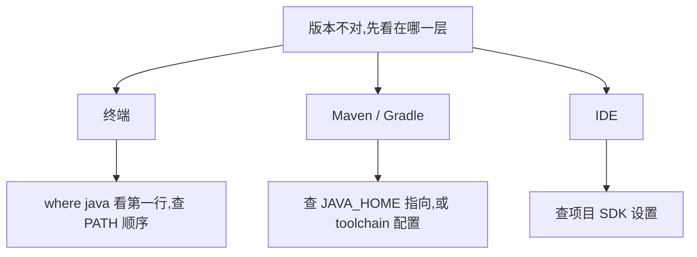

因为 Java 程序必须运行在 JVM 上,所以学 Java 的第一件事就是安装 JDK。整个过程就三步:下载、配环境变量、验证。十分钟之内应该能完成,完成不了多半是遇到了常见错误,下面把常见易错点都列出来了。

## 下载哪个 JDK

打开搜索一搜 JDK,会发现有好多家在下载:Oracle、Eclipse、Amazon、Azul……不用慌,它们都是从同一份 OpenJDK 源码构建出来的,通过了同一套兼容性测试,语法和行为完全一样,差别只在许可协议和技术支持。常见的几家:

| 构建 | 谁在维护 | 说明 |
| --- | --- | --- |
| Temurin | Eclipse Adoptium 社区 | 免费,安装包齐全,本文推荐 |
| Oracle JDK | Oracle | 免费可商用,但免费更新窗口有限,见下文 |
| Corretto | Amazon | 免费,亚马逊自己在生产上用的那份 |
| Zulu | Azul | 免费,老版本支持周期长 |
| Microsoft Build of OpenJDK | Microsoft | 免费,Azure 和 VS Code 生态里常见 |

学习用哪个都行,本文以 Temurin 为例,下载地址:<https://adoptium.net/temurin/releases/>。

版本选最新的 LTS。以 2026 年 11 月为准是 JDK 25,上一篇讲过原因:特性版六个月就换,LTS 会被维护很多年。公司项目用公司定的版本,通常是 21 或 17。

顺便说说 Oracle JDK 的许可,免得以后遇到许可问题:Oracle JDK 17 起在 NFTC 协议下可以免费商用,但免费更新只到「下一个 LTS 发布后一年」。按这个规则,JDK 21 的免费更新 2026 年 9 月已经结束,JDK 25 的免费更新到 2028 年 9 月。生产上停在老 Oracle JDK 又不付费,等于停在不再修漏洞的版本上,所以很多公司干脆用 Temurin 或 Corretto。

## Windows 安装

下载页选 Windows x64,有两种包:`.msi` 安装包和 `.zip` 压缩包,二选一。

省事的做法是下 `.msi`,双击安装,注意安装选项里把这两项勾上:

- Set JAVA_HOME variable
- Add to PATH

勾了这两项,环境变量就自动配好了,跳到下面的「验证」一节即可。

想弄清楚环境变量到底配了什么,就下 `.zip`,解压到一个不带空格和中文的路径,比如 `C:\Java\jdk-25`,然后手动配两个变量。打开「设置 → 系统 → 高级系统设置 → 环境变量」:

1. 新建系统变量 `JAVA_HOME`,值为 `C:\Java\jdk-25`。注意指向 JDK 的根目录,也就是里面有 `bin`、`lib`、`conf` 的那一层,不是 `bin` 目录本身;
2. 编辑系统变量 `Path`,新增一条 `%JAVA_HOME%\bin`,并把它移到最前面。

把 `bin` 目录加进 PATH,是为了在任意目录下都能直接敲 `java` 命令,不用每次输全路径。

几个注意:

- Win10 以后的 Path 编辑器是一条一行的列表,新增一条就行,别把整串路径粘进一个格子里;
- 用户变量里如果也有 `JAVA_HOME` 或 java 相关的 Path 条目,会和系统变量互相干扰,把用户变量里同名的删掉;
- 老教程会让你再配一个 `CLASSPATH` 变量,不用配,JDK 1.5 起就不需要了,看到这类步骤直接跳过;
- 改完环境变量要重开一个终端才生效,旧终端不会自己刷新。

## 验证

重开一个终端,输入:

```bash
java --version
javac --version
```

两条命令都应该打印 25 开头的版本号,比如:

```text
openjdk 25 2025-09-16 LTS
OpenJDK Runtime Environment Temurin-25+36 (build 25+36-LTS)
OpenJDK 64-Bit Server VM Temurin-25+36 (build 25+36-LTS, mixed mode, sharing)
```

看到版本号,环境就通了。如果报错,对号入座:

**报错「'java' 不是内部或外部命令,也不是可运行的程序」**:系统找不到 `java.exe`,说明 PATH 没配对。检查 `JAVA_HOME` 是否指向 JDK 根目录、Path 里是否加了 `%JAVA_HOME%\bin`、终端是否重开过。

**版本号不是 25,而是 1.8、17 之类**:机器上装了多个 JDK,排在 PATH 前面的不是你刚装的。用 `where java` 列出所有命中的 `java.exe`:

```text
C:\> where java
C:\Program Files\Common Files\Oracle\Java\javapath\java.exe
C:\Java\jdk-25\bin\java.exe
```

第一行才是实际生效的那个。上面这个例子里,旧安装留下的 `javapath` 抢在了前面,把 Path 里那条挪到后面或删掉,让你的 `%JAVA_HOME%\bin` 排第一。

## macOS 和 Linux

macOS 下载 `.pkg` 双击安装。注意 Apple Silicon(M 系列芯片)要选 aarch64 的包,别下成 x64。系统自带一个工具管理多版本 JDK,在 `~/.zshrc` 里加两行:

```bash
export JAVA_HOME=$(/usr/libexec/java_home -v 25)
export PATH="$JAVA_HOME/bin:$PATH"
```

`/usr/libexec/java_home -V` 可以列出机器上装过的所有 JDK。

Linux 两条路:用发行版仓库的 OpenJDK 包(比如 `apt install openjdk-25-jdk`,版本号跟仓库走),或者下载 `.tar.gz` 解压到 `/opt/jdk-25`,然后同样在 `~/.bashrc` 里 export `JAVA_HOME` 和 `PATH`。服务器上多版本切换常用 `update-alternatives`,思路和 Windows 的 PATH 顺序一样:用一个明确的开关决定谁生效。

## 机器上有多个 JDK 很正常

老项目要 17,新项目要 25,一台机器上装三四个 JDK 是常态。关键是分清三个地方各自用哪个:

1. 终端里:`where java`(Windows)或 `which -a java`(macOS/Linux)的第一行说了算,由 PATH 顺序决定;
2. Maven / Gradle 里:读 `JAVA_HOME`,或者构建工具自己的 toolchain 配置;
3. IDE 里:每个项目单独指定 SDK,和终端互不影响。



以后遇到「版本怎么不对」,先问自己在哪一层看的版本,再查那一层的开关,别上来就重装。

## 第一个程序

环境通了,来写第一个程序。打开任意文本编辑器(记事本就行,暂时不需要 IDE),输入:

```java
public class Hello {
    public static void main(String[] args) {
        System.out.println("Hello, world!");
    }
}
```

先不解释每个关键字,第 2 章会逐个讲。现在只需要知道三件事:

- `class Hello` 定义了一个类,类名是 `Hello`。Java 规定文件名必须和 public 类的类名完全一致,所以这个文件必须保存为 `Hello.java`,大小写也要一致;
- `main` 方法是 Java 程序的固定入口,程序总是从它开始执行;
- `System.out.println(...)` 把一行文字打印到屏幕上。

在文件所在目录打开终端,执行:

```bash
java Hello.java
```

看到输出:

```text
Hello, world!
```

环境就算彻底通了。

细心的同学可能发现,这里没有先 `javac` 编译。这是 JDK 11 新增的功能:`java` 命令可以直接运行单文件源码,它在内存里完成编译和执行,不生成 `.class` 文件。练习阶段这样最省事。

如果你装的是 JDK 25,还可以把文件内容换成上一篇的紧凑写法,同样能跑:

```java
void main() {
    IO.println("Hello, world!");
}
```

两种写法都试一遍。传统的两步走(`javac Hello.java` 编译,再 `java Hello` 运行)留给下一篇,那是实际项目里的日常用法,也是理解 classpath 的入口。

## 小结

- 装 JDK 三步:下载 LTS 构建(推荐 Temurin 25)、配 `JAVA_HOME` 和 PATH、`java --version` 验证;
- `JAVA_HOME` 指向 JDK 根目录,PATH 里加 `%JAVA_HOME%\bin` 并放到最前;`CLASSPATH` 不用配;
- 找不到 java 命令查 PATH,版本号不对用 `where java` 看谁排在前面;
- 文件名必须和 public 类名一致,`main` 方法是程序入口;
- JDK 11 起可以 `java Hello.java` 直接运行单文件源码,练习阶段最方便。

下一篇把编译和运行拆成两步亲手做一遍,再看看 IDE 的运行按钮背后是什么。