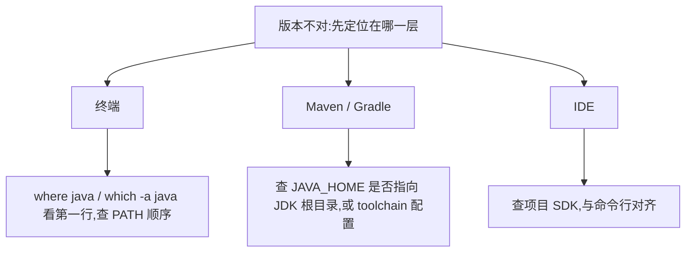

装 JDK 这件事,新手不必花超过十分钟:选一份 LTS 构建,配好 `JAVA_HOME` 和 `PATH`,跑通一个 Hello World。发行版之间的差别在许可与支持,不在语法。

## 先选发行版,再选版本

同一个 Java SE 规范,有多家厂商各自构建、各自通过兼容性测试(TCK)后发布:

| 构建 | 谁在做 | 特点 |
| --- | --- | --- |
| Temurin | Eclipse Adoptium 社区 | 免费、社区维护,安装包齐全,本文默认推荐 |
| Oracle JDK | Oracle | NFTC 许可下免费(含商用),免费更新窗口有限 |
| Corretto | Amazon | 免费,亚马逊自己在生产上用的那份 |
| Zulu | Azul | 免费档 + 付费支持,老版本支持周期长 |
| Liberica | BellSoft | 免费档 + 付费支持,带 JavaFX 的变体 |
| Microsoft Build of OpenJDK | Microsoft | 免费,Azure 与 VS Code 生态里常见 |

许可这件事值得知道一句:Oracle JDK 17 及以后在 NFTC(No-Fee Terms and Conditions)下可以免费商用,但免费更新只到「下一个 LTS 发布后一年」。按这个规则,JDK 21 的免费更新在 2026 年 9 月已经结束,JDK 25 的免费更新到 2028 年 9 月。生产上停在老 Oracle JDK 又不付费,等于停在不再修漏洞的版本上,这也是很多公司迁到 Temurin / Corretto 的原因。

版本建议:

- 学习:JDK 25,当前最新 LTS,第 1 篇提到的紧凑源文件在它上面转正;
- 公司项目:跟公司定的 LTS,通常是 21 或 17,别自己升;
- 不要拿特性版(27)当主线,预览语法下一版可能就变。

## Windows:安装包或压缩包二选一

路线 A(省事):下载 Temurin 的 `.msi`,安装时勾上 *Set JAVA_HOME variable* 与 *Add to PATH*,装完重开一个终端即可。

路线 B(可控):下载 `.zip`,解压到一个不带空格与中文的路径,例如 `C:\Java\jdk-25`,然后手动配两个环境变量:

1. 新建系统变量 `JAVA_HOME`,值为 `C:\Java\jdk-25`。指到 JDK 根目录,不是 `bin`,也不是里面的某个子目录;
2. 编辑系统变量 `Path`,新增一条 `%JAVA_HOME%\bin`,并把它移到靠前位置。Win10 以后的 Path 编辑器是分条的,一条一行,别把整串粘进一个格子里。

how2j 在安装页里提醒过一句容易漏的:系统变量上面的用户变量里,如果也有 `JAVA_HOME` 或 java 相关的 Path 条目,会互相干扰,配系统变量的同时把用户变量里同名的去掉。

老教程还会让你配第三个变量 `CLASSPATH`。菜鸟教程里写得很清楚:JDK 1.5 起就不需要了,看到这类步骤直接跳过。

验收(重开终端后):

```bash
java --version
javac --version
where java
```

`java --version` 应打印 25 开头的版本串;`where java` 列出所有命中的 `java.exe`,第一行必须是你刚装的那份。如果第一行是 `C:\Program Files\Common Files\Oracle\Java\javapath\java.exe` 之类,说明有旧安装抢在 PATH 前面,把那条挪后或删掉。javapath 抢 PATH 这个坑,菜鸟教程的笔记里也专门记了一条。

## macOS 与 Linux

macOS:下载 `.pkg` 双击安装,Apple Silicon 要选 aarch64 包。系统自带一个 `/usr/libexec/java_home` 工具管理多版本:

```bash
/usr/libexec/java_home -V          # 列出已装的所有 JDK
export JAVA_HOME=$(/usr/libexec/java_home -v 25)
export PATH="$JAVA_HOME/bin:$PATH"
```

把这两行 export 写进 `~/.zshrc`,以后每个终端都生效。

Linux:两条路都行,发行版仓库里的 OpenJDK 包(版本号跟仓库走,可能不是 25),或者下载 `.tar.gz` 解压到 `/opt/jdk-25` 后同样 export `JAVA_HOME` 与 `PATH`。服务器上还常用 `update-alternatives` 管理多版本,思路与 Windows 的 PATH 顺序一致:让一个明确的开关决定谁生效,而不是靠碰运气。

## 多版本共存是常态,不是事故

机器上同时有 17、21、25 很正常:老项目要 17,新项目要 25。记住三层:

1. 终端里谁生效:PATH 里第一个 `java` 说了算,`JAVA_HOME` 只是给构建工具看的约定;
2. 构建工具里谁生效:Maven / Gradle 读 `JAVA_HOME`,或自己的 toolchain 配置;
3. IDE 里谁生效:每个项目单独配 SDK,与终端互不影响。



排查「版本不对」时,先问「我在哪一层看的版本」,再查那一层的开关。`where java`(Windows)或 `which -a java`(macOS / Linux)是第一件该做的事。

## 第一个程序:先跑起来,再谈编译

新建 `Hello.java`:

```java
public class Hello {
    public static void main(String[] args) {
        System.out.println("Hello, Java");
    }
}
```

在文件所在目录执行:

```bash
java Hello.java
```

JDK 11 起 `java` 可以直接跑单文件源码:它在内存里编译并执行,不留下 `.class`。看到 `Hello, Java` 就说明环境通了。

如果你装的是 JDK 25,还可以把文件内容换成第 1 篇里的紧凑写法(不写 class、`void main()`),同样 `java Hello.java` 跑通。两种写法都试一遍,你会更清楚「类」和「入口」各自是什么。

传统的两步走(`javac Hello.java` 再 `java Hello`)留给下一篇,那才是工程里的日常,也是理解 classpath 的入口。

## 装完不对时的四个坑

1. 终端里还是旧版本。查 PATH 顺序:旧安装的 `javapath` 或系统自带 java 排在前面。`where java` / `which -a java` 看第一行。
2. `JAVA_HOME` 指错了层级。指到 `bin`、或指到 JDK 里某个子目录,都会让 Maven / Gradle 报「找不到 tools」一类错。它应该指向含 `bin`、`lib`、`conf` 的那一层。
3. 改完环境变量没重开终端。环境变量是进程启动时继承的,旧终端不会自己刷新;IDE 也要重启才读得到。
4. 下错架构或下错包。Apple Silicon 下了 x64 包会走转译甚至装不上;只想要运行时却下了完整 JDK 不算错,反过来想编译却找了「JRE 包」才会错,今天已经没有后者。

环境通了就往下走。下一篇把「编译」和「运行」拆成两步亲手做一遍,看看 IDE 的绿三角背后到底是什么。