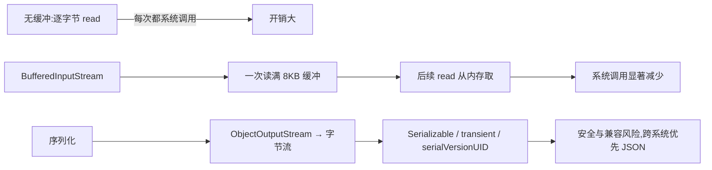

上一篇的流每次 read/write 都可能触发一次系统调用，开销大。缓冲流用一块内存攒批读写，显著减少调用次数。这一篇讲缓冲的收益，以及把对象整体转成字节流的序列化机制与其局限。

## 缓冲：减少系统调用



无缓冲时，读一个字节就一次系统调用；BufferedInputStream 内部维护一个缓冲区(默认 8KB)，一次系统调用读满缓冲，后续 read 从内存取：

```java
// 慢:逐字节,每次系统调用
try (InputStream in = new FileInputStream("a.bin")) {
    int b;
    while ((b = in.read()) != -1) { ... }
}

// 快:缓冲,批量系统调用
try (InputStream in = new BufferedInputStream(new FileInputStream("a.bin"))) {
    int b;
    while ((b = in.read()) != -1) { ... }
}
```

字符流同理用 BufferedReader/BufferedWriter。即使上层已按数组读，加缓冲仍能减少底层调用并支持 mark/reset。**文件 IO 默认套一层 Buffered**。

注意：缓冲意味着数据暂存内存，写出后需 flush/close 才落盘(上一篇)。

## 序列化：对象 → 字节流

序列化把对象图转成字节序列，便于存盘或网络传输；反序列化还原。Java 原生机制：

- 类实现 `Serializable`(标记接口，无方法);
- ObjectOutputStream.writeObject / ObjectInputStream.readObject;
- 引用的对象也须可序列化，递归整个对象图。

```java
class User implements Serializable {
    private static final long serialVersionUID = 1L;
    private String name;
    private transient String password;   // 不参与序列化
}

try (ObjectOutputStream oos = new ObjectOutputStream(new FileOutputStream("u.bin"))) {
    oos.writeObject(new User("alice"));
}
```

## transient 与 serialVersionUID

- **transient**:标记字段不参与序列化(敏感字段、可重算的缓存)；反序列化后为默认值；
- **serialVersionUID**:版本标识。反序列化时比对流中的与本地类的 UID，不一致抛 InvalidClassException。显式声明固定值，可在类小幅演进(加字段)时保持兼容；不声明则由编译器按类结构生成，类一改 UID 就变，旧数据读不出。

static 字段属于类不属于对象，也不序列化。

## 原生序列化的局限

- **安全**:反序列化不可信数据可触发 gadget 链执行任意代码(著名漏洞来源)；不要反序列化外部输入；
- **兼容**:Java 原生格式与语言绑定，跨语言/跨系统无法读；类结构演进脆弱；
- **体积与性能**:格式冗余，比 JSON/Protobuf 大且慢。

因此跨系统数据交换优先 **JSON**(Jackson/Gson)或 Protobuf;Java 原生序列化仅用于可信内部场景(如 RMI、会话复制)，且需过滤反序列化类(JEP 290 ObjectInputFilter)。

## 小结

- Buffered 流以内存缓冲减少系统调用，文件 IO 默认套缓冲；
- 序列化：Serializable + writeObject/readObject，递归对象图；
- transient 排除字段，serialVersionUID 固定版本保兼容；
- 原生序列化有安全/兼容/体积局限，跨系统优先 JSON/Protobuf;
- 不反序列化不可信输入，必要时用 ObjectInputFilter。

下一篇讲 NIO:Buffer / Channel / Selector 的非阻塞模型。
