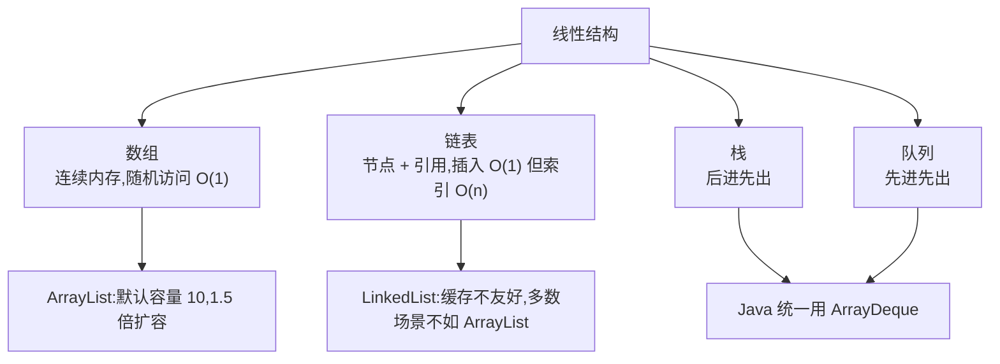

上一篇学会了估代价，这一篇拿来用：同一组数据，选错结构，复杂度差一个量级。

## 数组：连续内存



数组在内存里是一块连续区域，`a[i]` 的地址等于「首地址 + i × 元素大小」，一次乘法就算出来，所以随机访问是 O(1)。

代价在插入删除：下标 3 的位置插入一个元素，后面的全部要往后挪一格，O(n)。删掉头部同理。这是数组唯一的结构性缺陷，所有优化都是在绕它。

Java 的数组长度固定，扩容只能新建一个更大的、把旧的复制过去，O(n)。`ArrayList` 就是把这件麻烦事包起来：

```java
List<String> list = new ArrayList<>();     // 默认容量 10,第一次 add 时才分配
list.add("a");                             // 尾部追加,均摊 O(1)
list.get(0);                               // O(1)
list.add(0, "b");                          // 头部插入,O(n)
list.remove(0);                            // 头部删除,O(n)
```

扩容按 1.5 倍(`oldCapacity + (oldCapacity >> 1)`)，不是 2 倍。这个系数的取舍：太小则频繁复制，太大则浪费内存。已知元素个数时用 `new ArrayList<>(n)` 预分配，能省掉中间几次扩容。

## 链表：节点 + 引用

链表的每个节点保存数据和指向下一个节点的引用，内存不连续：

```java
class Node {
    String value;
    Node next;
}
```

- 插入删除 O(1):改两个引用就行，不用挪数据；
- 按下标访问 O(n):必须从头一个个走；
- 每个节点多一个引用(双向链表是两个)，内存开销比数组大；
- 节点分散在堆上，**缓存不友好**——CPU 取一个节点往往要一次内存访问，而数组能顺着缓存行连续读。

`LinkedList` 是双向链表，同时实现了 `List` 和 `Deque`。它常被误以为「插入删除快，所以比 ArrayList 快」，实际上：

```java
list.add(0, x);            // 找位置 O(n) + 改引用 O(1) = 还是 O(n)
Iterator it = list.iterator();
it.next(); it.remove();    // 迭代器已在位置上,删除才是真 O(1)
```

**按下标插入仍然是 O(n)**，因为要先走到那个位置。真正常用的场景是「边遍历边删除」和「当双端队列用」。绝大多数业务代码用 `ArrayList` 更快，因为数据量不大、主要是读和尾部追加，而且缓存友好。

## 链表的两个基本操作

反转，三指针原地搞定：

```java
Node prev = null, cur = head;
while (cur != null) {
    Node next = cur.next;      // 先存下一个,否则改完就丢了
    cur.next = prev;
    prev = cur;
    cur = next;
}
return prev;                   // 新的头
```

判环，快慢指针：

```java
Node slow = head, fast = head;
while (fast != null && fast.next != null) {
    slow = slow.next;
    fast = fast.next.next;
    if (slow == fast) return true;    // 相遇即有环
}
return false;
```

这两个模板覆盖了链表题的大半。快慢指针的直觉：在环形跑道上，快的一定会追上慢的。

## 栈与队列：受限的线性表

两者都限制「只能从特定位置进出」:

| | 进出规则 | 典型用途 | Java 实现 |
| --- | --- | --- | --- |
| 栈 Stack | 后进先出 LIFO | 括号匹配、撤销、DFS、调用栈 | `ArrayDeque`(不用 `Stack`) |
| 队列 Queue | 先进先出 FIFO | BFS、任务排队、消息缓冲 | `ArrayDeque` / `LinkedList` |

`ArrayDeque` 用环形数组实现，两端插入删除都是均摊 O(1)，比 `LinkedList` 快，也比老的 `Stack` 好——`Stack` 继承自 `Vector`，每个方法都加了 `synchronized`，单线程下纯属白付开销。

```java
Deque<Character> stack = new ArrayDeque<>();
stack.push('(');
stack.pop();

Deque<TreeNode> queue = new ArrayDeque<>();
queue.offer(root);
while (!queue.isEmpty()) {
    TreeNode node = queue.poll();      // 出队
    if (node.left != null) queue.offer(node.left);
    if (node.right != null) queue.offer(node.right);
}
```

括号匹配是栈最经典的应用：遇到左括号入栈，遇到右括号检查栈顶是否为对应的左括号，最后栈必须为空。

注意：`ArrayDeque` 不允许 `null`，需要存 `null` 时只能用 `LinkedList`。用 `Deque` 的方法名(`push` / `pop` / `offer` / `poll`)而不是 `List` 的 `add` / `remove`，可读性差很多。

## 怎么选

| 需求 | 选择 |
| --- | --- |
| 按下标读、尾部追加 | `ArrayList` |
| 频繁在头部插入删除 | `ArrayDeque`(当队列用) |
| 边遍历边删除 | `Iterator.remove()` 或 `LinkedList` |
| 后进先出 | `ArrayDeque` |
| 先进先出 | `ArrayDeque` |
| 需要存 `null` 的队列 | `LinkedList` |

一句话：**默认 `ArrayList`，需要两端操作换 `ArrayDeque`，想清楚再选 `LinkedList`**。

## 小结

- 数组连续内存，O(1) 随机访问，中间插入删除 O(n);
- `ArrayList` 默认容量 10，按 1.5 倍扩容，尾部追加均摊 O(1)；已知规模时预分配；
- `LinkedList` 按下标插入仍是 O(n)，节点多两个引用、缓存不友好，大多数场景不如 `ArrayList`;
- 链表两个模板：三指针反转、快慢指针判环；
- 栈与队列是受限线性表，`ArrayDeque` 是两者的首选实现，别用 `Stack`;
- 选型口诀：默认 `ArrayList`，两端操作用 `ArrayDeque`。

下一篇往上走一层：树与堆，以及 `PriorityQueue` 怎么用 O(log n) 取出最值。
