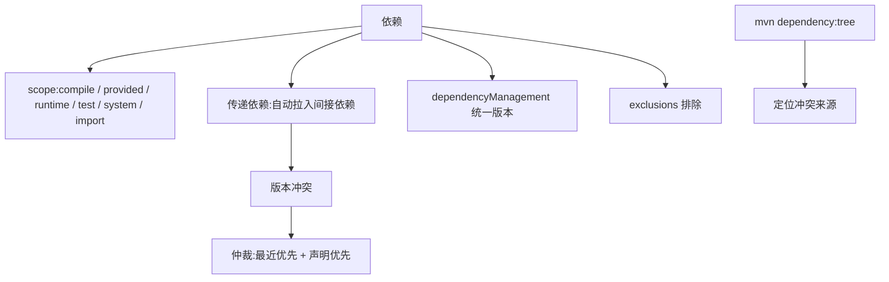

依赖不是孤立的：A 依赖 B,B 又依赖 C,Maven 自动把 C 也拉进来(传递依赖)。便利之余带来版本冲突与 scope 误用。这一篇讲 scope、传递规则与冲突仲裁。

## 六种 scope



| scope | 编译 | 测试 | 运行 | 传递 | 典型 |
| --- | --- | --- | --- | --- | --- |
| compile(默认) | ✓ | ✓ | ✓ | ✓ | spring-core |
| provided | ✓ | ✓ | ✗ | ✗ | servlet-api(容器提供) |
| runtime | ✗ | ✓ | ✓ | ✓ | JDBC 驱动(编译只需接口) |
| test | ✗ | ✓ | ✗ | ✗ | junit/mockito |
| system | ✓ | ✓ | ✗ | ✗ | 本地 jar(不推荐，用 systemPath) |
| import | — | — | — | — | 仅 dependencyManagement 中导入 BOM |

provided 编译可见但打包不含(运行环境提供);runtime 编译不可见运行可见(面向接口编程，实现运行时注入);test 仅测试 classpath。

## 传递依赖与调解

传递依赖的 scope 会"降级":compile 依赖的 runtime 传递为 runtime,test 不传递等(见官方传递表)。

**版本冲突仲裁**(dependency mediation):

- **最近优先**:依赖树中路径最短的版本胜出。A→B→C1.0 与 A→C2.0,C2.0 路径短胜出；
- **声明优先**:路径同长时，pom 中先声明的依赖所带版本胜出。

仲裁结果可能不是你要的版本 → NoSuchMethodError/ClassNotFoundException(编译用新版、运行被仲裁成旧版)。

## dependencyManagement:统一版本不引入

在父 pom 或 BOM 的 dependencyManagement 声明 GAV+version,**只锁版本不实际引入**；子模块 dependencies 里写 GA 不写 version 即继承锁定版本。Spring Boot 的 spring-boot-dependencies BOM 就是此机制，统一几百个依赖版本。

```xml
<dependencyManagement>
  <dependencies>
    <dependency>
      <groupId>com.fasterxml.jackson.core</groupId>
      <artifactId>jackson-databind</artifactId>
      <version>2.17.0</version>
    </dependency>
  </dependencies>
</dependencyManagement>
```

与 dependencies 的区别：前者"约定版本"，后者"真正引入"。

## exclusions 排除传递依赖

```xml
<dependency>
  <groupId>com.example</groupId>
  <artifactId>legacy-lib</artifactId>
  <version>1.0</version>
  <exclusions>
    <exclusion>
      <groupId>commons-logging</groupId>
      <artifactId>commons-logging</artifactId>
    </exclusion>
  </exclusions>
</dependency>
```

排除冲突/不需要的传递依赖(如换日志实现)。排除要精确到 GA。

## 定位冲突

`mvn dependency:tree -Dverbose` 打印完整树并标注 omitted for conflict;`mvn dependency:analyze` 报"用了未声明/声明未用"。冲突时看树确认仲裁结果，再用 dependencyManagement 锁版本或 exclusions 排除。

## 小结

- 六 scope:compile/provided/runtime/test/system/import，控制可见性与传递；
- 传递依赖自动引入，scope 降级；
- 冲突仲裁：最近优先 + 声明优先，可能引发运行时 NoSuchMethod;
- dependencyManagement 锁版本不引入(BOM);exclusions 精确排除；
- dependency:tree -Dverbose 定位，analyze 查未声明/未用。

下一篇讲多模块与生命周期：聚合、继承与 reactor 构建顺序。
