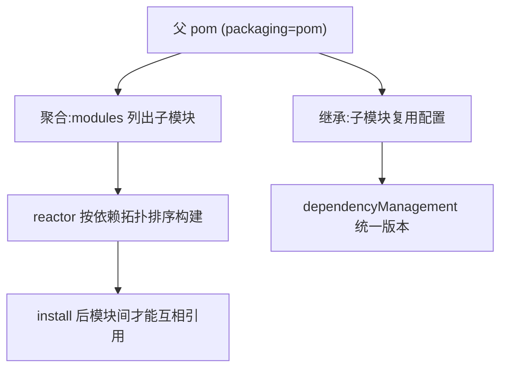

项目拆成 common / dao / service / web 多个模块后，需要一次构建全部、统一版本、复用配置。Maven 用**聚合**与**继承**两个机制(常合在一个父 pom)解决。这一篇讲多模块组织与 reactor。

## 聚合：modules



父 pom packaging=pom，用 modules 列出子模块：

```xml
<project>
  <groupId>com.example</groupId>
  <artifactId>order-parent</artifactId>
  <version>1.0.0</version>
  <packaging>pom</packaging>
  <modules>
    <module>order-common</module>
    <module>order-dao</module>
    <module>order-service</module>
    <module>order-web</module>
  </modules>
</project>
```

在父目录执行 mvn install,**reactor** 收集所有模块，按依赖关系拓扑排序后依次构建，一次命令完成全部。子模块间依赖(service 依赖 dao)决定顺序，而非 modules 书写顺序。

## 继承：parent

子 pom 用 parent 指向父：

```xml
<parent>
  <groupId>com.example</groupId>
  <artifactId>order-parent</artifactId>
  <version>1.0.0</version>
</parent>
<artifactId>order-service</artifactId>
```

继承 groupId/version/properties/dependencies/dependencyManagement/build 配置等，子模块只写差异。父的 dependencyManagement 统一锁版本，子 dependencies 不写 version。

**聚合与继承区别**:聚合是"一起构建"(modules)，继承是"复用配置"(parent)。可只聚合不继承、只继承不聚合，但实践常合一：父既 modules 又被子 parent。

## reactor 构建顺序与 -pl/-am

- 默认全模块按拓扑序；
- `mvn -pl order-web -am install`:-pl 指定模块，-am(also make)连带构建它依赖的上游模块；
- `-rf :order-service` 从某模块恢复构建(失败后续跑);
- 模块间引用需上游已 install 到本地仓库(或同 reactor 内)，否则找不到 SNAPSHOT。

## 版本与 BOM 实践

- 全模块统一 version，父 properties 定义 revision 配合 flatten-maven-plugin 简化(可选);
- 第三方版本集中在父 dependencyManagement 或导入 BOM;
- 子模块不重复声明 version，避免漂移；
- 发布时父与子同版本一起 deploy。

## 小结

- 聚合 modules + packaging=pom,reactor 拓扑序一次构建；
- 继承 parent 复用配置，dependencyManagement 统一版本；
- 聚合与继承可分离，实践常合一；
- -pl/-am 构建子集及上游，-rf 恢复；
- 模块间引用需上游 install；版本集中管理防漂移。

下一篇讲单元测试：JUnit 5 与 Mockito，把构建的 test 阶段用起来。
