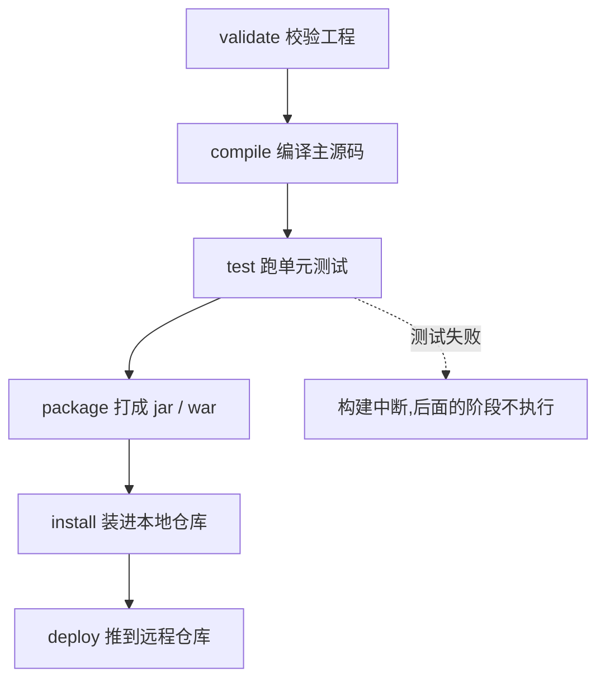

手写 javac + 手动管 jar 在项目变大后不可维护。Maven 用一份 pom.xml 声明"项目是什么、依赖什么、怎么构建"，把下载依赖、编译、测试、打包、安装串成标准流程。这一篇讲坐标、pom 与生命周期。

## 坐标 GAV

每个构件(项目/依赖)由三元组唯一标识：

- **groupId**:组织/项目域，如 com.example;
- **artifactId**:项目名，如 order-service;
- **version**:版本，如 1.0.0(SNAPSHOT 表开发中快照)。

加上 packaging(jar/war/pom)与 classifier 可进一步区分。仓库按 GAV 路径存放：groupId 转目录/artifactId/version/文件。

## pom.xml 骨架

```xml
<project>
  <modelVersion>4.0.0</modelVersion>
  <groupId>com.example</groupId>
  <artifactId>order-service</artifactId>
  <version>1.0.0</version>
  <packaging>jar</packaging>

  <properties>
    <maven.compiler.release>21</maven.compiler.release>
    <project.build.sourceEncoding>UTF-8</project.build.sourceEncoding>
  </properties>

  <dependencies>
    <dependency>
      <groupId>org.junit.jupiter</groupId>
      <artifactId>junit-jupiter</artifactId>
      <version>5.10.2</version>
      <scope>test</scope>
    </dependency>
  </dependencies>

  <build>
    <plugins>
      <plugin>
        <groupId>org.apache.maven.plugins</groupId>
        <artifactId>maven-surefire-plugin</artifactId>
        <version>3.2.5</version>
      </plugin>
    </plugins>
  </build>
</project>
```

## 标准目录(约定优于配置)

```
src/main/java      主代码
src/main/resources 主资源
src/test/java      测试代码
src/test/resources 测试资源
target/            构建输出
```

遵循约定就无需配置路径；偏离才要显式声明。



## 三套生命周期

- **clean**:pre-clean → clean → post-clean，清理 target;
- **default**:validate → compile → test → package → verify → install → deploy 等 23 阶段，构建主流程；
- **site**:pre-site → site → post-site → site-deploy，生成项目文档站点。

**阶段本身不干活**，由绑定到阶段的**插件目标(goal)**执行。如 compile 阶段绑 maven-compiler-plugin:compile,test 绑 surefire:test,package 绑 jar:jar。执行 `mvn package` 会按序执行 default 生命周期到 package 的所有阶段(含 compile、test)。

常用命令：mvn clean package(清理+打包)、mvn install(装到本地仓库)、mvn dependency:tree(看依赖树)、mvn -DskipTests package(跳测试)。

## 仓库与依赖解析

本地仓库(~/.m2/repository)缓存下载构件；没有则从远程(中央仓库/私服)下载。SNAPSHOT 每次检查更新，release 一旦下载不再变。依赖传递：A 依赖 B、B 依赖 C，则 A 自动得 C(受 scope 与 mediation 影响，下一篇)。

## 小结

- GAV 唯一标识构件，仓库按坐标路径存放；
- pom 声明坐标/properties/dependencies/build plugins;
- 标准目录约定优于配置；
- 三套生命周期，阶段由插件 goal 执行，mvn package 跑到该阶段；
- 本地仓库缓存，SNAPSHOT 检查更新；dependency:tree 看传递依赖。

下一篇讲依赖坐标、scope 与冲突仲裁：传递依赖怎么管、版本冲突怎么解。