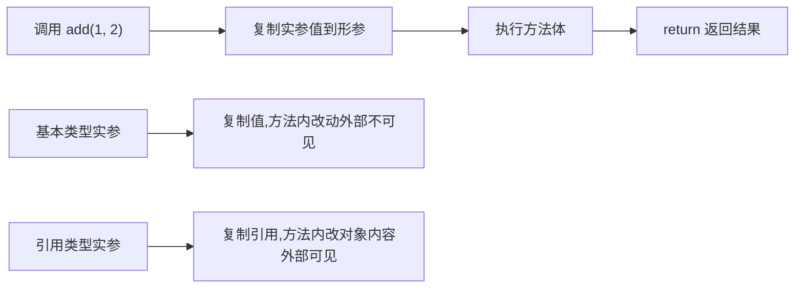

写着写着你会发现，一段逻辑要在好几个地方用，复制粘贴三份，改一处忘两处。方法就是把逻辑封装起来并命名，需要时在调用处通过方法名调用。这一篇讲方法的定义、参数、返回值，以及 Java 传参的规则。

## 定义一个方法



先写一个求两数之和的方法：

```java
public class Main {
    static int add(int a, int b) {
        return a + b;
    }

    public static void main(String[] args) {
        int sum = add(3, 5);
        System.out.println(sum);   // 8
    }
}
```

拆开看：

- `int`:返回值类型，这个方法计算完返回一个 int;
- `add`:方法名，调用时使用它；
- `(int a, int b)`:参数列表，调用方传入的输入，方法内部当局部变量用；
- `return a + b;`:把结果返回，方法到此结束；
- `static`:表示这个方法属于类本身，不用创建对象就能调。main 是 static 的，现阶段我们写的方法都先加 static，面向对象那章再解释为什么。

调用就是 `add(3, 5)`:3 和 5 叫实参，传入之后 a 和 b 叫形参。

不需要返回结果时，返回值类型写 `void`，方法里可以不写 return:

```java
static void greet(String name) {
    System.out.println("你好," + name);
}
```

注意：返回值类型是 int 的方法，每条路径都必须 return 一个 int，漏了编译报错。`return` 之后的代码执行不到，写了也报编译错误。

## 参数：Java 只有值传递

方法调用时，实参是「复制一份传进去」，不是把原件传进去。这就是值传递。基本类型很好理解：

```java
static void change(int n) {
    n = 99;
}

public static void main(String[] args) {
    int x = 1;
    change(x);
    System.out.println(x);   // 1,没变
}
```

change 里的 n 是 x 的副本，改副本不影响原件。

引用类型容易让人误会。看数组的例子：

```java
static void change(int[] arr) {
    arr[0] = 99;      // 改的是数组内容
}

static void rebind(int[] arr) {
    arr = new int[]{0, 0, 0};   // 让形参指向新数组
}

public static void main(String[] args) {
    int[] a = {1, 2, 3};
    change(a);
    System.out.println(a[0]);   // 99,变了

    rebind(a);
    System.out.println(a[0]);   // 99,没变
}
```

两个现象放一起看：

- `change` 里改 `arr[0]`，外面的 a 看得见。因为复制进去的是引用，形参 arr 和实参 a 指向同一个数组，改的是那个数组的内容；
- `rebind` 里让 arr 指向新数组，外面的 a 不受影响。因为被重新赋值的是形参这个副本，原件 a 里装的引用一直没动。

所以结论是：Java 只有值传递。引用类型传的「值」是引用本身——复制的是指向对象的引用，不是对象。方法里通过引用修改对象内容，外面看得见；把形参重新指向新对象，外面看不见。

这个规则对 String、集合、自定义对象全部适用，第 3 章会再拿 String 验证一遍(String 不可变，所以看起来像「改不动」，其实是改不了对象本身)。

## 方法重载：同名不同参数

同一个类里，方法名相同、参数列表不同，叫重载：

```java
static int add(int a, int b) { return a + b; }
static double add(double a, double b) { return a + b; }
static int add(int a, int b, int c) { return a + b + c; }
```

调用时编译器按实参的类型和个数挑一个。`System.out.println` 就是重载的典型：传 int、传 String、传数组，各有一个版本。

注意：只有返回值类型不同不算重载，参数列表必须不同。重载的细节(比如自动装箱参与挑选时的易错点)留在第 3 章。

## 局部变量的作用域

方法里定义的变量是局部变量，只在这个方法里有效，方法结束就销毁。两个方法可以各有同名的变量，互不相干。

花括号也划作用域：for 循环的 `int i` 只在循环里有效，循环外再用 i 就报「找不到符号」。变量在最小的需要它的作用域里定义，这是好习惯。

```java
for (int i = 0; i < 3; i++) {
    int t = i * 2;
}
// 这里 i 和 t 都不存在了
```

## 递归：方法调用自己

方法可以调用自己，叫递归。经典例子是阶乘：

```java
static long fact(int n) {
    if (n <= 1) return 1;      // 终止条件
    return n * fact(n - 1);
}
```

递归必须有一个不再调用自己的出口，否则一路调下去，栈溢出，抛 `StackOverflowError`。每次方法调用都会在栈上占一层，递归太深同样会溢出，所以能用循环写的优先用循环。递归在读树形结构(第 17 章)时才真正发挥作用，现在认识即可。

## 小结

- 方法 = 名字 + 参数(输入)+ 返回值(输出);void 表示不返回结果；现阶段方法先加 static;
- Java 只有值传递：基本类型复制值；引用类型复制引用，改对象内容外面看得见，重新赋值形参外面看不见；
- 重载是同名不同参数列表，只有返回值不同不算；
- 局部变量只在方法里有效，花括号也划作用域；
- 递归要有出口，太深会 StackOverflowError，能循环就循环。

到这里，变量、运算、分支循环、数组、方法都齐了，你已经能写出完整的小程序。下一章进入 Java 的主干：面向对象。
