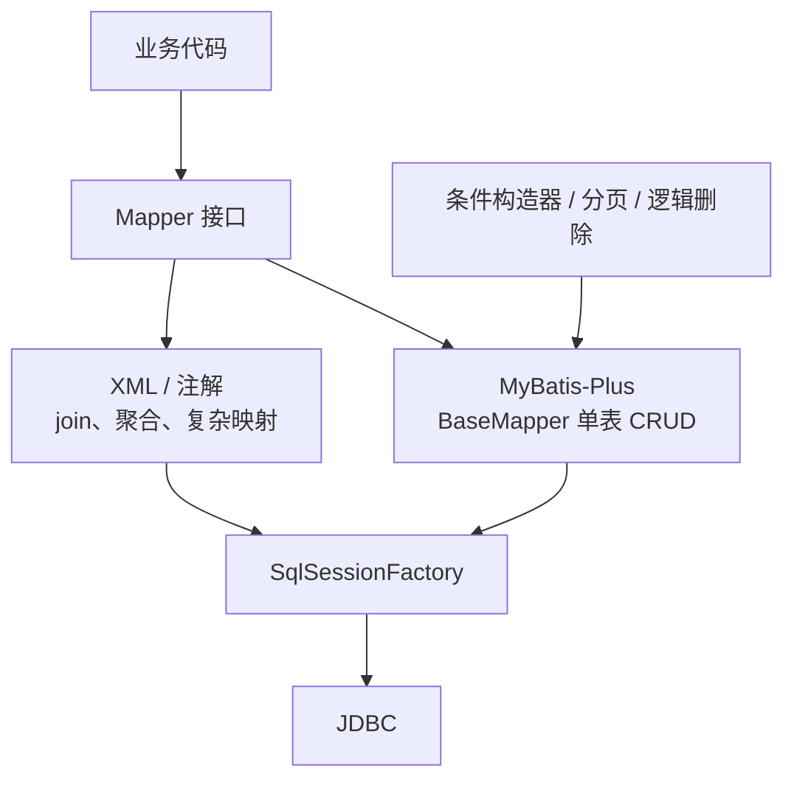

上一章讲完服务之间怎么调，这一章回到一个服务内部：数据存哪、怎么读写。Java 访问数据库的底层是 JDBC，但业务代码几乎不直接写 JDBC——样板太多。中间这一层就是 MyBatis，以及它之上的 MyBatis-Plus。

## 两者是什么关系



- **MyBatis** 是 SQL 映射框架。你写 SQL，它负责把参数塞进去、把结果集变成对象；
- **MyBatis-Plus** 不是另一个框架，是 MyBatis 的增强包。它复用同一个 `SqlSessionFactory`，通过插件与 `BaseMapper` 补上单表 CRUD、条件构造器、分页、逻辑删除、代码生成。

一句话分工：**通用的单表 CRUD 交给 Plus，需要设计 SQL 的地方自己写**。Plus 生成的 SQL 你看不到也改不了，复杂查询硬用条件构造器拼，最后会写出一段比 SQL 更难读的 Java。

## 一个 Mapper 长什么样

MyBatis 的核心是「接口 + SQL」的绑定：

```java
@Mapper
public interface UserMapper {

    @Select("select id, user_name, created_at from user where id = #{id}")
    User selectById(Long id);

    List<User> selectActive();
}
```

`selectActive` 没有注解，对应的 SQL 写在 XML 里：

```xml
<mapper namespace="com.example.mapper.UserMapper">
  <select id="selectActive" resultType="com.example.domain.User">
    select id, user_name, created_at
    from user
    where status = 1
    order by id desc
  </select>
</mapper>
```

两条规则不能错：XML 的 `namespace` 必须等于接口全限定名，语句的 `id` 必须等于方法名。对不上时启动不一定报错，第一次调用才抛 `Invalid bound statement (not found)`——这个报错九成是名字对不上或 XML 没被打包进去。

启动类上加 `@MapperScan("com.example.mapper")` 可以省掉每个接口的 `@Mapper`。

XML 放在 `src/main/resources/mapper/` 下，Boot 默认就扫这个位置。放在 Java 包下时要配 `mybatis.mapper-locations`，并且让 Maven 把 `**/*.xml` 一起打进 jar，否则本地能跑、打包后报找不到。

## BaseMapper:继承就有的单表 CRUD

```java
public interface UserMapper extends BaseMapper<User> {
    // 不用写任何方法
}
```

`BaseMapper<User>` 提供了 `insert`、`deleteById`、`updateById`、`selectById`、`selectList`、`selectCount`、`selectPage` 等方法。它们靠实体上的注解推断表名与列名：

```java
@TableName("t_user")
public class User {

    @TableId(type = IdType.AUTO)
    private Long id;

    private String userName;          // 默认转成 user_name

    @TableField("created_at")
    private LocalDateTime createdAt;

    @TableField(exist = false)
    private List<Role> roles;         // 不是表字段,别让 Plus 拼进 SQL
}
```

默认的驼峰转下划线映射是开着的(`map-underscore-to-camel-case`)，所以 `userName` 对应 `user_name` 不用额外声明。字段名和列名完全对不上时才需要 `@TableField`。

主键策略要选对：`AUTO` 交给数据库自增；`ASSIGN_ID` 用雪花算法生成 19 位 Long，分库分表时不会撞；`ASSIGN_UUID` 生成字符串。用 `AUTO` 却把数据库列建成了 varchar，插入就会失败。

## Service 层：IService 是薄封装

```java
public interface UserService extends IService<User> {
    void register(RegisterCmd cmd);
}

@Service
public class UserServiceImpl extends ServiceImpl<UserMapper, User> implements UserService {

    @Override
    public void register(RegisterCmd cmd) {
        // 业务规则:校验、加密、发事件
        save(new User(cmd.name(), cmd.rawPassword()));
    }
}
```

`ServiceImpl` 把 Mapper 的方法原样转出来，`save`、`getById`、`list`、`page` 都能直接用。它只是省掉一层转发代码，不是业务层。业务逻辑该写在自己的方法里，而不是让 Controller 直接调 `service.getById()` 拼流程——那样分层就没意义了。

## 边界在哪

| 场景 | 写哪 |
| --- | --- |
| 按主键查、按单表条件查 | `BaseMapper` + Wrapper |
| 一对多、多表 join | XML + `resultMap` |
| `group by`、聚合统计、窗口函数 | XML |
| 批量插入几万条 | XML + `foreach`，配 `rewriteBatchedStatements` |
| 报表类复杂查询 | XML，必要时直接 `@Select` 写整段 SQL |

最常见的性能坑是「用 CRUD 逐表查，再在内存里拼关联」:查 100 个订单，循环里查 100 次用户，数据库被打 101 次。这种查询应该是一条 join，或者两条 in 查询在内存里按 id 分组——判断依据是「能不能用一次 SQL 表达」，而不是「Plus 能不能少写代码」。

## 小结

- MyBatis 是 SQL 映射框架，MyBatis-Plus 是它的增强包，复用同一个 `SqlSessionFactory`;
- Mapper 接口 + XML/注解，`namespace` 与 `id` 必须和方法一一对应；
- `BaseMapper<T>` 继承即得单表 CRUD，靠 `@TableName` / `@TableId` / `@TableField` 推断表结构；
- 主键策略 `AUTO` 与 `ASSIGN_ID` 各有适用场景，要和数据库列类型匹配；
- `ServiceImpl` 只是转发，业务逻辑仍写在自己的 service 方法里；
- join、聚合、复杂映射写 XML；能用一次 SQL 表达的查询，不要拆成 N 次 CRUD。

下一篇讲 XML 里那部分：resultMap 怎么映射列，动态 SQL 怎么按条件拼语句。
