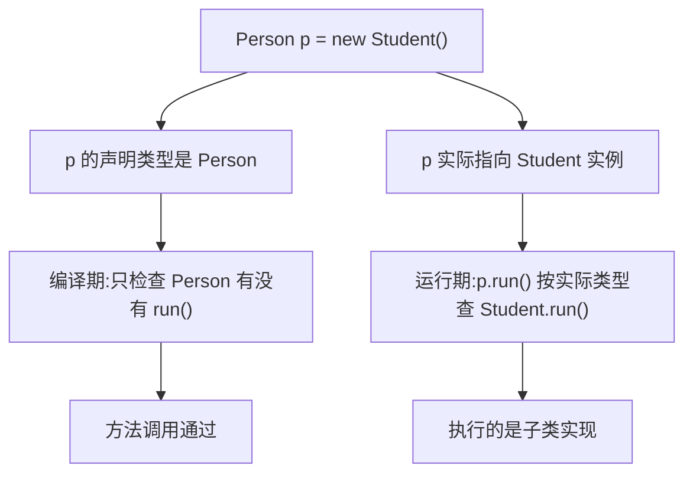

上一篇末尾留了个现象：`Person p = new Student();` 之后调 p.getName()，如果 Student 覆写了这个方法，执行的是 Student 的版本。这个机制就是多态。

## 覆写：签名相同，实现换掉

子类定义一个与父类**方法签名完全相同**的方法，叫覆写(Override):

```java
class Person {
    public void run() {
        System.out.println("Person.run");
    }
}

class Student extends Person {
    @Override
    public void run() {
        System.out.println("Student.run");
    }
}
```

签名相同指方法名、参数列表都一样。返回值要求相同(或是父类返回值的子类，叫协变返回，少见)。参数不同就成了重载，那是另一个方法，不是覆写。

`@Override` 注解不是必需的，但强烈建议写：它让编译器帮你检查「你以为在覆写，其实签名写错了」。比如手误把 run() 写成 run(String s)，没有注解时编译器当它是新增的重载方法，一声不吭；加了注解，当场报错。覆写时漏写注解不犯法，但排查这种 bug 的时间远超敲这几个字符。



## 运行期才定调哪个

```java
Person p = new Student();
p.run();   // 打印 Student.run
```

p 的声明类型是 Person，实际指向 Student。调 run() 时，JVM 看的是**实际类型**，执行 Student 的版本。这就是多态：针对某个类型的方法调用，真正执行哪个实现，取决于运行时的实际类型。

单看这一行，结论显而易见。威力体现在方法参数上：

```java
static void runTwice(Person p) {
    p.run();
    p.run();
}
```

写 runTwice 的人不知道传进来的会是 Person、Student 还是 Teacher——编译期根本定不下来。运行时传谁，就执行谁的 run()。

## 一个完整的例子：算税

定义收入类 Income，税率 10%:

```java
class Income {
    protected double income;

    public Income(double income) {
        this.income = income;
    }

    public double getTax() {
        return income * 0.1;
    }
}
```

工资收入有 5000 的免征额，覆写 getTax:

```java
class Salary extends Income {
    public Salary(double income) {
        super(income);
    }

    @Override
    public double getTax() {
        if (income <= 5000) {
            return 0;
        }
        return (income - 5000) * 0.2;
    }
}
```

特殊津贴免税，再覆写：

```java
class Allowance extends Income {
    public Allowance(double income) {
        super(income);
    }

    @Override
    public double getTax() {
        return 0;
    }
}
```

现在写汇总报税的方法：

```java
static double totalTax(Income[] incomes) {
    double total = 0;
    for (Income income : incomes) {
        total += income.getTax();
    }
    return total;
}
```

跑一下：

```java
Income[] incomes = {
    new Income(3000),
    new Salary(7500),
    new Allowance(15000)
};
System.out.println(totalTax(incomes));   // 300 + 500 + 0 = 800.0
```

仔细看 totalTax:它只认识 Income，完全不知道 Salary 和 Allowance 的存在，却把三种税都算对了。每种收入自己负责自己的算法，totalTax 只管调 getTax。

关键在于：**以后新增一种稿费收入，只要从 Income 派生、覆写 getTax,totalTax 一行都不用改。** 基于父类写的代码，对扩展开放，对修改关闭——这是面向对象最值钱的一条性质，后面讲接口、讲设计模式，翻来覆去用的都是它。

## 覆写 Object 的方法

所有类都继承 Object,Object 定义了三个常用方法：

- `toString()`:把对象输出成字符串，默认是「类名@哈希值」，可读性差；
- `equals()`:判断逻辑相等，默认就是 ==;
- `hashCode()`:算哈希值，配合 equals 给 HashMap 用。

实际写类，经常要覆写它们：

```java
class Student extends Person {
    @Override
    public String toString() {
        return "Student{name=" + getName() + ", score=" + score + "}";
    }
}
```

覆写 toString 后，`System.out.println(s)` 直接打出有意义的内容。equals 和 hashCode 的覆写有严格契约，3.2 节专门两篇讲，这里先知道「它们来自 Object，可以覆写」。

## 多态只管实例方法

两个容易误会的边界：

**字段没有多态。** 父类引用访问字段，拿到的是父类的字段，不看实际类型：

```java
class A { int x = 1; }
class B extends A { int x = 2; }

A a = new B();
System.out.println(a.x);   // 1,不是 2
```

字段在编译期就按声明类型定死了。这也是「严禁子类定义与父类同名字段」的又一个理由。

**static 方法没有多态。** static 方法属于类，父类引用调 static 方法，执行的是父类的版本。子类写一个同签名的 static 方法叫隐藏，不叫覆写，不要这样写。

多态是实例方法的动态分派，字段和 static 方法不参与。

## 小结

- 覆写 = 父子类间方法签名相同、实现换掉；加 @Override 让编译器把关；
- 父类引用调实例方法，执行运行时实际类型的版本，这就是多态；
- 多态让基于父类的代码不用修改就能接纳新子类，扩展新功能只加类不改旧代码；
- toString / equals / hashCode 来自 Object，按需覆写；
- 字段和 static 方法没有多态，按声明类型定死。