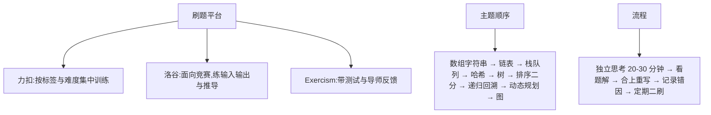

这一章从复杂度讲到具体结构，最后一步是把它们变成手上的能力。刷题是最直接的练法，但「刷了多少题」和「会不会」是两件事。这一篇讲怎么刷才有效。

## 三个平台，三种用途

| 平台 | 适合练什么 | 特点 |
| --- | --- | --- |
| 力扣 LeetCode | 面试高频题型、按主题集中训练 | 题库按标签与难度组织，题解丰富，有周赛 |
| 洛谷 | 竞赛、算法推导、输入输出细节 | 难度评级细，题目偏数学与思维，需自己处理 IO |
| Exercism | 语言特性、工程写法 | 每道题自带测试，可以提交给导师 review |

分工很清楚：

- **准备面试**，主力是力扣。按标签刷，每个标签 10~15 道，从简单过渡到中等；
- **还在学语言**，先做 Exercism 的 Java 轨道。它逼你写符合习惯的代码(`record`、`Stream`、`Optional`)，而且有测试告诉你写错了；
- **想练思维**，洛谷的中低难度题能补上力扣不考的推导。竞赛选手练手速与套路，工程岗位不必从这里起步。

一个常见的误区是只刷力扣。力扣的输入输出是「函数签名」，模板帮你处理了读取；真实工程里要自己解析参数、处理异常、考虑边界数据量。Exercism 的测试驱动写法更接近工程。

## 主题顺序

按依赖关系排，后面的用到前面的：

1. **数组与字符串**(2 周):双指针、滑动窗口、前缀和；
2. **链表**(1 周):反转、快慢指针、合并；
3. **栈与队列**(1 周):括号匹配、单调栈、BFS;
4. **哈希表**(1 周):两数之和、去重、计数；
5. **树**(2 周):四种遍历、BST、递归返回值的设计；
6. **排序与二分**(1 周):手写快排归并、二分边界；
7. **递归与回溯**(1 周):排列组合、子集、剪枝；
8. **动态规划**(2 周):线性 DP、背包、区间 DP;
9. **图**(1 周，可选):DFS/BFS、拓扑排序、最短路。

两个月到三个月走完一轮，每周 8~12 道。不要一上来就刷动态规划——递归都没写顺的时候，DP 的递推式只会变成背答案。

## 一道题的流程

刷题的价值不在「做出来」，在「做完之后留下什么」。四步：

1. **先独立思考 20~30 分钟**。写下思路、复杂度，再动手。卡住也要先把「我卡在哪」说清楚，这一步最容易被跳过，也最有用；
2. **看题解，只看到能往下写为止**。别整段抄。看懂关键的那一步，合上页面自己写；
3. **合上重写一遍**。不看任何提示，从空文件开始。写得出来才算会了；
4. **记录错因**。不是记题目，记「我为什么错」:边界没考虑？用了 O(n²) 被卡？思路对了但代码写错？这份错题本比刷题量值钱。

二刷的节奏：三天后、两周后各一次。二刷只看题目不看代码，能写出最优解就过。

## 方法与边界

- **记建模过程，不背题解**。「看到有序数组想二分」「看到 Top-K 想堆」这类映射才是可迁移的，具体代码忘了没关系；
- **复杂度先算再写**。题目给的 n 范围直接决定能不能用 O(n²)，写完再算已经晚了；
- **面试和工程不一样**。面试考的是「在压力下把思路讲清楚」，工程考的是「三个月后别人能不能改」。刷题练的是前者，别指望它提升架构能力；
- **别追求刷完**。力扣三千多道，没有人刷完。一个标签吃透十道，比每个标签各碰两道强得多；
- **写不出就看答案，不丢人**。卡三小时不如看十分钟题解再重写。但要保证重写那一步真的做了。

## 小结

- 平台分工：力扣练面试题型，洛谷练竞赛推导，Exercism 用测试驱动打磨语言写法；
- 主题顺序：数组字符串 → 链表 → 栈队列 → 哈希 → 树 → 排序二分 → 递归回溯 → 动态规划 → 图；
- 每周 8~12 道，8~12 周走完一轮，别一上来碰 DP;
- 流程：独立思考 20~30 分钟 → 看题解看到能写为止 → 合上重写 → 记错因 → 二刷；
- 记建模与复杂度判断，不背代码；一个标签吃透十道胜过每样碰两道。

到这里，17 章走完了：从装 JDK、写第一个 `main`，到面向对象、集合、并发、JVM，再到 Maven、Spring、数据库、设计模式、领域建模，最后落到算法。这条线不是要求你全部记住——它是一张地图，写代码时卡在哪，回来查对应那一节就够。
