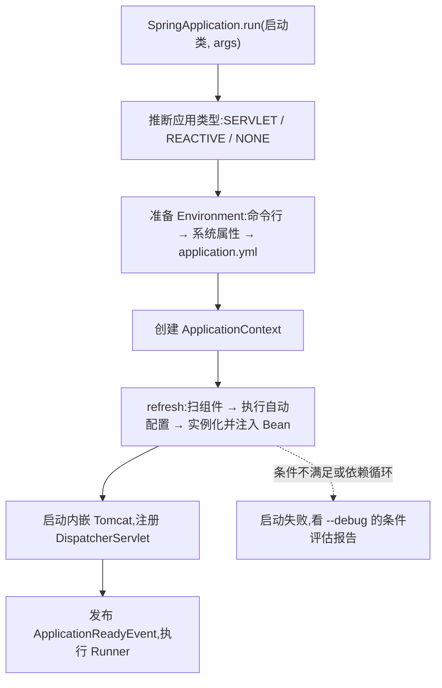

Spring 框架强大但配置繁琐。Spring Boot 在其上做"约定优于配置":starter 聚合依赖、自动配置按 classpath 装配 Bean、内嵌服务器打成可执行 jar。这一篇讲项目结构与启动流程。

## 三个核心能力

- **starter**:如 spring-boot-starter-web 一次引入 Spring MVC + Jackson + 内嵌 Tomcat + 校验，版本由 Boot BOM 统一；
- **自动配置**:按 classpath 有什么类/Bean/配置，自动注册合理默认 Bean(见第 3 篇);
- **内嵌服务器 + 可执行 jar**:java -jar app.jar 直接运行，无需外置 Tomcat,main 方法即入口。

## 启动类

```java
@SpringBootApplication
public class OrderApplication {
    public static void main(String[] args) {
        SpringApplication.run(OrderApplication.class, args);
    }
}
```

@SpringBootApplication 组合三个注解：

- @SpringBootConfiguration:本质 @Configuration，标记配置类；
- @EnableAutoConfiguration:开启自动配置(导入 AutoConfiguration.imports);
- @ComponentScan:扫描启动类所在包及子包的 @Component/@Service/@Repository/@Controller。

故启动类放根包，业务代码放子包，保证被扫描。

## 标准分层目录

```
com.example.order
├─ OrderApplication.java
├─ controller/   Web 入口
├─ service/      业务逻辑
├─ repository/   数据访问
├─ domain/       实体/值对象
├─ config/       自定义配置
└─ dto/          传输对象
```

分层是约定不是强制，小项目可简化；关键是依赖方向(controller→service→repository)，不反向。

## 启动流程

SpringApplication.run 大致：

1. 创建 SpringApplication，推断应用类型(SERVLET/REACTIVE/NONE)，加载初始化器/监听器；
2. 准备 Environment(配置源：命令行 > 系统属性 > application.yml 等);
3. 创建 ApplicationContext(AnnotationConfigServletWebServerApplicationContext);
4. 准备上下文：注册启动类、执行 initializer;
5. **refresh 容器**:扫描组件 → 执行自动配置 → 实例化/注入 Bean → 初始化回调；
6. 创建并启动内嵌 Web 服务器(Tomcat)，注册 DispatcherServlet;
7. 发布 ApplicationReadyEvent，执行 ApplicationRunner/CommandLineRunner。

启动失败常见：端口占用、Bean 循环依赖、自动配置条件不满足、配置缺失。看启动日志的 CONDITIONS EVALUATION REPORT(--debug)定位自动配置为何生效/不生效。



## 配置文件位置

application.yml/properties 在 src/main/resources；多环境 application-{profile}.yml；外部化配置优先级见第 5 篇。

## 小结

- Boot 三能力：starter 聚合、自动配置、内嵌服务器可执行 jar;
- @SpringBootApplication = Configuration + EnableAutoConfiguration + ComponentScan，启动类放根包；
- 分层目录约定，依赖方向单向；
- run 流程：Environment→创建容器→refresh(扫描+自动配置+注入)→内嵌服务器→Ready;
- --debug 看自动配置报告定位启动问题。

下一篇讲 IoC 与依赖注入：容器怎么管理 Bean、怎么装配。