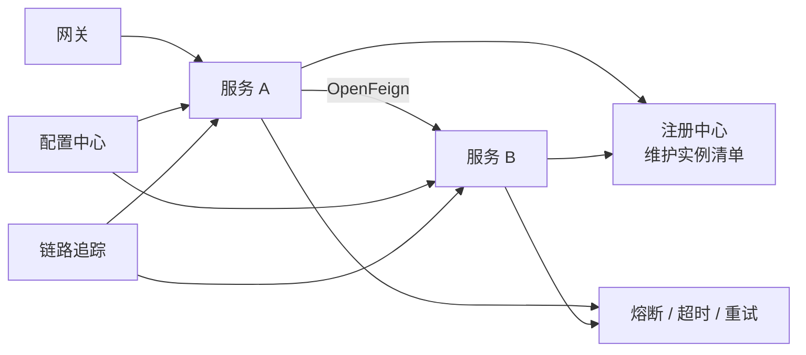

上一篇停在单个进程内部：请求如何被容器接收，又如何走到 Controller。系统拆成多个服务后，请求要跨进程，实例地址会变，配置也不再集中在一份文件里。Spring Cloud 处理的就是这组「拆开之后才出现」的问题。

## 拆开之后多出来的五件事



单体里，A 调 B 就是一次方法调用：编译期就能确定目标，失败了抛异常，配置在一份文件里。切成服务后，每件事都变贵了：

- 目标地址会变。B 扩容成三个实例、IP 变了，调用方不能写死；
- 配置要下发。二十个服务各有一份 yml，改一个超时时间要动二十次；
- 入口要收敛。鉴权、限流、跨域、日志，不能让每个服务各写一遍；
- 调用会失败。网络超时、对端挂了，得有超时、重试、熔断；
- 出了问题要能查。一次请求串了五个服务，日志里得有同一个 id 才串得起来。

Spring Cloud 就是把这些问题的常见解法收成一堆可组装的组件。它不是框架，是一组项目的集合。

## 注册中心：谁在哪

服务启动时把自己的地址注册进注册中心，并定时心跳；调用方从注册中心拉实例列表，缓存到本地。这样扩容、缩容、实例漂移都不需要改配置。

常见实现有三种：

| | 特点 | 一致性 |
| --- | --- | --- |
| Nacos | 注册与配置二合一，国内使用广，控制台好用 | AP / CP 可切换 |
| Eureka | Netflix 出品，早期 Spring Cloud 默认，已进入维护状态 | AP |
| Consul | HashiCorp 出品，自带健康检查与 KV | CP |

```yaml
spring:
  application:
    name: order-service
  cloud:
    nacos:
      discovery:
        server-addr: 127.0.0.1:8848
```

服务名(这里是 `order-service`)比 IP 更稳定，后面所有跨服务调用都用它对目标。

注意：注册中心只解决「有多少实例、在哪」，不解决「调用哪个」。选择实例是负载均衡的事，在客户端做。

## 配置中心：一处改，处处生效

配置中心把 yml 从各个仓库里搬出来，按「应用名 + profile」组织，服务启动时拉取，变更时推送。

- 好处一：改超时、改开关不用重新打包；
- 好处二：敏感值集中在服务端，配合权限控制，不用发给每个开发；
- 好处三：同一个 key 在不同环境、不同命名空间下可以有不同值。

Nacos 的 dataId 约定是 `${spring.application.name}-${profile}.yml`，加 `@RefreshScope` 的 bean 能在配置变更后重新绑定。Boot 3 之后也可以用 `spring.config.import=nacos:` 的方式在启动早期导入，避免「配置文件还没拉到，数据源已经初始化」的时序问题。

## 网关：所有流量的入口

网关是唯一对外暴露的端口，后面所有服务都在内网。Spring Cloud Gateway 的核心概念只有三个：

- **路由(Route)**:id + 目标 uri + 断言 + 过滤器；
- **断言(Predicate)**:匹配条件，路径、方法、请求头、时间窗口，全部匹配才转发；
- **过滤器(Filter)**:转发前后改写请求与响应，加头、去头、限流、重试。

```yaml
spring:
  cloud:
    gateway:
      routes:
        - id: order
          uri: lb://order-service        # lb:// 表示交给负载均衡挑实例
          predicates:
            - Path=/api/orders/**
          filters:
            - StripPrefix=1              # 去掉 /api 前缀再转发
            - AddRequestHeader=X-From, gateway
```

鉴权、限流、跨域、灰度这些横切逻辑放在网关，下游服务就不用各自实现一遍。代价是网关成了单点，必须多副本部署。

## 服务调用：声明式 HTTP

有了注册中心，调用方可以按服务名发请求。Spring Cloud LoadBalancer 负责从实例列表里挑一个(默认轮询),OpenFeign 让你把 HTTP 调用写成接口：

```java
@FeignClient(name = "inventory-service")
public interface InventoryClient {

    @GetMapping("/stock/{sku}")
    StockDTO stock(@PathVariable("sku") String sku);
}
```

方法签名就是请求，注解就是路径与方法，序列化交给消息转换器。调用方看起来像本地方法，底下是一次 HTTP 请求——这个「像」要记住，否则容易忘了它会超时、会失败。

超时是必须显式配的：`spring.cloud.openfeign.client.config.default.connectTimeout` 与 `readTimeout`。默认值在分布式环境下往往太长，一个卡住的下游能把上游线程吃光。

## 稳定性：熔断、限流、追踪

- **熔断**:连续失败达到阈值就打开断路器，后续请求直接走降级逻辑，不再打在已经挂掉的下游上。Resilience4j 是 Spring Cloud 官方推荐的实现，Sentinel 在国内更常见，带控制台；
- **限流**:在网关或服务入口限制 QPS，保护自己不被流量打穿；
- **链路追踪**:请求进网关时生成 traceId，跨服务传递，每段调用一个 spanId。Micrometer Tracing 把 traceId 写进日志的 MDC，一个 `grep` 就能把五个服务的日志拼成一条链。

这三件事不是「上线前顺手加」，而是拆分之后的基本配套。没有它们，一次故障的定位时间会从十分钟变成一天。

## 版本：Release Train

Spring Cloud 按年份发布「列车」，一列车里的组件版本互相兼容，对外只有一个版本号。引入方式不是逐个写依赖，而是导入 BOM:

```xml
<dependencyManagement>
  <dependencies>
    <dependency>
      <groupId>org.springframework.cloud</groupId>
      <artifactId>spring-cloud-dependencies</artifactId>
      <version>2025.0.0</version>
      <type>pom</type>
      <scope>import</scope>
    </dependency>
  </dependencies>
</dependencyManagement>
```

具体哪个 train 配哪个 Spring Boot 版本，**只能查官方兼容表**，不要凭印象写。版本对不上时的报错通常很隐蔽：启动成功，某个自动配置悄悄不生效，运行时才炸。这是微服务项目里最常见的一类「玄学问题」。

## 小结

- 拆分后多出五件事：寻址、配置下发、统一入口、调用失败、跨服务排查；
- 注册中心(Nacos / Eureka / Consul)维护实例清单，服务名比 IP 稳定；
- 配置中心按应用名 + profile 下发，`@RefreshScope` 支持运行期刷新；
- 网关路由 = id + uri + 断言 + 过滤器，`lb://` 交给负载均衡，鉴权限流放这里；
- OpenFeign 把 HTTP 调用写成接口，超时必须显式配置；
- 熔断、限流、traceId 是拆分后的基本配套；
- Spring Cloud 用 Release Train + BOM 管版本，与 Boot 的对应关系只能查官方表。

第 13 章结束。下一章进数据库：MyBatis 与 MyBatis-Plus 各写哪一半代码。
