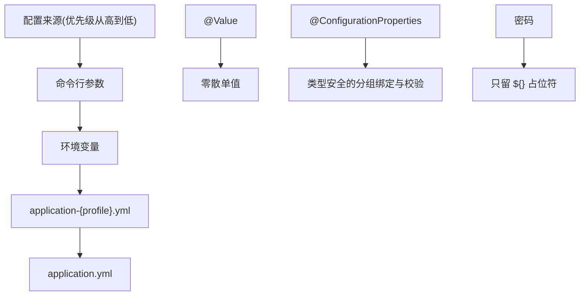

上一篇把返回值统一成了 `Result`，但同一份代码跑在本地和服务器上，端口、数据库地址、功能开关都不一样。把这些值写进代码，改一次环境就要重新编译；写进配置文件，运维能在不改构建产物的前提下换掉它们。

## 配置文件放哪、怎么写



Spring Boot 启动时自动加载 classpath 下的 `application.properties` 或 `application.yml`。两个同时存在也都生效，properties 的优先级更高。

除了 classpath,jar 包同级的 `config/` 目录、jar 所在目录、当前工作目录也在搜索范围内。这条规则是给运维留的口子：构建出来的 jar 不动，旁边放一个 `config/application.yml` 就能覆盖包里的值。

```yaml
server:
  port: 8080

spring:
  application:
    name: order-service

app:
  mail:
    host: smtp.example.com
    port: 465
```

properties 是平铺的 `key=value`，一行一条，没有缩进问题，配置项一多前缀重复得厉害；yml 用缩进表达层级，同一前缀只写一次。yml 有两个硬规矩：**不能用 Tab 缩进**，冒号后面必须留一个空格，少一个空格就是一个启动报错。

需要脚本批量替换时用 properties 更省事，层级深、要写注释、要用 `---` 拆多文档时用 yml。一个项目挑一种，混着用只会让「这个值到底从哪来的」更难查。

## @Value 与 @ConfigurationProperties

取单个值最直接的办法是 `@Value`:

```java
@Service
class MailService {
    @Value("${app.mail.host}")
    private String host;

    @Value("${app.mail.port:25}")
    private int port;      // 冒号后面是默认值,key 缺失时用它
}
```

它支持 `${}` 占位符和 SpEL，适合零散一两个值。局限在类型层面：key 拼错要到启动时才发现，一个前缀下的十几个配置要写十几个字段，也没法对整个前缀做校验。

`@ConfigurationProperties` 把某个前缀下的一组配置绑成一个对象：

```java
@ConfigurationProperties(prefix = "app.mail")
@Validated
public class MailProperties {

    @NotBlank
    private String host;

    @Min(1)
    private int port = 25;

    private String from;

    // getter / setter 省略
}
```

在启动类上补一个 `@ConfigurationPropertiesScan`，或者给这个类加 `@Component`，绑定就在启动阶段完成。绑定支持松散命名：yml 里写 `host-name`，字段写 `hostName`；环境变量写成 `APP_MAIL_HOSTNAME`，都能对上。

`@Validated` 加上 jakarta.validation 的注解，取值不合法时启动直接失败——这比运行到一半才因为端口配错而报错友好得多。

把 `spring-boot-configuration-processor` 声明为可选依赖，构建时会生成配置元数据，IDE 里写 `app.mail.` 能补全 key，拼错的前缀会被标成 unknown property。

## 配置优先级

同一个 key 出现在多个地方，高优先级覆盖低优先级：

```text
1. 命令行参数        --server.port=9090
2. Java 系统属性      -Dserver.port=9090
3. 环境变量          SERVER_PORT=9090
4. application-prod.yml
5. application.yml
```

覆盖以 key 为单位，不会整文件替换，所以底层文件里没被覆盖的项照常生效。容器部署时常用环境变量，因为它不需要改启动命令。

环境变量名由属性名转换而来：字母大写，`.` 换成 `_`，比如 `SPRING_DATASOURCE_URL` 对应 `spring.datasource.url`。名字里带连字符的 key 在环境变量中不保证能正确绑定，这类配置改用命令行参数传入更稳。

## profile:一套代码，多套配置

profile 是一组配置的命名分组。激活方式有三种，效果一样：

- 配置文件里写 `spring.profiles.active: dev`，作为默认值；
- 环境变量 `SPRING_PROFILES_ACTIVE=prod`;
- 命令行 `--spring.profiles.active=prod`。

激活 `prod` 后，`application-prod.yml` 和 `application.yml` 一起加载，前者覆盖后者。没显式激活时，`spring.profiles.default` 决定默认值，不设就是 `default`。

`@Profile` 让整个配置类或单个 `@Bean` 只在指定环境下生效：

```java
@Configuration
@Profile("dev")
public class DevSeedConfig {

    @Bean
    CommandLineRunner seedData() {
        return args -> System.out.println("dev: 初始化示例数据");
    }
}
```

注意：把 `active` 写死在打包进 jar 的 `application.yml` 里，只适合本地开发。部署时用环境变量或命令行覆盖，同一份产物才能分别跑在测试和生产上。

## 密码不进仓库

数据库密码、第三方 AppSecret、签名密钥不写在代码里，也不写在会被提交的 yml 里。配置项只留占位符，值在部署环境注入：

```yaml
spring:
  datasource:
    url: jdbc:mysql://db.internal:3306/order
    username: order_app
    password: ${DB_PASSWORD}
```

`${DB_PASSWORD}` 从环境变量读，变量缺失时启动失败——这比默认空密码更安全，也让问题暴露在部署那一刻而不是第一次连库时。本地开发用一份不进版本库的 `application-local.yml`，并写进 `.gitignore`。团队规模再大一点，就换成配置中心或专门的密钥管理服务。

## 配置改了要生效怎么办

进程启动后，值已经绑进 bean，改文件不会自动生效。单机部署重启进程最简单。需要运行期调整时，接配置中心(Spring Cloud Config、Nacos)，客户端监听变更，刷新标了 `@RefreshScope` 的 bean。这一层不是越早接越好，重启能解决的问题就别加组件。

## 小结

- Boot 默认加载 `application.properties` / `application.yml`,jar 外的 `config/` 目录能覆盖包内配置；
- properties 适合扁平配置，yml 适合层级结构；yml 不许 Tab 缩进、冒号后留空格；
- `@Value` 取零散单值，`@ConfigurationProperties` 做分组绑定，配 `@Validated` 校验、配 processor 补全；
- 优先级：命令行参数 > 系统属性 > 环境变量 > `application-{profile}.yml` > `application.yml`，逐 key 覆盖；
- profile 用配置、环境变量或命令行激活，`@Profile` 控制 bean 的生效环境；
- 密码只留 `${}` 占位符，值由环境注入；运行期刷新交给配置中心。

下一篇往下沉一层：Servlet 与请求生命周期，也就是 Boot 底下那层。
