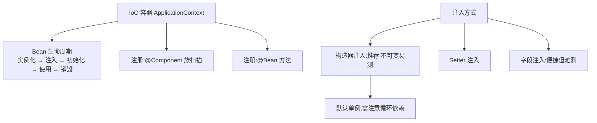

new 对象把"创建谁、用哪个实现"硬编码在调用方，换实现/测试都要改代码。IoC(控制反转)把对象的创建与装配交给容器，调用方只声明"我需要什么"，容器注入具体实例。DI(依赖注入)是 IoC 的实现手段。

## 容器与 Bean



ApplicationContext 是 IoC 容器，管理的对象称 **Bean**。Bean 由容器负责：实例化 → 属性注入 → 初始化回调(@PostConstruct/InitializingBean)→ 使用 → 销毁回调(@PreDestroy)。默认单例(scope=singleton)，全容器一个实例。

注册 Bean 的方式：

- 组件扫描：@Component/@Service/@Repository/@Controller/@RestController 标注类，被 @ComponentScan 发现；
- @Configuration + @Bean:方法返回值注册为 Bean，适合第三方类(无法加注解);
- 自动配置：Boot 按条件注册(第 3 篇)。

## 三种注入方式

```java
@Service
class OrderService {
    private final OrderRepository repo;   // final,不可变
    OrderService(OrderRepository repo) {  // 构造器注入
        this.repo = repo;
    }
}
```

- **构造器注入(推荐)**:依赖不可变(final)、对象创建即完整、脱离容器可 new 测试、暴露过多依赖(构造器参数长提示类职责过重);
- **Setter 注入**:可选/可重配置依赖，对象可半初始化；
- **字段注入(@Autowired 字段)**:最简洁但依赖隐藏、无法 final、脱离容器难实例化测试，官方不推荐。

单构造器可省 @Autowired；多构造器需标注或用 @Autowired 指定。按类型装配，同类型多 Bean 用 @Qualifier 或 @Primary 区分。

## 作用域

- singleton(默认):容器一个；
- prototype:每次 getBean/注入新实例；
- request/session/application:Web 环境每请求/会话/ServletContext 一个。

单例注入 prototype 会"冻结"为注入时那一个；需每次新实例用 ObjectProvider/lookup-method/@Scope(proxyMode)。

## 循环依赖

A 依赖 B、B 依赖 A。构造器注入循环依赖**无法解决**(创建 A 需 B,B 需 A，死锁),Boot 2.6+ 默认禁止并报错。解法：重构消除循环(提取第三方/事件)、改 Setter/字段注入(三级缓存可解单例循环)、@Lazy 延迟一方。循环依赖往往是职责划分不清的信号，优先重构。

## 小结

- IoC 容器管 Bean 创建/装配/生命周期，DI 是实现；
- 注册：组件扫描 / @Bean / 自动配置；
- 构造器注入推荐(不可变/易测/暴露职责)，字段注入不推荐；
- 作用域 singleton/prototype/request；单例注 prototype 需 provider;
- 构造器循环依赖无解，优先重构，而非 @Lazy 掩盖。

下一篇讲自动配置与 starter:Boot 怎么"猜"出你要的 Bean。
