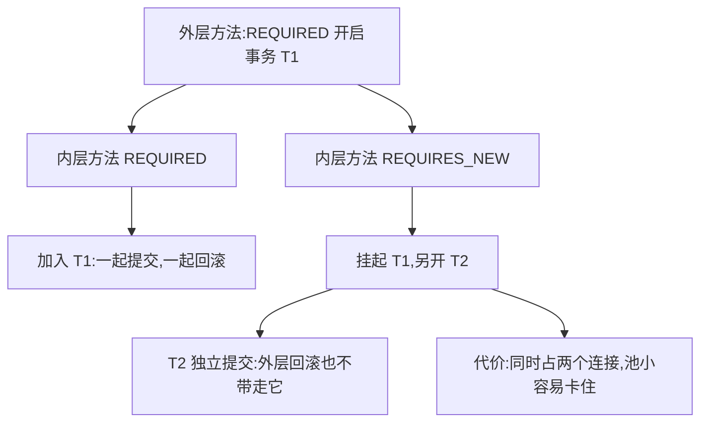

上一篇解决了单条查询怎么拼。真实的业务操作很少只有一条 SQL:下单要扣库存、写订单、记流水,三步中任何一步失败,前面的都不能留下。这就是事务。

## ACID:四个性质

| 性质 | 含义 | 谁保证 |
| --- | --- | --- |
| 原子性 Atomicity | 要么全做,要么全不做 | 数据库(undo log) |
| 一致性 Consistency | 事务前后都满足约束,如转账总额不变 | 数据库约束 + 业务代码 |
| 隔离性 Isolation | 并发事务互不干扰,程度由隔离级别定 | 数据库(锁 + MVCC) |
| 持久性 Durability | 提交后的修改不因宕机丢失 | 数据库(redo log) |

四个里只有一致性需要业务参与:数据库能保证「转账前后总金额相等」这个约束,前提是你写的 SQL 确实是一扣一加。

## JDBC 的提交方式

连接默认 `autocommit = true`,每条 SQL 独立提交,没法跨语句回滚。要显式控制:

```java
try (Connection conn = dataSource.getConnection()) {
    conn.setAutoCommit(false);
    try {
        deduct(conn, sku, qty);      // 扣库存
        insertOrder(conn, order);     // 写订单
        conn.commit();
    } catch (SQLException e) {
        conn.rollback();              // 一步失败,前面全部撤销
        throw e;
    } finally {
        conn.setAutoCommit(true);     // 归还连接前恢复默认值
    }
}
```

最后那行 `setAutoCommit(true)` 很重要:连接是复用的,带着 `false` 回到池里,下一个借到它的人会莫名其妙地「改了不生效」。

## @Transactional:注解只是元数据

Spring 把上面这段模板收进了注解:

```java
@Service
public class OrderService {

    @Transactional(rollbackFor = Exception.class)
    public void place(PlaceCmd cmd) {
        inventoryMapper.deduct(cmd.sku(), cmd.qty());
        orderMapper.insert(cmd.toOrder());
    }
}
```

注解本身不做事,做事的是代理。容器为 `OrderService` 生成一个代理对象,调用 `place` 时,代理先向事务管理器要一个事务(本质是关掉 autocommit 并绑定连接到当前线程),方法正常返回就提交,抛异常就回滚。这也是为什么注入进来的 `orderService` 其实是代理。

由此引出四个常见失效场景:

- **同类自调用**。`this.other()` 不经过代理,事务注解等于没写。根因在第 8 章动态代理那篇讲过:代理对象没被调用;
- **方法不是 public**。基于代理的实现拦不到 private / protected 方法;
- **异常被吞掉**。`catch` 之后不再抛,代理看到的是正常返回,自然提交;
- **checked 异常默认不回滚**。`@Transactional` 默认只对 `RuntimeException` 和 `Error` 回滚,受检异常要显式写 `rollbackFor = Exception.class`。

自调用的解法有两种:把方法拆到另一个 bean 里;或者注入自己(`@Lazy` 注入自身代理)。前者更干净,后者知道原理就行。

## 传播行为:加入还是新建

一个事务方法调用另一个事务方法时,内层怎么处理,由传播行为决定:

| 传播行为 | 行为 | 场景 |
| --- | --- | --- |
| `REQUIRED`(默认) | 有事务就加入,没有就新建 | 绝大多数业务方法 |
| `REQUIRES_NEW` | 挂起外层,自己开一个独立事务 | 记日志、发消息,不想被外层回滚带走 |
| `NESTED` | 在外层里开保存点,失败只回到保存点 | 局部失败不影响整体 |
| `SUPPORTS` | 有就加入,没有就非事务执行 | 查询方法 |
| `NOT_SUPPORTED` | 挂起外层,自己非事务执行 | 长耗时的非关键操作 |
| `MANDATORY` | 必须在事务中,否则抛异常 | 强制约束调用方 |
| `NEVER` | 必须不在事务中,否则抛异常 | 极少数场景 |

`REQUIRES_NEW` 要占用第二个数据库连接。外层事务还没提交时,两个连接同时持有,池小的时候容易把自己锁死——这是「事务里嵌套独立事务」最常见的翻车方式。



## 隔离级别:并发读会出现什么

| 隔离级别 | 脏读 | 不可重复读 | 幻读 |
| --- | --- | --- | --- |
| READ UNCOMMITTED | 可能 | 可能 | 可能 |
| READ COMMITTED | 不会 | 可能 | 可能 |
| REPEATABLE READ | 不会 | 不会 | InnoDB 下基本不会 |
| SERIALIZABLE | 不会 | 不会 | 不会 |

- 脏读:读到了别人未提交的数据;
- 不可重复读:同一事务内两次读同一行,值变了;
- 幻读:同一事务内两次范围查询,行数变了。

MySQL 的 InnoDB 默认 `REPEATABLE READ`,靠 MVCC 加间隙锁基本消除了幻读。Oracle、PostgreSQL 默认 `READ COMMITTED`。隔离级别越高,并发度越低,除非有明确理由,否则不要动数据库默认值。

## 连接池:HikariCP

每次 `getConnection()` 都建一次 TCP 连接 + 认证,几十毫秒起步。连接池提前建好一批,用完归还。

Spring Boot 默认用 HikariCP,几个参数必须知道:

```yaml
spring:
  datasource:
    hikari:
      maximum-pool-size: 10        # 池上限,默认 10
      minimum-idle: 10             # 最小空闲,默认与上限相同
      connection-timeout: 3000     # 借连接等多久算超时(毫秒)
      idle-timeout: 600000         # 空闲多久回收
      max-lifetime: 1800000        # 连接最长寿命,要小于数据库的 wait_timeout
      leak-detection-threshold: 20000   # 借出超过 20s 没还就打印堆栈
```

两个经验:

1. **池不是越大越好**。数据库的连接数和 CPU 核数强相关,几十个连接就能把一台库打满。应用侧的池上限通常 10~20 就够,真正该扩的是实例数;
2. **`max-lifetime` 要小于数据库的 `wait_timeout`**。否则连接被数据库单方面掐断,应用还以为是好的,借出去就报 `Communications link failure`。

`leak-detection-threshold` 只在排查时打开:它会在连接借出超时后打印借用方的堆栈,能直接指出哪段代码忘了关。

## 小结

- 事务保证多条 SQL 一起成功或一起撤销,ACID 里只有一致性需要业务参与;
- JDBC 关掉 autocommit 后显式 commit / rollback,归还连接前恢复默认值;
- `@Transactional` 靠代理织入,同类自调用、非 public、异常被吞、checked 异常默认不回滚都会让它失效;
- 传播行为:`REQUIRED` 加入、`REQUIRES_NEW` 独立、`NESTED` 保存点;独立事务会多占一个连接;
- 隔离级别越高并发越低,MySQL 默认 `REPEATABLE READ`,别轻易改;
- HikariCP 池大小 10~20 通常够用,`max-lifetime` 必须小于数据库的 `wait_timeout`,泄漏用 `leak-detection-threshold` 查。

下一篇回头看最底层:JDBC 自己是怎么执行一条 SQL 的。
