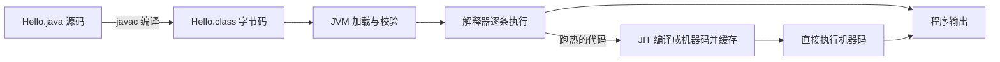

Java 有两层身份:一门编程语言,和一套让这门语言跑起来的平台。你写的 `.java` 文件操作系统并不认识,它先被编译成字节码,再交给 JVM 这台「假机器」执行。JDK、JRE、JVM 不是三个并列的东西,而是一层包一层:

<figure class="lg-figure">
  <svg class="lg-diagram" viewBox="0 0 760 430" role="img" aria-label="JDK 包含 JRE,JRE 包含 JVM 的三层包含关系图">
    <rect x="6" y="6" width="748" height="418" rx="20" fill="var(--panel)" stroke="var(--line-strong)" />
    <text x="32" y="48" font-size="20" font-weight="700" fill="var(--ink)">JDK</text>
    <text x="88" y="48" font-size="13" fill="var(--muted)">JRE + 开发工具</text>
    <g font-size="12" font-family="ui-monospace, SFMono-Regular, Menlo, monospace" fill="var(--muted)" text-anchor="middle">
      <rect x="430" y="28" width="52" height="26" rx="13" fill="var(--canvas)" stroke="var(--line)" />
      <text x="456" y="45">javac</text>
      <rect x="490" y="28" width="38" height="26" rx="13" fill="var(--canvas)" stroke="var(--line)" />
      <text x="509" y="45">jar</text>
      <rect x="536" y="28" width="66" height="26" rx="13" fill="var(--canvas)" stroke="var(--line)" />
      <text x="569" y="45">javadoc</text>
      <rect x="610" y="28" width="58" height="26" rx="13" fill="var(--canvas)" stroke="var(--line)" />
      <text x="639" y="45">jshell</text>
      <rect x="676" y="28" width="50" height="26" rx="13" fill="var(--canvas)" stroke="var(--line)" />
      <text x="701" y="45">jlink</text>
    </g>
    <rect x="38" y="74" width="684" height="318" rx="16" fill="var(--canvas)" stroke="var(--line-strong)" />
    <text x="64" y="116" font-size="20" font-weight="700" fill="var(--ink)">JRE</text>
    <text x="120" y="116" font-size="13" fill="var(--muted)">JVM + 核心类库</text>
    <g font-size="12" font-family="ui-monospace, SFMono-Regular, Menlo, monospace" fill="var(--muted)" text-anchor="middle">
      <rect x="452" y="96" width="80" height="26" rx="13" fill="var(--panel)" stroke="var(--line)" />
      <text x="492" y="113">java.lang</text>
      <rect x="540" y="96" width="80" height="26" rx="13" fill="var(--panel)" stroke="var(--line)" />
      <text x="580" y="113">java.util</text>
      <rect x="628" y="96" width="66" height="26" rx="13" fill="var(--panel)" stroke="var(--line)" />
      <text x="661" y="113">java.io</text>
    </g>
    <rect x="70" y="142" width="620" height="218" rx="14" fill="var(--accent-soft)" stroke="var(--accent)" stroke-opacity="0.55" />
    <text x="380" y="228" font-size="22" font-weight="700" fill="var(--accent)" text-anchor="middle">JVM</text>
    <text x="380" y="260" font-size="14" fill="var(--ink)" text-anchor="middle">加载、校验、执行字节码</text>
    <text x="380" y="288" font-size="12" fill="var(--muted)" text-anchor="middle">类加载器 · 执行引擎(解释器 + JIT) · 内存管理与 GC</text>
  </svg>
  <figcaption>写成等式:JDK = JRE + 开发工具,JRE = JVM + 核心类库。</figcaption>
</figure>

## 三个名字各管什么

| 名字 | 里面有什么 | 你什么时候需要它 |
| --- | --- | --- |
| JVM | 类加载器、执行引擎(解释器 + JIT)、内存管理与 GC | 跑任何 Java 程序都需要,但它不单独安装 |
| JRE | JVM + 核心类库 | 只运行别人编译好的程序时的最小环境 |
| JDK | JRE + 编译、打包、诊断工具 | 你要写代码、编译代码,就装它 |

两个容易记反的点:

- 跨平台的是字节码,不是 JVM。Windows、Linux、macOS 各有一份自己的 JVM 实现,同一份 `.class` 交给哪一份都能跑,这才是「一次编写,到处运行」的含义。
- JRE 今天不再单独发布。JDK 11 起 Oracle 不提供独立的 JRE 安装包;JDK 9 引入模块系统后,JDK 被重组成一组模块,想要「只带运行时」的产物,用 JDK 里的 `jlink` 按模块裁一份定制运行时。所以新手装环境的答案很简单:**装 JDK**。

## 从源码到输出,中间发生了什么

```bash
javac Hello.java   # 编译:Hello.java → Hello.class(字节码)
java Hello         # 运行:启动 JVM,加载 Hello.class,从 main 开始执行
```

拆开看是四步:

1. 编译期。`javac` 做语法与类型检查,把源码翻译成字节码,写进 `.class`。这一步发现的错叫编译错误,程序根本还没跑。
2. 加载。JVM 按类的全限定名找到 `.class`,读进内存,生成对应的 `Class` 对象。
3. 校验。字节码在执行前先过一遍校验器,非法指令、越界跳转在这一步被拦下。Java 敢让陌生代码跑在自己进程里,靠的就是这类检查。
4. 执行。解释器逐条执行字节码;某段代码跑热了,JIT 把它编译成本地机器码缓存起来,之后直接跑机器码。



所以「Java 是解释执行所以慢」只说对了开头。JavaGuide 把这件事概括成「编译与解释并存」,并补了一句:JVM 规范并不要求实现必须带解释器或 JIT,具体执行策略由各实现自己定。

内存不够用的对象由垃圾回收器自动收走,你不用手动 `free`。这条线第 11 章会专门讲,这里先知道有这回事就够。

## 规范与实现是两件事

JVM 是一份规范(Java Virtual Machine Specification),规定字节码长什么样、指令什么语义、类怎么加载。满足这份规范的实现有好几个:

- HotSpot:OpenJDK 与 Oracle JDK 默认带的那份,绝大多数人说的「JVM」就是它;
- OpenJ9:Eclipse 基金会维护,内存占用取向不同;
- GraalVM:带提前编译(AOT)等能力的发行版,能把 Java 程序编成原生可执行文件。

换实现不换字节码,你的 `.class` 照样跑。面试里问「JVM 内存结构」,问的是规范加 HotSpot 的落地方式,不是问 Java 语法。

## 版本:六个月一版,LTS 每两年

Java 从 9 开始改成固定节奏:每六个月一个特性版,每两年挑一个做 LTS(长期支持)。到 2026 年 11 月这个时间点:

- 最新特性版是 JDK 27(2026 年 9 月发布),不是 LTS;
- 最新 LTS 是 JDK 25(2025 年 9 月发布),下一个 LTS 是 2027 年 9 月的 29;
- 还在被广泛使用的老 LTS 是 21 和 17。

学习和生产都建议跟 LTS:特性版里的预览语法可能下一版就改,而 LTS 的 API 与行为会被厂商修很多年。

还有一个常被忽略的事实:语言版本、类库版本、JVM 版本是一起走的。`javac --release 21` 的意思是「按 21 的语法和 21 的 API 编译,产出 21 的 JVM 能跑的字节码」,而不是只改一个语法开关。用新 JDK 编译出旧版本能跑的产物,靠的就是它。

## JDK 25 起,第一个程序可以不写 class

JDK 25 把 JEP 512 转正了:紧凑源文件加实例 main。一个文件里可以不写类声明,直接写方法:

```java
// Hello.java —— JDK 25 起可以直接 java Hello.java 运行
void main() {
    IO.println("Hello, Java");
}
```

编译器会替你把这段内容包进一个隐式的顶层类;`java.base` 模块导出的包自动导入,所以 `IO`、`List`、`Map` 不用写 import。`main` 也不必是 `public static`,`void main()` 就能作为入口。

这是给第一周的学习准备的糖。正式工程里仍然写 `class` 与 `public static void main(String[] args)`,因为隐式类没有名字,别的代码引用不到它。知道有这条捷径,是为了让你第一天就能跑起来,而不是为了替代后面的第 3 章。

## 四个常见误解

1. 「Java 和 JavaScript 是一家」。不是。两者除了名字像,语言设计、运行环境、用途都不同;JavaScript 跑在浏览器与 Node 里,不经过 JVM。
2. 「跑程序只要 JRE,所以装 JRE 就够」。说法对,但今天没有独立 JRE 可装;装 JDK 是最省事的答案,`jlink` 是进阶答案。
3. 「JVM 跨平台」。反了。跨平台的是字节码,JVM 是每个平台一份的实现。
4. 「版本越新越好,追 27」。特性版适合尝鲜与评估,不适合当学习与生产的主线;跟 LTS,把精力花在语言与类库本身。

骨架就是这些:源码 → 字节码 → JVM,JDK 包着 JRE,JRE 包着 JVM。下一篇把这套骨架落到你的机器上,选一份 JDK、配好环境变量、跑通第一个程序。