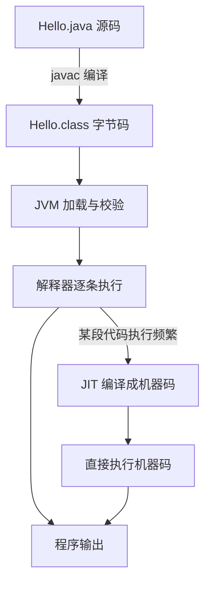

Java 是 Sun 公司在 1995 年发布的一门编程语言,作者是 James Gosling。它最初叫 Oak,本来是给家电里的嵌入式设备用的,市场没什么反响,后来赶上互联网兴起,改名 Java 重新发布,反而成了最流行的编程语言之一。Sun 公司后来在 2010 年被 Oracle 收购,Java 也就归了 Oracle。

今天 Java 主要用在三个地方:

- 互联网和企业应用的后台,国内大量电商、银行、支付系统都是 Java 写的;
- Android 应用,Android 开发长期以 Java 为主(现在 Kotlin 也很多,Kotlin 同样跑在 JVM 上);
- 大数据平台,Hadoop、Spark、Flink 都是 Java 或 Scala 开发的。

注意:Java 和 JavaScript 没有关系。前者跑在 JVM 上,后者跑在浏览器和 Node.js 里,除了名字像,是两门完全不同的语言。

## Java 程序是怎么跑起来的

C、C++ 这类编译型语言,源码直接编译成机器码。机器码和 CPU 指令集绑定,Windows 上编译出来的程序拿到 Linux 上就不能跑,得为每个平台各编译一份。Python 这类解释型语言没这个问题,解释器直接加载源码运行,代价是慢。

Java 走了中间一条路:先把源码编译成字节码(bytecode),再由虚拟机执行。字节码不是机器码,你可以把它理解成一套抽象的 CPU 指令,操作系统不认识它,只有 JVM 认识。

```text
Hello.java  ──javac 编译──▶  Hello.class  ──java 执行──▶  JVM 加载并运行
 (源码)                      (字节码)
```

「一次编写,到处运行」就是这么来的:同一份 `Hello.class`,Windows、Linux、macOS 上都能跑。但要注意,跨平台的是字节码,不是 JVM。JVM 本身是每个平台各有一份的,Windows 版的 JVM 是 Windows 程序,Linux 版的 JVM 是 Linux 程序,这些脏活累活由写虚拟机的人干了,你只管编译一次。

## JDK、JRE、JVM 是什么关系

这三个名字经常一起出现,它们不是三个并列的东西,而是一层包一层:

<figure class="lg-figure">
  <svg class="lg-diagram" viewBox="0 0 760 430" role="img" aria-label="JDK 包含 JRE,JRE 包含 JVM 的三层包含关系图">
    <rect x="6" y="6" width="748" height="418" rx="20" fill="var(--panel)" stroke="var(--line-strong)" />
    <text x="32" y="48" font-size="20" font-weight="700" fill="var(--ink)">JDK</text>
    <text x="88" y="48" font-size="13" fill="var(--muted)">JRE + 开发工具</text>
    <g font-size="12" font-family="ui-monospace, SFMono-Regular, Menlo, monospace" fill="var(--muted)" text-anchor="middle">
      <rect x="430" y="28" width="52" height="26" rx="13" fill="var(--canvas)" stroke="var(--line)" />
      <text x="456" y="45">javac</text>
      <rect x="490" y="28" width="38" height="26" rx="13" fill="var(--canvas)" stroke="var(--line)" />
      <text x="509" y="45">jar</text>
      <rect x="536" y="28" width="66" height="26" rx="13" fill="var(--canvas)" stroke="var(--line)" />
      <text x="569" y="45">javadoc</text>
      <rect x="610" y="28" width="58" height="26" rx="13" fill="var(--canvas)" stroke="var(--line)" />
      <text x="639" y="45">jshell</text>
      <rect x="676" y="28" width="50" height="26" rx="13" fill="var(--canvas)" stroke="var(--line)" />
      <text x="701" y="45">jlink</text>
    </g>
    <rect x="38" y="74" width="684" height="318" rx="16" fill="var(--canvas)" stroke="var(--line-strong)" />
    <text x="64" y="116" font-size="20" font-weight="700" fill="var(--ink)">JRE</text>
    <text x="120" y="116" font-size="13" fill="var(--muted)">JVM + 核心类库</text>
    <g font-size="12" font-family="ui-monospace, SFMono-Regular, Menlo, monospace" fill="var(--muted)" text-anchor="middle">
      <rect x="452" y="96" width="80" height="26" rx="13" fill="var(--panel)" stroke="var(--line)" />
      <text x="492" y="113">java.lang</text>
      <rect x="540" y="96" width="80" height="26" rx="13" fill="var(--panel)" stroke="var(--line)" />
      <text x="580" y="113">java.util</text>
      <rect x="628" y="96" width="66" height="26" rx="13" fill="var(--panel)" stroke="var(--line)" />
      <text x="661" y="113">java.io</text>
    </g>
    <rect x="70" y="142" width="620" height="218" rx="14" fill="var(--accent-soft)" stroke="var(--accent)" stroke-opacity="0.55" />
    <text x="380" y="228" font-size="22" font-weight="700" fill="var(--accent)" text-anchor="middle">JVM</text>
    <text x="380" y="260" font-size="14" fill="var(--ink)" text-anchor="middle">加载、校验、执行字节码</text>
    <text x="380" y="288" font-size="12" fill="var(--muted)" text-anchor="middle">类加载器 · 执行引擎(解释器 + JIT) · 内存管理与 GC</text>
  </svg>
  <figcaption>JDK = JRE + 开发工具,JRE = JVM + 核心类库。</figcaption>
</figure>

一个一个说。

JVM(Java Virtual Machine,Java 虚拟机)是真正执行字节码的程序。它负责把 `.class` 文件加载进内存,检查字节码是否合法,然后一条一条执行。内存不够用了,垃圾回收器(GC)会自动把没人用的对象清掉,所以写 Java 不用像写 C 那样手动释放内存。

JRE(Java Runtime Environment,Java 运行环境)是 JVM 加上核心类库。光有虚拟机还不够,你写的程序总要用到 `String`、`ArrayList` 这些现成的类,它们在核心类库里。只运行别人编译好的 Java 程序,有 JRE 就够了。

JDK(Java Development Kit,Java 开发工具包)是 JRE 再加上一套开发工具。装完 JDK,在它的 `bin` 目录下能看到这些可执行文件:

- `java`:就是 JVM 的启动入口,运行 Java 程序就是启动它;
- `javac`:编译器,把 `.java` 源码编译成 `.class` 字节码;
- `jar`:把一堆 `.class` 打包成一个 `.jar` 文件,方便发布;
- `javadoc`:从源码注释里生成文档;
- `jshell`:交互式命令行,敲一行执行一行,试 API 很方便。

所以三者的关系写成等式就是:JDK = JRE + 开发工具,JRE = JVM + 核心类库。你要写代码,就装 JDK,装了 JDK 就什么都不缺了。

注意:从 JDK 11 起,Oracle 不再单独发布 JRE 安装包,网上老教程里「先装 JDK 再装 JRE」的步骤已经过时了。想要一个只含运行时的精简产物,用 JDK 自带的 `jlink` 按模块裁剪,这是部署阶段的事,现在不用管。

## 编译和运行,两条命令

Java 源码就是文本文件,操作系统不能直接执行它。完整的流程是两步:

```bash
javac Hello.java   # 第一步:编译,生成 Hello.class
java Hello         # 第二步:运行,注意参数是类名,不带 .class 后缀
```

第一步 `javac` 做语法和类型检查,把源码翻译成字节码写进 `.class` 文件。这一步报的错叫编译错误,比如少个分号、类型对不上,此时程序还没跑。

第二步 `java` 启动 JVM,JVM 找到 `Hello.class`,加载、校验,然后从 `main` 方法开始执行。这一步报的错叫运行时错误,比如除零、空指针。



有人说 Java 是解释执行所以慢,这个说法只对了一半。JVM 一开始确实用解释器逐条执行字节码,但某段代码执行得多了(所谓热点代码),JIT(Just-In-Time)编译器会把它编译成本地机器码缓存起来,后面直接跑机器码,速度和编译型语言差不了多少。所以 Java 是编译与解释并存的。

再补充一点:JVM 是一份规范,规定了字节码长什么样、指令什么含义、类怎么加载。满足规范的实现有好几个,最常见的是 HotSpot(OpenJDK 和 Oracle JDK 默认带的就是它),此外还有 Eclipse 基金会的 OpenJ9、能提前编译成原生可执行文件的 GraalVM 等。换实现不用换字节码,你的 `.class` 照样跑。面试里问「JVM 内存结构」,问的就是规范加上 HotSpot 的具体实现。

## 版本怎么选

Java 早年的版本号是 1.5、1.6、1.7、1.8 这样走的,从 Java 9 开始改成固定节奏:每六个月发一个新版本,每两年挑一个作为 LTS(Long Term Support,长期支持版)。

以 2026 年 11 月为准:

| 版本 | 发布时间 | 类型 |
| --- | --- | --- |
| JDK 27 | 2026 年 9 月 | 最新特性版,不是 LTS |
| JDK 25 | 2025 年 9 月 | 最新 LTS,学习推荐 |
| JDK 21 / 17 | 2023 / 2021 年 | 老 LTS,很多公司项目还在用 |
| JDK 29 | 2027 年 9 月(计划) | 下一个 LTS |

学习装最新的 LTS(现在是 25),公司项目跟公司定的版本,通常是 21 或 17,别自己升。不建议追特性版:里面的预览语法下一版可能就改了,而 LTS 的 API 和行为会被厂商维护很多年。

另外,语言版本、类库版本、字节码版本是一起走的。用新 JDK 编译出老版本 JVM 能跑的产物,加一个参数就行:

```bash
javac --release 21 Hello.java
```

意思是按 21 的语法和 21 的 API 编译,产物能在 21 的 JVM 上运行。第 3 篇还会提到它。

## JDK 25 起,第一个程序可以不写 class

老教程里第一个 Java 程序长这样:

```java
public class Hello {
    public static void main(String[] args) {
        System.out.println("Hello, world!");
    }
}
```

还没学语法,就得先面对 `public`、`class`、`static`、`String[] args` 一堆关键字,很多初学者第一天就被劝退了。JDK 25 把 JEP 512 转正,允许把第一个程序写成这样:

```java
// Hello.java,JDK 25 起可以直接 java Hello.java 运行
void main() {
    IO.println("Hello, world!");
}
```

不用写类声明,不用写 `public static`,`IO` 也不用 import,编译器会自动处理。这样第一天就能把程序跑起来,类、方法、修饰符这些概念留到后面再学。

注意:这是给入门学习行方便的写法。正式项目里仍然写 `class` 和 `public static void main(String[] args)`,因为不写类声明时编译器生成的隐式类没有名字,别的代码没法引用它。

## 小结

- Java 源码先由 `javac` 编译成字节码,再由 JVM 执行;跨平台的是字节码,JVM 每个平台各有一份;
- JDK = JRE + 开发工具,JRE = JVM + 核心类库;学 Java 直接装 JDK,JRE 已不再单独发布;
- Java 是编译与解释并存:解释器先跑,热点代码由 JIT 编译成机器码;
- 版本跟 LTS 走,现在学习装 JDK 25,公司项目跟公司定的版本;
- JDK 25 起第一个程序可以不写 class,直接 `void main()`。

下一篇把 JDK 装到你的电脑上,跑通第一个程序。