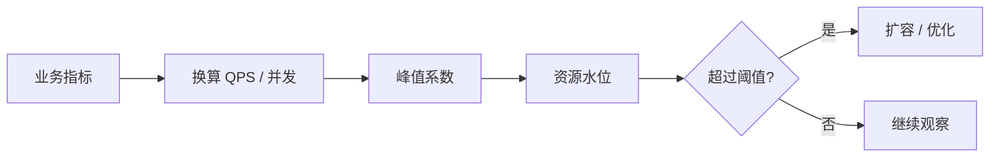

容量规划不是精确预测未来，而是回答两个问题：当前还能撑多久，什么时候必须扩容。答案来自指标与压测，不来自感觉。



## 先有指标

- QPS / TPS：按接口与业务动作拆分；
- 并发连接：网关、应用、数据库各自统计；
- 数据量增长：每日新增行数与字节数；
- 带宽：入口与出口流量；
- 存储：磁盘使用率与增长率。

没有这些数据，扩容只能靠“感觉卡了”。

## 峰值系数

平均值不能用于容量决策。常见做法：

- 统计过去 30 天的 P95 与最高值；
- 峰值系数 = 峰值 / 平均值，常见 3–10 倍；
- 大促、定时任务、批量导入要单独估算；
- 按峰值乘以安全系数（1.3–2）确定容量。

## 并发与延迟

排队系统里有一个近似关系：

```text
并发 ≈ QPS × 平均延迟(秒)
```

QPS 1000、平均延迟 50ms，则并发约 50。延迟上升到 200ms，同样 QPS 需要 200 并发。容量规划要同时看 QPS 与延迟，否则会在延迟恶化时突然过载。

## 水位线

为每类资源设阈值：

| 资源 | 告警水位 | 扩容水位 |
| --- | --- | --- |
| CPU | 70% | 85% |
| 内存 | 75% | 90% |
| 磁盘 | 70% | 80% |
| 连接池 | 70% | 85% |
| 复制延迟 | 业务容忍值 | 接近上限 |

水位要留出扩容与故障切换的时间。磁盘 90% 才处理，往往来不及。

## 扩容提前量

扩容需要时间：申请资源、部署、预热、验证。按“从告警到扩容完成”的时长，反推触发水位。例如预计 2 小时完成扩容，而每天增长 2%，就不能等到 95%。

## 容量模型

1. 选一个核心接口，统计峰值 QPS 与延迟；
2. 压测单实例在该延迟下的最大 QPS；
3. 实例数 = 峰值 QPS / 单实例能力 × 安全系数；
4. 数据库按写入量、索引大小与复制延迟单独估算；
5. 每季度用真实流量复核模型。

## 常见误区

- **按平均值扩容**：峰值一来就过载；
- **只看 CPU**：IO、连接池、锁等待都可能先到瓶颈；
- **忽略数据增长**：磁盘与索引膨胀是慢性问题；
- **没有压测**：单实例能力靠猜；
- **扩容不验证**：新实例未预热，流量打上去仍超时。

## 小结

- 容量规划从 QPS、并发、数据与带宽四类指标开始；
- 用峰值系数与安全系数覆盖波动；
- 并发与延迟相互影响，不能只看 QPS；
- 设告警与扩容两级水位，预留操作时间；
- 定期用真实流量复核模型。
