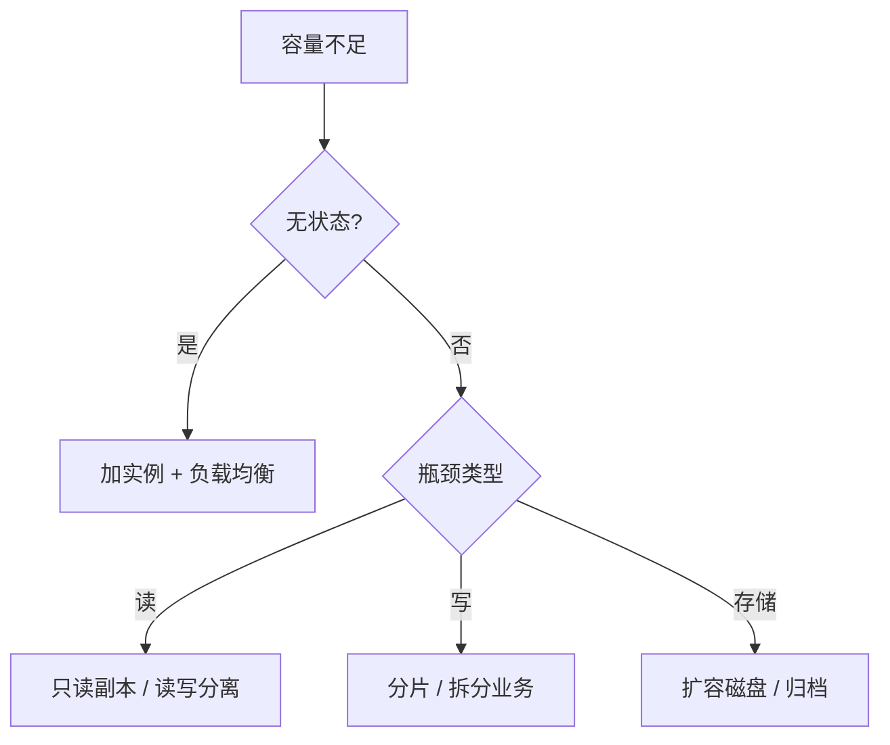

扩容有两种方向：把机器变强（垂直），或增加机器（水平）。前者简单但有上限，后者需要应用无状态与流量分发。

## 垂直扩容

- 提升 CPU、内存、磁盘 IO；
- 对应用透明，不需要改架构；
- 受单机上限与成本曲线限制；
- 重启才能生效，需要维护窗口。

数据库、缓存这类有状态组件，垂直扩容往往是最省事的第一步。

## 水平扩容

前提：

- 应用无状态，会话放 Redis 或客户端；
- 请求可以分发到任意实例；
- 定时任务、文件上传等有状态逻辑做了协调。

步骤：

1. 新实例部署并通过健康检查；
2. 加入负载均衡，先小流量验证；
3. 观察错误率、延迟与资源；
4. 逐步扩大流量；
5. 确认稳定后保留一段观察期。

一次性把新实例全部接入，可能把未预热的问题放大。

## 有状态扩容

### 读扩展

主从复制 + 读写分离，读请求分流到从库。注意：

- 写后立即读要走主库；
- 复制延迟要在业务容忍范围内；
- 从库故障要能自动摘除。

### 写扩展

- 垂直扩容优先；
- 业务拆分：按领域拆库；
- 分片：按用户或订单哈希，跨片查询与事务成本高；
- 分片是最后手段，设计阶段就要考虑路由与迁移。

## 缩容

缩容比扩容更危险：

1. 先把实例从负载均衡摘除；
2. 等待存量请求处理完；
3. 确认无长连接与后台任务；
4. 再停止实例；
5. 观察剩余实例水位。

有状态缩容还要确认数据已迁移、副本数满足最小要求。直接关机可能触发数据重平衡或丢失。

## 扩容演练

- 在低峰期模拟扩容，记录从触发到稳定耗时；
- 验证新实例的配置、证书、密钥与版本一致；
- 检查监控与日志是否覆盖新实例；
- 记录容量模型与实际能力的偏差。

## 常见坑

- **会话存在本地**：新实例登录态丢失；
- **定时任务多实例重复执行**：需要分布式锁或选主；
- **扩容后数据库先崩**：应用层扩容没有同步评估下游；
- **缩容直接关机**：请求中断、数据未迁移；
- **配置不一致**：新实例连错库或缓存；
- **自动扩容抖动**：指标瞬时波动导致频繁扩缩。

## 小结

- 垂直扩容简单，水平扩容需要无状态与流量分发；
- 读扩展靠副本，写扩展靠拆分与分片；
- 扩容要灰度接入并观察；
- 缩容先摘流量、再停机；
- 每次扩容都是对容量模型与自动化程度的检验。
