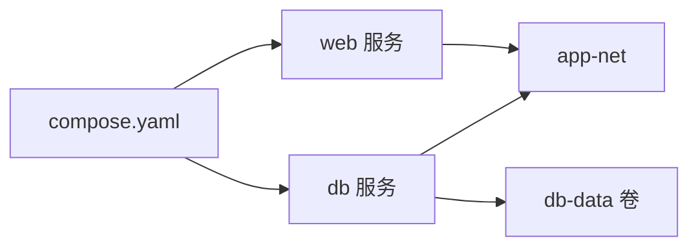

单机多容器场景，Compose 比一长串 `docker run` 更可维护：网络、卷、环境变量与依赖关系都写在一个文件里，能重复启动和销毁。



## 基本结构

```yaml
services:
  web:
    image: app:20261126
    build: .
    ports:
      - "3000:3000"
    environment:
      DATABASE_URL: mysql://app:secret@db:3306/shop
    depends_on:
      db:
        condition: service_healthy
    restart: unless-stopped

  db:
    image: mysql:8.4
    environment:
      MYSQL_ROOT_PASSWORD: change-me
      MYSQL_DATABASE: shop
    volumes:
      - db-data:/var/lib/mysql
    healthcheck:
      test: ["CMD", "mysqladmin", "ping", "-h", "127.0.0.1"]
      interval: 10s
      timeout: 5s
      retries: 5

volumes:
  db-data:
```

- `depends_on` 配 `condition: service_healthy` 才会等待健康，而不是只等容器启动；
- 健康检查要针对服务自身，不要依赖外部系统；
- 数据库密码等敏感值放 `.env` 或 secrets，不写进仓库。

## 网络与访问

Compose 默认创建独立网络，服务之间用服务名访问：

```text
mysql://app:secret@db:3306/shop
```

常见错误：

- 在应用里写 `localhost:3306`，实际指向应用容器自身；
- 用宿主机 IP，容器内可能不可达；
- 多个 Compose 项目网络隔离，跨项目访问要显式加入同一网络。

## 常用命令

```bash
docker compose up -d
docker compose ps
docker compose logs -f web
docker compose exec web sh
docker compose restart web
docker compose down
docker compose down -v      # 同时删除卷，谨慎
docker compose config       # 校验并展开配置
```

`down -v` 会删除命名卷，数据库数据一并丢失，执行前确认。

## 环境与配置

```yaml
env_file:
  - .env
```

- `.env` 放默认值，生产用环境变量或 secrets 覆盖；
- 配置变更后 `docker compose up -d` 会重建受影响的容器；
- 不要用 `latest` 标签，升级要写明确版本；
- 需要固定容器名时显式设置，否则 Compose 会加项目前缀。

## 上线与更新

```bash
docker compose pull
docker compose up -d
docker compose ps
```

更新单个服务时 Compose 只重建该服务，但依赖它的服务可能需要重启。数据库迁移应在应用启动前完成，并保证向后兼容。

## 常见坑

- **`depends_on` 不等待健康**：应用先启动，连不上数据库；
- **数据库数据没挂卷**：`down` 后数据丢失；
- **容器内用 localhost 访问其他服务**：应使用服务名；
- **健康检查命令不存在**：镜像里没有 `curl`，检查一直失败；
- **端口冲突**：宿主机已占用 3000，容器起不来；
- **日志无限增长**：未配置日志驱动与轮转。

## 小结

- Compose 用一个文件管理多容器、网络与卷；
- 依赖顺序用健康检查，不只看容器启动；
- 容器间用服务名访问，`localhost` 只指自身；
- 数据卷必须显式声明，`down -v` 会删数据；
- 生产固定镜像版本，配置与密钥外置。
