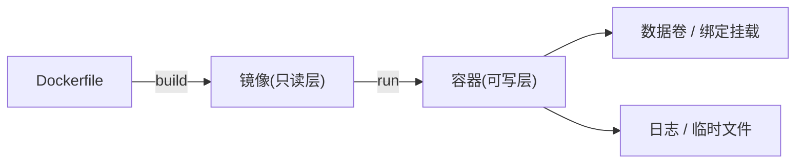

容器的核心是“镜像不可变、容器可替换”。理解镜像分层与数据卷，才能避免“容器删了数据也没了”和“镜像越做越大”。



## 镜像与容器

- 镜像由只读层叠加而成，每条 Dockerfile 指令生成一层；
- 容器在镜像之上加一个可写层，删除容器即丢失；
- 需要持久化的数据必须放到卷或绑定挂载；
- 镜像标签要固定，生产不要用 `latest`。

```bash
docker build -t app:20261126 .
docker run -d --name app -p 3000:3000 app:20261126
docker logs -f app
docker exec -it app sh
```

## Dockerfile

```dockerfile
FROM node:24-bookworm-slim AS build
WORKDIR /app
COPY package*.json ./
RUN npm ci
COPY . .
RUN npm run build

FROM node:24-bookworm-slim
WORKDIR /app
ENV NODE_ENV=production
COPY --from=build /app/dist ./dist
COPY --from=build /app/node_modules ./node_modules
USER node
EXPOSE 3000
CMD ["node", "dist/server.js"]
```

要点：

- 多阶段构建把编译依赖留在构建阶段，运行时镜像更小；
- 先复制依赖清单再复制源码，利用层缓存；
- 用非 root 用户运行；
- 只复制运行需要的文件；
- `CMD` 用 exec 形式，确保信号能传给进程。

## 数据卷与挂载

```bash
docker run -d --name db \
  -v mysql-data:/var/lib/mysql \
  mysql:8.4

docker run -d --name app \
  -v /opt/app/config:/app/config:ro \
  app:20261126
```

| 方式 | 特点 |
| --- | --- |
| 命名卷 | Docker 管理，跨容器复用，适合数据库 |
| 绑定挂载 | 直接映射宿主机目录，便于改配置，注意权限 |
| tmpfs | 内存文件系统，重启即失，适合临时数据 |

数据库、上传文件、证书都应持久化；日志建议输出到 stdout，由外部采集。

## 网络与端口

```bash
docker network create app-net
docker run -d --name db --network app-net mysql:8.4
docker run -d --name app --network app-net -p 3000:3000 app:20261126
```

- 同一自定义网络内可以用容器名互相访问；
- `-p` 暴露到宿主机，容器之间不需要；
- 容器内的 `127.0.0.1` 指向容器自身，不是宿主机；
- 默认 bridge 网络不支持容器名解析，跨容器访问要自定义网络。

## 资源限制

```bash
docker run -d --name app \
  --cpus=2 \
  --memory=1g \
  --memory-swap=1g \
  app:20261126
```

不限制资源时，一个容器可能吃满宿主机。内存限制过低会触发 OOM Kill，现象是容器突然重启，日志里没有应用报错。

## 常见坑

- **数据写容器层**：重建即丢失；
- **镜像用 latest**：无法确定运行版本；
- **容器内 PID 1 不转发信号**：`docker stop` 超时后才强杀，应用无法优雅退出；
- **时区不一致**：容器默认 UTC，日志与应用时间对不上；
- **日志写文件**：容器删除后日志丢失，应输出 stdout；
- **构建缓存导致旧代码**：`COPY . .` 放在依赖安装之前，缓存失效频繁。

## 小结

- 镜像不可变，容器可替换，状态放卷；
- 多阶段构建 + 固定基础镜像 + 非 root 用户是生产基线；
- 容器间通信用自定义网络，`127.0.0.1` 只指自身；
- 资源限制防止单容器拖垮宿主机；
- 日志输出到 stdout，由外部系统收集。
