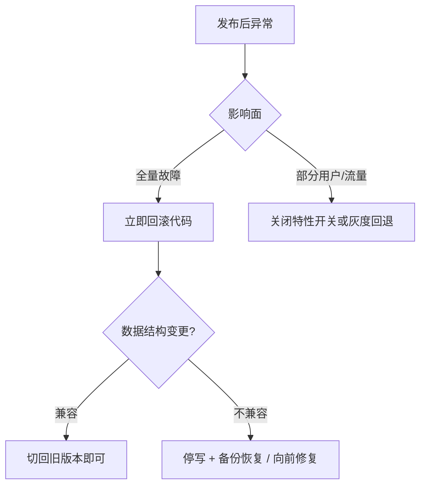

回滚是发布的一部分，不是事故后的补救。发布前就要明确：回滚到什么版本、数据是否兼容、谁来决策、多久内必须决定。



## 代码回滚

软链发布下最简单：

```bash
ln -sfn /opt/app/releases/20261125-2300 /opt/app/current
systemctl reload app
```

前提是旧版本目录、依赖与配置都还在。保留最近 3–5 个版本，并记录每个版本对应的提交号与迁移。

## 配置回滚

配置错误常被当成代码问题。配置要版本化：

- 配置与代码同仓或独立配置仓；
- 变更走发布流程，不直接改线上文件；
- 回滚时把配置与代码一起切回；
- 密钥轮换要兼容旧值，避免回滚后连不上。

## 数据回滚

代码可以秒回，数据往往不能：

- 新增字段、新增表通常兼容，旧代码可以继续运行；
- 删除字段、修改类型、重命名属于不兼容变更，回滚前必须恢复数据；
- 采用“扩展 → 迁移 → 收缩”的三步法，避免同一发布里既改结构又删旧字段；
- 不兼容变更的回滚依赖备份与 binlog，RTO 明显更长。

## 灰度

灰度把风险限制在部分流量：

- 按比例：1% → 10% → 50% → 100%；
- 按用户：内部账号、特定地区、白名单；
- 按实例：先发一台，观察后再扩大；
- 每步设置观察窗口与回退阈值。

灰度需要入口层支持流量分配（Nginx、网关或服务网格），并且新旧版本要能同时运行。

## 特性开关

```javascript
if (flags.newCheckout && user.inExperiment) {
  return newCheckout(user)
}
return oldCheckout(user)
```

特性开关与部署解耦：代码先上线但默认关闭，出问题直接关开关，不需要回滚版本。代价是代码里长期存在两套逻辑，必须定期清理。

## 回滚决策

提前约定触发条件，例如：

- 5 分钟内错误率超过基线 2 倍；
- P99 延迟超过阈值；
- 核心接口不可用或数据出现不一致；
- 支付、登录等关键链路失败。

决策人、回滚命令、验证步骤写在值班手册里。事故现场不应临时讨论“要不要回”。

## 回滚演练

- 每季度做一次真实回滚；
- 记录从决定到恢复的时间；
- 验证旧版本能读到当前数据；
- 检查缓存、消息、定时任务是否也需要回退。

## 常见坑

- **只保留一个版本**：想回也回不去；
- **回滚忘记迁移**：旧代码在新表结构上报错；
- **缓存未失效**：回滚后仍读到新版本写入的缓存；
- **消息格式变更**：旧消费者读不了新消息；
- **灰度没有观察指标**：放量后才发现问题。

## 小结

- 回滚分为代码、配置与数据三层，数据回滚成本最高；
- 发布保留多个版本，软链切换最快；
- 不兼容变更用扩展/迁移/收缩，避免同版本删旧结构；
- 灰度与特性开关把风险限制在可控范围；
- 回滚触发条件与演练要提前确定。
