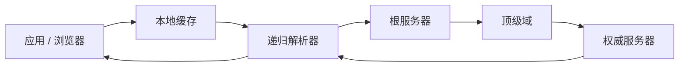

访问域名失败时，第一层要判断的是“解析有没有问题”。解析错误表现为连接超时、证书域名不匹配或直接返回 NXDOMAIN，与后端服务本身无关。



## 常见记录

| 类型 | 作用 | 示例 |
| --- | --- | --- |
| A | 域名指向 IPv4 | `example.com → 1.2.3.4` |
| AAAA | 域名指向 IPv6 | `example.com → 2001:db8::1` |
| CNAME | 别名指向另一个域名 | `www → example.com` |
| MX | 邮件交换 | `example.com → mail.example.com` |
| TXT | 文本校验 | SPF、站点验证 |
| NS | 权威服务器 | `example.com → ns1.example.com` |

CNAME 不能与 A 记录同时存在同一主机名，根域名使用 CNAME 也会受限制。需要“根域名指向 CDN”时，通常用 A/AAAA 或厂商提供的别名记录。

## 用 dig 排查

```bash
dig example.com A +short
dig www.example.com CNAME
dig example.com MX
dig @8.8.8.8 example.com A
dig +trace example.com
```

- `+short` 只输出结果；
- `@8.8.8.8` 指定解析器，用于判断“本机 DNS 与公共 DNS 是否一致”；
- `+trace` 从根开始逐级查询，适合定位权威记录配置错误；
- 输出的 `TTL` 是剩余缓存时间，`ANSWER SECTION` 才是最终记录。

## 缓存与生效

解析结果会在浏览器、操作系统、递归解析器与权威服务器之间缓存。修改记录后：

- 权威服务器立即生效；
- 递归解析器按 TTL 缓存，常见 300–3600 秒；
- 客户端与浏览器还有自己的缓存。

降低 TTL 要在变更前提前做，而不是改完再降。发布切换前把 TTL 调到 60–300 秒，可以减少回滚等待。

## 常见解析问题

- **NXDOMAIN**：记录不存在或拼错；
- **返回旧 IP**：缓存未过期，用 `dig +trace` 与权威记录对比；
- **解析偶发失败**：多个解析器不一致，或内网 DNS 劫持；
- **能解析但不能连**：DNS 正常，问题在端口、防火墙或证书；
- **CNAME 链路过长**：多次跳转增加解析时间，也容易在某一层断开；
- **IPv6 优先但不可用**：AAAA 返回了地址，实际网络不支持，应用超时。

## 内网与容器

- 容器内 DNS 由 Docker/编排平台接管，`/etc/resolv.conf` 指向内部解析器；
- 服务发现常用内部域名，跨命名空间访问要写全限定名；
- 修改宿主机 DNS 不一定影响已启动容器，需重建或重启；
- 内网域名与公网同名时，优先匹配内部解析，容易出现“本地能解析、线上不能”的反向情况。

## 排查顺序

1. `dig` 确认解析结果与 TTL；
2. 对比公共 DNS 与权威记录；
3. `curl -v` 看实际连接的 IP；
4. 解析正确但连接失败，转到端口与链路排查。

## 小结

- DNS 负责域名到 IP，缓存与 TTL 决定变更生效速度；
- CNAME 是别名，不能与同名的其他记录随意共存；
- `dig +short` 看结果，`+trace` 看权威配置；
- 解析正常不代表可访问，下一层要查 TCP 与 TLS。
