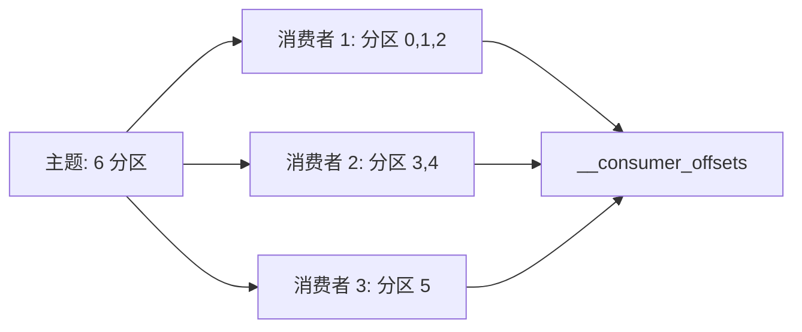

消费组是横向扩展消费的方式：组内成员分摊分区，组间互不影响。位移（offset）记录“读到哪”，提交时机决定消息语义。



## 消费组

- 一个分区同一时刻只被组内一个消费者消费；
- 消费者数超过分区数时，多出的成员空闲；
- 不同消费组各自维护位移，互不影响；
- 组名要按业务与环境区分，避免误共用。

```bash
kafka-consumer-groups.sh --bootstrap-server localhost:9092 --describe --group order-worker
```

输出包含每个分区的当前位移、日志末端位移与 lag。

## 位移提交

```properties
enable.auto.commit=true
auto.commit.interval.ms=5000
```

自动提交简单，但可能丢消息或重复：

- 处理失败但位移已提交 → 消息丢失（至少一次语义被破坏）；
- 处理成功但提交前崩溃 → 重启后重复消费。

手动提交更可控：

```java
while (true) {
    var records = consumer.poll(Duration.ofMillis(500));
    process(records);
    consumer.commitSync();
}
```

| 语义 | 提交时机 | 结果 |
| --- | --- | --- |
| 至多一次 | 先提交后处理 | 可能丢 |
| 至少一次 | 先处理后提交 | 可能重复 |
| 精确一次 | 事务 + 幂等 | 成本高 |

大多数业务选择“至少一次 + 消费端幂等”。

## 重平衡

重平衡是组内分区重新分配。触发条件：

- 成员加入或离开；
- 订阅主题的分区数变化；
- 心跳超时（`session.timeout.ms`）；
- 处理过久（`max.poll.interval.ms`）。

减少重平衡：

- 调大 `max.poll.interval.ms` 或减小单次拉取量；
- 处理逻辑异步化，避免 poll 线程阻塞；
- 使用静态成员（`group.instance.id`）减少滚动重启带来的抖动；
- 监控 rebalance 次数与耗时。

重平衡期间消费会暂停，频繁重平衡表现为 lag 波动与吞吐下降。

## 位移重置

新消费组没有位移时，按 `auto.offset.reset` 决定：

- `earliest`：从头读；
- `latest`：从最新开始；
- `none`：没有位移直接报错。

重置已有位移要谨慎：

```bash
kafka-consumer-groups.sh --bootstrap-server localhost:9092 \
  --group order-worker --topic orders \
  --reset-offsets --to-earliest --execute
```

执行前必须停止该组消费者，否则会与运行中的提交冲突。

## 消费延迟

lag = 日志末端位移 - 消费者位移。排查顺序：

1. 消费者是否存活、是否频繁重平衡；
2. 单条处理耗时是否超过拉取间隔；
3. 下游数据库或接口是否变慢；
4. 分区数是否不足；
5. 是否存在毒消息导致反复重试。

lag 持续增长但消费者 CPU 不高，通常是下游阻塞或处理串行。

## 小结

- 分区是消费并行的上限，组内成员分摊分区；
- 自动提交简单但语义弱，业务优先“至少一次 + 幂等”；
- 重平衡由成员变化、心跳与处理时长触发；
- 位移重置前先停消费者；
- 消费延迟先看消费者状态，再看下游与分区数。
