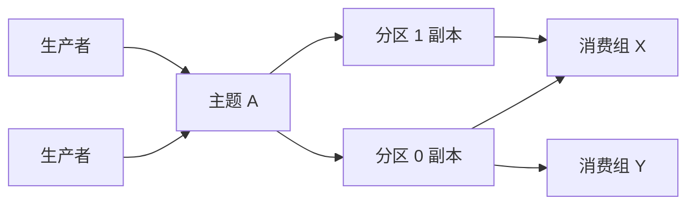

Kafka 常被当作消息队列，但它的本质是“可持久化、可重放的分布式提交日志”。生产者追加记录，消费者按位移读取，消息不会因为被消费而删除。



## 核心概念

| 概念 | 含义 |
| --- | --- |
| Broker | 单个 Kafka 服务节点 |
| Topic | 逻辑主题，消息分类 |
| Partition | 主题的分片，决定并行度 |
| Replica | 分区副本，包含 leader 与 follower |
| Offset | 分区内消息的唯一序号 |
| Consumer Group | 一组消费者共同消费主题 |

分区是并行的最小单位：一个分区同一时刻只由一个消费者消费，所以消费者数量超过分区数时会有空闲。

## KRaft 部署

Kafka 4.0 起只支持 KRaft，ZooKeeper 已移除。单节点开发环境可以用 Compose：

```yaml
services:
  kafka:
    image: apache/kafka:4.0.0
    ports:
      - "9092:9092"
    environment:
      KAFKA_NODE_ID: 1
      KAFKA_PROCESS_ROLES: broker,controller
      KAFKA_CONTROLLER_QUORUM_VOTERS: 1@kafka:9093
      KAFKA_LISTENERS: PLAINTEXT://:9092,CONTROLLER://:9093
      KAFKA_ADVERTISED_LISTENERS: PLAINTEXT://localhost:9092
      KAFKA_CONTROLLER_LISTENER_NAMES: CONTROLLER
      KAFKA_LISTENER_SECURITY_PROTOCOL_MAP: CONTROLLER:PLAINTEXT,PLAINTEXT:PLAINTEXT
      KAFKA_OFFSETS_TOPIC_REPLICATION_FACTOR: 1
      KAFKA_TRANSACTION_STATE_LOG_REPLICATION_FACTOR: 1
      KAFKA_TRANSACTION_STATE_LOG_MIN_ISR: 1
```

生产环境至少 3 个 broker + 3 个 controller，副本因子 3，`min.insync.replicas=2`。

## 命令行验证

```bash
kafka-topics.sh --bootstrap-server localhost:9092 --list
kafka-topics.sh --bootstrap-server localhost:9092 \
  --create --topic orders --partitions 3 --replication-factor 1
kafka-console-producer.sh --bootstrap-server localhost:9092 --topic orders
kafka-console-consumer.sh --bootstrap-server localhost:9092 \
  --topic orders --from-beginning
```

## 适合与不适合

适合：

- 高吞吐的异步解耦；
- 事件溯源与日志聚合；
- 多消费组独立消费同一份数据；
- 需要重放历史消息的场景。

不适合：

- 低延迟的 RPC 调用；
- 需要复杂路由与优先级队列；
- 消息很小但数量极大、且要求严格顺序的单分区场景；
- 团队没有运维精力时，优先考虑云托管。

## 与 Redis 队列的区别

Redis 的 List/Stream 更轻量，适合简单队列与短保留；Kafka 提供分区、副本、持久化与消费组位移管理，适合大规模事件流。选型取决于吞吐、保留与可靠性要求。

## 小结

- Kafka 是可重放的分布式日志，消费不删除消息；
- 分区决定并行度，副本决定可靠性；
- 4.0 起仅 KRaft，生产至少 3 broker + 3 controller；
- 适合高吞吐解耦与事件流，不适合低延迟 RPC；
- 运维重点是副本、ISR、磁盘与消费延迟。
