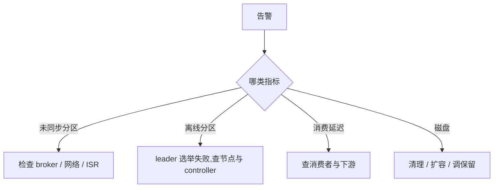

Kafka 故障的典型表现是“生产变慢、消费延迟、分区不可用”。多数问题最终指向副本不足、磁盘写满或消费者处理不过来，而不是 Kafka 本身。



## 可靠性组合

- 副本因子 3；
- `min.insync.replicas=2`；
- 生产者 `acks=all`；
- 关闭不安全的 unclean leader 选举（`unclean.leader.election.enable=false`）。

这组配置保证“至少两个副本确认才写入”，代价是副本不足时写入失败。可用性与一致性需要按业务选择，不要为了“永远可写”打开 unclean 选举。

## 关键监控

| 指标 | 含义 | 关注点 |
| --- | --- | --- |
| UnderReplicatedPartitions | 副本不足的分区数 | 持续大于 0 需处理 |
| OfflinePartitionsCount | 无 leader 的分区数 | 大于 0 即不可用 |
| ActiveControllerCount | 活跃 controller 数 | 应为 1 |
| RequestHandlerAvgIdlePercent | 请求线程空闲率 | 过低说明过载 |
| 消费 lag | 组内积压 | 持续增长需扩容或优化 |
| 磁盘使用率 | 日志目录 | 接近 100% 会停写 |

## 磁盘与保留

Kafka 把消息写在日志段里，保留策略决定删除时机：

```properties
log.retention.hours=168
log.retention.bytes=1073741824
log.segment.bytes=1073741824
```

时间与容量同时生效，先到先删。磁盘写满时 broker 会停止接收，生产直接失败。扩容前先评估副本数带来的放大：3 副本意味着 3 倍存储。

## 常见故障与处置

### 未同步分区持续增加

- broker 负载过高或磁盘 IO 慢；
- 网络抖动导致 follower 拉取落后；
- 单分区写入量突增。

先看 broker 日志与磁盘，再判断是否需要扩容或限流。

### 离线分区

- leader 所在 broker 不可用；
- controller 无法完成选举；
- 副本全部不可用。

需要恢复 broker 或等待 ISR 重新同步。不要用 unclean 选举“强行恢复”，可能丢数据。

### 消费延迟

- 消费者实例不足或频繁重平衡；
- 处理逻辑阻塞（数据库、外部接口）；
- 分区数不足，无法再扩消费者。

先扩消费者到分区数上限，再优化单条处理，最后才考虑扩分区。

### 磁盘写满

- 调小保留时间或容量；
- 清理无用的 topic；
- 扩容磁盘并迁移分区；
- 临时降低副本数有风险，不建议作为常规手段。

## 常用命令

```bash
kafka-topics.sh --bootstrap-server localhost:9092 --describe --topic orders
kafka-consumer-groups.sh --bootstrap-server localhost:9092 --describe --group order-worker
kafka-log-dirs.sh --bootstrap-server localhost:9092 --describe
kafka-configs.sh --bootstrap-server localhost:9092 --describe --entity-type topics --entity-name orders
```

## 小结

- 可靠性由副本、ISR 与确认机制共同决定；
- 监控重点是未同步/离线分区、消费 lag 与磁盘；
- 磁盘按副本数放大，保留策略要同时看时间与容量；
- 故障处置先保数据，再恢复可用性；
- 不要用 unclean 选举掩盖副本问题。
