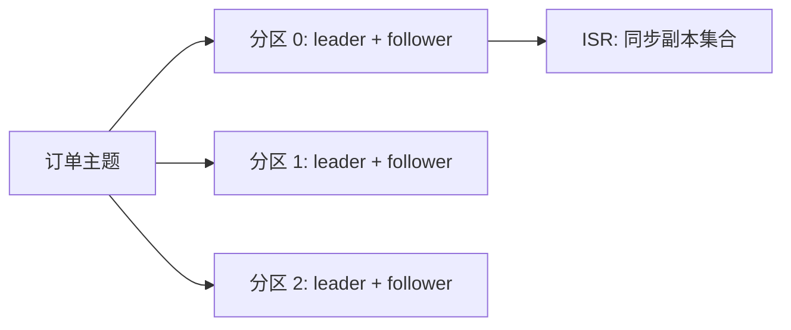

主题是逻辑分类，分区是物理分片。同一分区内消息严格有序，不同分区之间不保证顺序。分区数一旦确定，扩容只能增加不能减少，消息也不会自动重分布。



## 创建主题

```bash
kafka-topics.sh --bootstrap-server localhost:9092 \
  --create --topic orders \
  --partitions 6 --replication-factor 3 \
  --config min.insync.replicas=2 \
  --config retention.ms=604800000
```

- `partitions`：并行度的上限，消费者数不超过分区数才有意义；
- `replication-factor`：副本数，生产至少 3；
- `min.insync.replicas`：写入至少被多少个副本确认；
- `retention.ms`：消息保留时长，按业务与磁盘容量设置。

## 分区与顺序

同一个 key 默认按哈希落到固定分区，从而保证同一业务实体的顺序，例如订单号：

```java
producer.send(new ProducerRecord<>("orders", orderId, payload));
```

不指定 key 时消息轮询分布到各分区，顺序不保证。需要全局顺序只能单分区，代价是无法并行消费。

## 副本与 ISR

- leader 处理读写，follower 拉取 leader 的日志；
- ISR（in-sync replicas）是与 leader 保持同步的副本集合；
- `acks=all` 时，leader 等待 ISR 中所有副本确认（受 `min.insync.replicas` 约束）；
- ISR 数量低于 `min.insync.replicas` 时，写入会被拒绝，这是保护而不是故障。

| acks | 行为 | 风险 |
| --- | --- | --- |
| 0 | 不等待确认 | 可能丢消息 |
| 1 | leader 确认 | leader 故障可能丢 |
| all | ISR 全部确认 | 延迟更高，可靠性最好 |

## 分区数量怎么定

- 按目标吞吐估算，单分区写入能力有限；
- 消费者并行度不超过分区数，多出的消费者会空闲；
- 分区过多会增加元数据、文件句柄与选举成本；
- 预留一定增长空间，但不要一次开到几百；
- 需要严格顺序的实体控制在单分区内。

扩分区：

```bash
kafka-topics.sh --bootstrap-server localhost:9092 \
  --alter --topic orders --partitions 12
```

扩分区后新消息按新分区数分布，旧消息不会迁移；基于 key 的路由会变化，依赖“同 key 同分区”的消费者需要评估影响。

## 主题参数

- `cleanup.policy=delete|compact`：日志清理或键压缩；
- `retention.bytes`：按容量保留；
- `max.message.bytes`：单条消息上限；
- `segment.bytes`：日志段大小。

键压缩适合“每个 key 只保留最新值”的场景，例如配置同步；普通事件流用删除策略。

## 常见坑

- **副本因子 1**：节点故障即丢分区；
- **min.insync.replicas 与 acks 不匹配**：可靠性预期落空；
- **分区数远大于消费者数**：资源浪费；
- **随意扩分区**：顺序与 key 路由被破坏；
- **保留策略按时间但磁盘先满**：同时设置容量上限；
- **主题命名无规范**：环境、业务、版本混在一起。

## 小结

- 分区决定并行与顺序，副本决定可靠性；
- 生产副本 3、`min.insync.replicas=2`、`acks=all` 是常见组合；
- 同 key 同分区保证局部顺序，全局顺序只能单分区；
- 分区扩容不可逆，需提前规划；
- 保留策略要同时考虑时间与磁盘容量。
