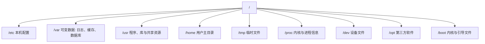
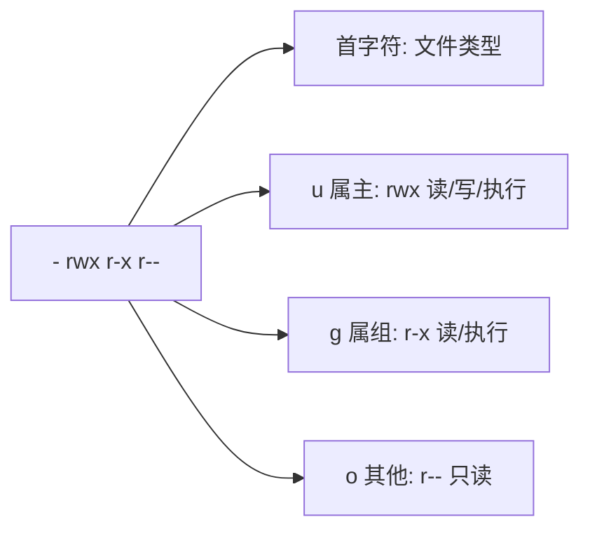

Linux 将设备、进程与部分内核对象统一以文件接口暴露，并以单根目录树组织。理解目录职责与权限模型，是排查“文件找不到”“权限不足”“磁盘写满”等问题的基础。

## 目录结构

Linux 没有盘符概念，所有文件都从根目录 `/` 开始。主流发行版遵循 FHS（Filesystem Hierarchy Standard），主要目录的职责如下：



| 目录 | 职责 |
| --- | --- |
| `/etc` | 本机配置文件；不存放二进制程序 |
| `/var` | 运行期可变数据，日志在 `/var/log` |
| `/usr` | 只读的程序、库与文档，`/usr/local` 用于本地安装 |
| `/home` | 普通用户主目录 |
| `/tmp` | 临时文件，通常重启清空 |
| `/proc` | 内核与进程的虚拟文件系统，不占磁盘 |
| `/dev` | 设备节点 |
| `/opt` | 独立第三方软件包 |

部署应用时，代码通常放在 `/opt` 或 `/usr/local`，配置放入 `/etc`，运行数据与日志放入 `/var`。这种划分便于备份与权限控制：配置可纳入版本管理，数据目录单独扩容。

## 查看文件属性

`ls -l` 的第一列包含文件类型与权限，其余字段依次为硬链接数、属主、属组、大小、修改时间与文件名：

```bash
$ ls -l /etc/ssh/sshd_config
-rw-r--r-- 1 root root 3120 Nov 21 10:20 /etc/ssh/sshd_config
```

首字符表示文件类型：`-` 普通文件、`d` 目录、`l` 符号链接、`c` 字符设备、`b` 块设备、`s` 套接字、`p` 命名管道。

权限部分共九位，按属主（u）、属组（g）、其他用户（o）三组排列：



`r`、`w`、`x` 对文件和目录的含义不同：

| 权限 | 文件 | 目录 |
| --- | --- | --- |
| `r` | 读取内容 | 列出目录项 |
| `w` | 修改内容 | 创建、删除、重命名目录项 |
| `x` | 执行程序 | 进入目录、访问目录内文件 |

目录的 `x` 权限常被忽略：即使知道文件路径，如果路径中任意一级目录缺少 `x`，访问都会返回 `Permission denied`。

## 修改权限

数字模式将三组权限分别求和，读为 4、写为 2、执行为 1：

| 数字 | 权限 | 常见用途 |
| --- | --- | --- |
| `644` | `rw-r--r--` | 普通文件、配置 |
| `600` | `rw-------` | 私钥、含敏感信息的配置 |
| `755` | `rwxr-xr-x` | 可执行文件、目录 |
| `700` | `rwx------` | 仅属主可访问的目录 |
| `777` | `rwxrwxrwx` | 所有用户可读写执行，生产环境不应使用 |

```bash
chmod 644 app.conf          # 数字模式
chmod u+x deploy.sh         # 符号模式: 属主增加执行权限
chmod g-w,o-r secret.txt    # 同时移除属组写、其他读
chown app:app /var/lib/app  # 修改属主与属组
```

`umask` 决定新建文件的默认权限。常见值 `022` 使新文件为 `644`、新目录为 `755`。`umask` 是“扣除位”，而不是直接指定权限。

## 特殊权限位

除九位基本权限外，还有三个特殊位：

- **setuid（4）**：程序以文件属主身份运行。`/usr/bin/passwd` 是典型例子，普通用户借此修改 `/etc/shadow`。
- **setgid（2）**：作用于文件时以属组身份运行；作用于目录时，新建文件继承目录的属组，常用于协作目录。
- **sticky（1）**：作用于目录时，仅文件属主、目录属主或 root 可以删除文件。`/tmp` 通常为 `1777`。

特殊位会带来提权风险，非必要不要给脚本或二进制文件设置 setuid。

## 链接

- **硬链接**：多个目录项指向同一 inode，删除其中一个不影响数据；不能跨文件系统，也不能链接目录。
- **符号链接**：保存目标路径，目标删除后链接失效；可以跨文件系统。

```bash
ln app-v1 app-current          # 硬链接
ln -s /opt/app/releases/2026-11-22 /opt/app/current   # 符号链接
```

发布系统常用符号链接切换版本：新版本解压到独立目录，修改 `current` 指向，回滚只需改回链接。这种方式切换快，且不需要移动大量文件。

## 权限排查

遇到 `Permission denied` 时，按以下顺序检查：

1. 当前用户与目标文件的属主、属组关系；
2. 目标文件本身的权限位；
3. 路径中每一级目录是否具备 `x` 权限；
4. 是否存在 ACL（`getfacl`）；
5. 是否被 SELinux 或 AppArmor 拦截（`ausearch`、`dmesg`）。

直接使用 `chmod 777` 通常只是掩盖问题，并扩大攻击面。应先确认进程以哪个用户运行，再按最小权限原则调整。

## 常用命令

```bash
df -h                      # 文件系统使用率
df -i                      # inode 使用率
du -sh /var/log/*          # 各目录占用
find /var/log -name "*.log" -mtime +7 -size +100M   # 按时间与大小筛选
stat app.conf              # inode、权限与时间戳
```

## 要点

- Linux 为单根目录树，`/etc`、`/var`、`/usr`、`/opt` 分别承担配置、数据、程序与第三方软件的职责；
- `ls -l` 首字符表示文件类型，后九位按属主、属组、其他用户分组；
- 目录的 `x` 权限决定能否进入，路径中任意一级缺失都会导致访问失败；
- `chmod` 数字模式以读 4、写 2、执行 1 求和；`umask` 决定新建文件的默认扣除位；
- setuid、setgid、sticky 具有特定用途，也带来安全风险；
- 权限问题应按用户、文件、路径、ACL、安全模块的顺序排查，避免直接使用 `777`。

下一篇讨论进程、端口与系统资源的观测方法。
