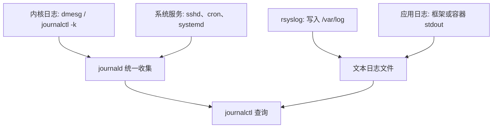
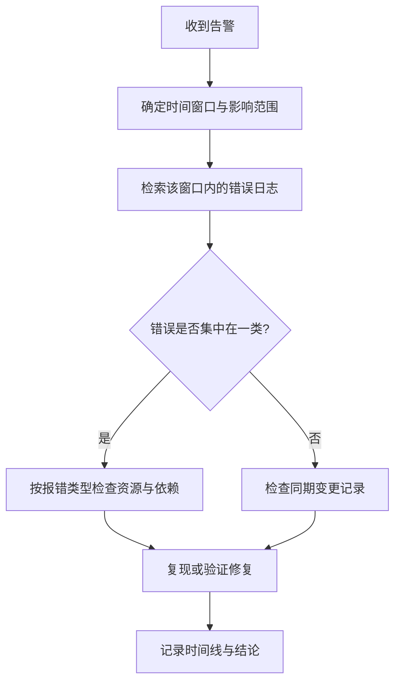

日志用于回答三个问题：发生了什么、发生在什么时候、影响了谁。定位故障时，日志的价值取决于两点：是否集中、是否可检索。分散在各台主机上的文本文件，检索成本会随规模迅速上升。

## 日志来源

Linux 上的日志大致分为四层：



- 内核日志：硬件、驱动、OOM、文件系统错误；
- 系统日志：认证、定时任务、服务启停；
- 应用日志：业务请求、异常栈、慢查询；
- 容器日志：默认写入 json-file，由 Docker 或日志驱动收集。

## journald

使用 systemd 的发行版默认由 journald 收集。常用查询：

```bash
journalctl -u nginx --since "2026-11-22 09:00" --no-pager
journalctl -u nginx -f                       # 持续跟踪
journalctl -p err -b                         # 本次启动以来的错误级别
journalctl -k                                # 仅内核日志
journalctl --disk-usage                      # 日志占用
```

`-p` 接收 `emerg`、`alert`、`crit`、`err`、`warning`、`notice`、`info`、`debug`。默认输出会分页，脚本或远程执行时应加 `--no-pager`。

journald 的日志默认持久化位置为 `/var/log/journal`；若目录不存在，日志可能只保存在内存中，重启后丢失。生产环境应确认持久化配置。

## rsyslog 与文本日志

rsyslog 按 `facility.severity` 规则分流日志。常见 facility 包括 `auth`、`cron`、`daemon`、`kern`、`local0` 至 `local7`；severity 从 `debug` 到 `emerg` 逐级升高。

```conf
# /etc/rsyslog.conf
auth,authpriv.*        /var/log/auth.log
*.info;mail.none       /var/log/syslog
local0.*               /var/log/app.log
```

常见文件：

| 文件 | 内容 |
| --- | --- |
| `/var/log/syslog` 或 `/var/log/messages` | 系统综合日志 |
| `/var/log/auth.log` 或 `/var/log/secure` | 登录与提权记录 |
| `/var/log/kern.log` | 内核日志 |
| `/var/log/nginx/` | Nginx 访问与错误日志 |

应用不应向系统日志写入大量业务数据。业务日志应使用独立文件或日志驱动，避免与系统日志混在一起。

## 日志轮转

不轮转的日志会持续增长，最终写满磁盘。logrotate 由 cron 或 systemd timer 触发，配置通常放在 `/etc/logrotate.d/`：

```conf
/var/log/app/*.log {
    daily
    rotate 14
    size 100M
    compress
    missingok
    notifempty
    copytruncate
}
```

- `daily` 与 `size` 同时存在时，任一条件满足即轮转；
- `rotate 14` 保留 14 份；
- `copytruncate` 适用于无法重新打开文件句柄的程序，但复制与截断之间可能丢少量日志；
- 支持重载的程序应使用 `postrotate` 发送 `HUP` 或调用重新打开日志的命令。

验证配置与手动触发：

```bash
logrotate -d /etc/logrotate.d/app     # 仅打印决策，不执行
logrotate -f /etc/logrotate.d/app     # 强制执行一次
```

## 检索方法

```bash
tail -f /var/log/app/error.log
grep -F "Traceback" -A20 -B5 app.log        # 固定字符串，保留上下文
grep -i "timeout" app.log | tail -50
awk '{print $1}' access.log | sort | uniq -c | sort -nr | head   # 按来源统计
```

- 优先使用 `grep -F`，避免正则元字符导致误匹配；
- 大文件先用 `tail` 缩小范围，再按时间窗口检索；
- 多行异常栈使用 `-A`、`-B` 保留上下文；
- 访问日志的统计应明确字段分隔方式，否则 `awk` 取列会错位。

## 常见报错

| 报错 | 常见原因 | 排查方向 |
| --- | --- | --- |
| `Permission denied` | 用户、权限位、路径 `x`、ACL、SELinux | 确认进程运行用户与目标文件权限 |
| `No space left on device` | 磁盘容量或 inode 耗尽 | `df -h`、`df -i`、`du -sh` |
| `Too many open files` | 文件句柄达到 `ulimit -n` | `ulimit -n`、`lsof -p <PID>` |
| `Connection refused` | 端口未监听或被拒绝 | `ss -lntp`、防火墙规则 |
| `Connection timed out` | 网络不可达、安全组、上游无响应 | `ping`、`traceroute`、`curl -v` |
| `502 Bad Gateway` | 上游服务不可用或连接被重置 | 上游进程、端口、健康检查 |
| `504 Gateway Timeout` | 上游处理超时 | 上游耗时、代理超时配置 |
| `OOMKilled` | 容器内存超过限制 | 容器内存上限、进程 RSS、内核 OOM 日志 |

同一条报错可能对应多种原因。排查时应先确认错误发生的时间窗口与影响范围，再结合指标判断，而不是直接搜索报错文本。

## 排查顺序



## 日志规范

可维护的日志应满足：

- **级别明确**：`error` 记录需要人工介入的问题，`warn` 记录可恢复的异常，`info` 记录关键流程；
- **结构化**：使用 JSON 或固定字段，至少包含时间、级别、服务名、请求 ID；
- **可关联**：入口生成 trace ID，并在下游调用中透传；
- **脱敏**：不记录密码、token、身份证号与完整银行卡号；
- **轮转与保留**：明确保留周期与磁盘上限，避免日志成为故障源。

## 要点

- 日志分为内核、系统、服务与应用四层，journald 与 rsyslog 是两条主要收集路径；
- `journalctl` 按单元、时间、优先级过滤，远程执行加 `--no-pager`；
- 日志必须配置轮转与保留期，否则会写满磁盘；
- 检索时先用时间窗口缩小范围，再用固定字符串与上下文参数定位；
- 高频报错应先判断资源与依赖，再对照变更记录；
- 日志应统一级别、结构与脱敏规则，并支持请求级关联。

Linux 基础三节至此完成：目录与权限、进程与资源、日志与排障。后续章节将进入网络排障与服务管理。
