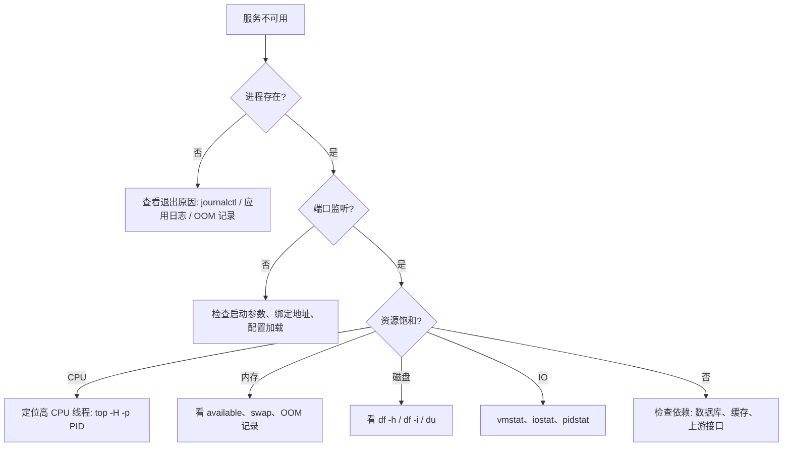

服务不可用时，排查顺序通常是：进程是否存活、端口是否监听、资源是否耗尽、依赖是否可达。本文按这一顺序整理常用命令与字段含义。

## 进程视图

`ps` 用于获取某一时刻的进程快照，`top` 用于持续观察：

```bash
ps aux | grep nginx
ps -ef --forest            # 显示父子关系
top -b -n 1 | head -20     # 批处理模式输出一次
pstree -p 1                # 以 1 号进程为根的进程树
```

`ps aux` 的主要字段：

| 字段 | 含义 |
| --- | --- |
| `PID` | 进程 ID |
| `%CPU` / `%MEM` | CPU 与物理内存占用比例 |
| `VSZ` | 虚拟内存大小 |
| `RSS` | 常驻物理内存，排查内存占用时看这一列 |
| `STAT` | 进程状态 |
| `TIME` | 累计 CPU 时间 |

`STAT` 常见取值：`R` 运行中、`S` 可中断睡眠、`D` 不可中断睡眠（通常等待 IO）、`Z` 僵尸进程、`T` 已停止。大量 `D` 状态进程往往指向磁盘或网络文件系统问题。

## 信号

终止进程应优先使用 `SIGTERM`（15），给程序清理资源的机会；`SIGKILL`（9）由内核直接终止，可能导致数据未落盘：

```bash
kill -15 <PID>
kill -9 <PID>        # 仅在进程无响应时使用
```

`SIGHUP`（1）在部分服务中用于重新加载配置。是否支持取决于程序实现，不能假定所有服务都遵守这一约定。

## 端口与连接

```bash
ss -lntp                          # 监听中的 TCP 端口及进程
ss -tnp state established         # 已建立的连接
lsof -i :8787                     # 指定端口的占用进程
```

端口无人监听时，客户端会收到 `Connection refused`；端口监听但连接超时，通常是防火墙、安全组或上游代理的问题。

连接状态中需要区分两类：

- `TIME_WAIT`：本端主动关闭后的正常状态，持续约 2 倍 MSL。数量很大时通常是短连接过多，可考虑连接复用。
- `CLOSE_WAIT`：对端已关闭，本端尚未关闭。长期堆积说明应用没有正确关闭套接字，属于代码或连接池配置问题。

## 系统资源

### 负载

```bash
uptime
# load average: 0.52, 0.61, 0.48
```

三个数值分别是 1、5、15 分钟的平均负载。负载统计的是可运行与不可中断状态的任务数，需要与 CPU 核数比较：4 核机器负载持续高于 4，说明存在排队。

### 内存

```bash
free -h
```

重点关注 `available` 而非 `free`。`buff/cache` 可被回收，`free` 很小并不代表内存不足；`available` 才是新进程可用的估计值。当 `available` 接近 0 且开始使用 swap，系统会出现明显抖动。

### 磁盘与 inode

```bash
df -h
df -i
du -sh /var/* | sort -h
```

`No space left on device` 不一定由磁盘容量引起，也可能是 inode 耗尽（大量小文件）。两者需要分别检查。

### IO

```bash
vmstat 1 5
iostat -x 1 5
```

`vmstat` 的 `wa` 表示等待 IO 的 CPU 时间比例；`iostat -x` 的 `%util` 接近 100% 且 `await` 明显升高，说明磁盘已饱和。此时应优先定位是哪个进程在读写：

```bash
pidstat -d 1 5
```

## OOM

内存耗尽时，内核的 OOM Killer 会选择进程终止。排查依据：

```bash
dmesg -T | grep -i "out of memory"
dmesg -T | grep -i "killed process"
cat /proc/<PID>/oom_score
```

被终止的进程会在内核日志中留下记录。容器环境还会在 `docker inspect` 或 `kubectl describe` 中显示 `OOMKilled`。

OOM 的根本原因通常是内存上限配置过低、缓存无上限增长或存在泄漏。仅提高内存上限而不定位增长来源，问题会再次出现。

## 排查顺序



CPU 占用高时，可以先定位线程，再映射到代码：

```bash
top -H -p <PID>
```

得到线程 ID 后，Java 等运行时可通过线程转储定位到具体栈帧。

## 要点

- 排查顺序为进程、端口、资源、依赖，不要直接从代码开始怀疑；
- `ps` 的 `RSS` 反映实际物理内存，`STAT` 中的 `D` 状态通常意味着 IO 等待；
- 终止进程优先使用 `SIGTERM`，`SIGKILL` 仅用于无响应场景；
- `TIME_WAIT` 属于正常状态，`CLOSE_WAIT` 堆积说明应用未正确关闭连接；
- 负载需要与核数比较，内存看 `available`，磁盘同时检查容量与 inode；
- OOM 的结论应以内核日志为准，不能仅凭监控曲线推断。

下一篇讨论日志的采集、检索与常见报错的定位方法。
