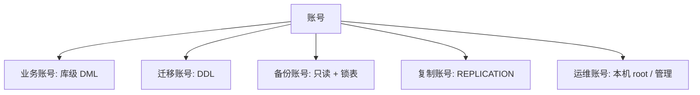

权限问题的代价往往在事故后才显现：应用账号能删库、备份账号能写数据、离职人员的账号还留着。账号治理的目标是让每个身份只拥有完成工作所需的最小权限。



## 账号由两部分组成

`user@host` 中 host 是允许连接的来源，不是密码的一部分：

```sql
CREATE USER 'app'@'10.0.%' IDENTIFIED BY '...';
```

`'app'@'10.0.%'` 与 `'app'@'%'` 是两个不同账号。权限按最具体的 host 匹配，排查“为什么连上了却没权限”时先看实际匹配的 host。

## 四类账号

```sql
-- 业务：只读写业务库
CREATE USER 'app'@'10.0.%' IDENTIFIED BY '...';
GRANT SELECT, INSERT, UPDATE, DELETE ON shop.* TO 'app'@'10.0.%';

-- 迁移：需要改表结构
CREATE USER 'migrate'@'10.0.%' IDENTIFIED BY '...';
GRANT SELECT, INSERT, UPDATE, DELETE, CREATE, ALTER, INDEX, DROP
  ON shop.* TO 'migrate'@'10.0.%';

-- 备份：只读
CREATE USER 'backup'@'10.0.%' IDENTIFIED BY '...';
GRANT SELECT, SHOW VIEW, TRIGGER, EVENT, RELOAD, PROCESS, REPLICATION CLIENT
  ON *.* TO 'backup'@'10.0.%';

-- 复制
CREATE USER 'repl'@'10.0.%' IDENTIFIED BY '...';
GRANT REPLICATION SLAVE ON *.* TO 'repl'@'10.0.%';
```

- 业务账号不给 `DROP`、`ALTER`，也不给 `FILE`；
- 备份账号需要 `RELOAD` 与 `PROCESS`，但不给写权限；
- 复制账号只给 `REPLICATION SLAVE`，不要复用业务账号；
- 运维账号限制来源主机，并优先使用跳板机。

## 角色

账号多时用角色管理：

```sql
CREATE ROLE 'app_read', 'app_write';
GRANT SELECT ON shop.* TO 'app_read';
GRANT INSERT, UPDATE, DELETE ON shop.* TO 'app_write';

GRANT 'app_read', 'app_write' TO 'app'@'10.0.%';
SET DEFAULT ROLE ALL TO 'app'@'10.0.%';
```

角色本身不能登录，只作为权限集合。调整权限时改角色，所有绑定账号同步生效。

## 密码与账号状态

```sql
ALTER USER 'app'@'10.0.%' IDENTIFIED BY 'new-password';
ALTER USER 'app'@'10.0.%' ACCOUNT LOCK;
ALTER USER 'app'@'10.0.%' PASSWORD EXPIRE INTERVAL 180 DAY;
```

- 8.4 默认 `caching_sha2_password`，不要为了兼容把新账号建在旧插件上；
- 可安装 `validate_password` 组件强制复杂度；
- 离职与临时账号及时锁定或删除；
- 定期审计长期未登录账号。

查看权限：

```sql
SHOW GRANTS FOR 'app'@'10.0.%';
SELECT user, host, account_locked FROM mysql.user;
```

## 最小授权检查清单

1. 业务账号是否只有目标库的 DML；
2. 是否存在 `%` 来源的高权限账号；
3. 备份账号是否意外拥有写权限；
4. 复制账号是否与业务账号分离；
5. 离职人员与临时账号是否清理；
6. 是否定期审查 `SHOW GRANTS`。

## 常见坑

- **用 root 跑应用**：一次注入即可删除整库；
- **账号 host 写成 `%`**：公网扫描会持续尝试；
- **为了省事给 `ALL`**：权限边界消失，事故范围扩大；
- **共享账号**：无法追责，也无法按人回收；
- **改密码不踢旧会话**：旧连接仍可继续操作，需要 `KILL` 对应连接。

## 小结

- 账号由 user@host 定义，权限有明确的层级；
- 业务、迁移、备份、复制四类账号分开，各自最小授权；
- 角色适合批量管理权限；
- 密码策略、锁定与定期审计是账号治理的一部分；
- root 只用于本机运维，不进入应用配置。
