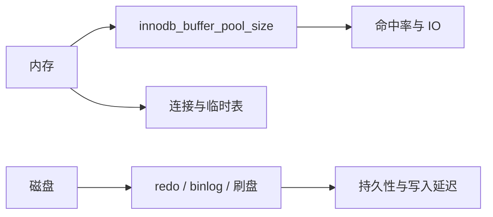

参数调整的目标不是“把每个值都调到最优”，而是让内存、磁盘与写入模式匹配。多数性能问题来自索引与 SQL，参数只在资源边界上起作用。



## 内存

```ini
[mysqld]
innodb_buffer_pool_size = 8G
innodb_buffer_pool_instances = 8
```

- 缓冲池缓存数据页与索引页，通常给物理内存的 50%–70%；
- 剩余内存留给连接、排序、临时表与系统缓存；
- 缓冲池不是越大越好，超过可用内存会触发 swap，性能骤降；
- 8.4 对 `innodb_buffer_pool_instances` 的默认值有调整，显式设置便于容量核算。

监控命中率：

```sql
SHOW STATUS LIKE 'Innodb_buffer_pool_read%';
```

`Innodb_buffer_pool_read_requests` 与 `Innodb_buffer_pool_reads` 的比值接近 1 时，说明大部分读命中内存；磁盘读比例升高，先看是不是热数据放不下。

## redo 与刷盘

```ini
innodb_redo_log_capacity = 2G
innodb_flush_log_at_trx_commit = 1
sync_binlog = 1
innodb_flush_method = O_DIRECT
```

- `innodb_redo_log_capacity` 在 8.0.30 之后取代旧的日志文件大小参数，默认 100MB，写入突发的实例应提高到 1–4GB；
- `innodb_flush_log_at_trx_commit=1` 每次提交刷盘，最安全；改为 2 会丢最近约 1 秒的事务；
- `sync_binlog=1` 每次提交同步 binlog，主从与恢复更可靠；
- `O_DIRECT` 绕过系统页缓存，避免双重缓存，SSD 上通常更稳。

刷盘策略是安全与性能的直接取舍，改动前必须确认业务能接受的数据丢失窗口。

## 连接与临时表

```ini
max_connections = 500
tmp_table_size = 64M
max_heap_table_size = 64M
```

- 连接数要结合应用连接池上限，数据库连接不是越多越好；
- 每个连接都有内存开销，连接数过高会挤压缓冲池；
- 临时表参数影响 GROUP BY、DISTINCT 与排序，过小会落盘；
- 连接打满时，先查慢查询与长事务，而不是直接调大上限。

## 容量估算

1. **数据与索引**：按行数 × 平均行宽估算，索引通常再占 20%–40%；
2. **增长**：按业务增速预留 6–12 个月；
3. **binlog**：按写入量与保留天数估算，ROW 格式下大事务会显著放大；
4. **undo**：长事务越多，undo 空间越大；
5. **备份**：全量与增量并存，预留 2–3 倍数据量的备份空间；
6. **临时空间**：大查询与 DDL 需要额外磁盘。

磁盘使用率超过 80% 后，写入性能与故障风险都会上升，应提前扩容或归档。

## 需要长期盯的指标

- QPS / TPS 与慢查询数量；
- 连接数、活跃连接与等待连接；
- 缓冲池命中率与磁盘读；
- redo 生成速率与检查点；
- 复制延迟；
- 磁盘使用率与 inode；
- 主从切换与备份任务状态。

## 常见误区

- **只看 CPU 使用率**：数据库瓶颈常在 IO 与锁等待；
- **把 buffer pool 调到 90%**：系统缓存与连接内存不足，反而更慢；
- **为了吞吐关闭双 1**：一次断电就丢数据；
- **连接数翻倍解决排队**：可能让所有请求一起变慢；
- **不监控磁盘**：binlog 与数据文件把盘写满是最常见的线上事故之一。

## 小结

- 参数围绕内存、redo、连接与刷盘四组调整；
- 缓冲池与 redo 容量按数据量与写入峰值估算；
- 刷盘策略决定 RPO，不能只为性能关闭；
- 容量规划要覆盖数据、索引、binlog、undo 与备份；
- 监控优先看 IO、锁等待与复制延迟，而不只是 CPU。
