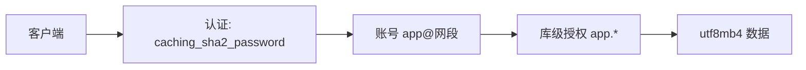

实例启动后，第一件事不是建表，而是确认“谁能连、连上用什么字符集、能操作哪些库”。这三件事决定了后续数据是否会出现乱码、越权与连接失败。



## 连接方式

```bash
mysql -h 127.0.0.1 -P 3306 -u root -p
mysql -h 10.0.0.12 -u app -p app_db
```

- `-h 127.0.0.1` 走 TCP，`localhost` 在部分客户端会走本地 socket，两者权限匹配的 host 可能不同；
- 容器内连接用 `docker exec -it mysql8 mysql -uroot -p`；
- 应用连接串要显式写字符集与时区，不要依赖服务端默认值。

## 8.4 的认证变化

8.4 默认使用 `caching_sha2_password`，`mysql_native_password` 默认关闭。老版本驱动可能直接报“Authentication plugin cannot be loaded”。

处理顺序：

1. 优先升级驱动。主流语言的 MySQL 驱动都已支持 `caching_sha2_password`；
2. 确认连接是否走 TLS，非 TLS 时首次认证需要 RSA 公钥交换；
3. 确实无法升级时，才考虑在服务端开启 `--mysql-native-password=ON`，并接受它的安全弱点。

不要为了省事把新账号建在旧插件上，后续大版本会再次卡住。

## 最小初始化

```sql
CREATE DATABASE app_db
  CHARACTER SET utf8mb4
  COLLATE utf8mb4_0900_ai_ci;

CREATE USER 'app'@'10.0.%' IDENTIFIED BY 'replace-with-strong-password';

GRANT SELECT, INSERT, UPDATE, DELETE
  ON app_db.* TO 'app'@'10.0.%';

-- 需要改表结构时再单独授权，不要直接给 ALL
-- GRANT ALTER, CREATE, INDEX ON app_db.* TO 'app'@'10.0.%';
```

要点：

- host 用网段而不是 `%`，把账号限制在应用所在网络；
- 业务账号默认只给 DML，DDL 交给迁移账号；
- 8.0 之后 `GRANT` 会立即生效，`FLUSH PRIVILEGES` 通常不需要；
- 不要用 root 跑应用，root 只用于本机运维。

## 字符集与时区

```sql
SHOW VARIABLES LIKE 'character_set%';
SHOW VARIABLES LIKE 'collation%';
SHOW VARIABLES LIKE 'time_zone';
SELECT @@system_time_zone;
```

- 库、表、连接三处都要是 `utf8mb4`，任何一处退回 `latin1` 都可能出现乱码；
- 排序规则用 `utf8mb4_0900_ai_ci`，它按 Unicode 9.0 排序，不区分重音与大小写；
- 时间字段建议统一存 UTC，展示时在应用层转换；连接串里显式设置 `serverTimezone=UTC` 或等价参数。

## 连接串示例

JDBC：

```text
jdbc:mysql://10.0.0.12:3306/app_db?useUnicode=true&characterEncoding=utf8&serverTimezone=UTC&useSSL=true
```

Python（PyMySQL）：

```python
pymysql.connect(
    host="10.0.0.12",
    user="app",
    password="...",
    database="app_db",
    charset="utf8mb4",
    autocommit=False,
)
```

连接池要限制最大连接数，并给获取连接设置超时。数据库的连接数不是越多越好，超过实例承载能力后，所有请求都会变慢。

## 初始化检查清单

1. 远程能连通，防火墙只放行应用网段；
2. 账号使用 `caching_sha2_password`，驱动版本匹配；
3. 业务账号只有库级 DML 权限；
4. 库与连接字符集为 `utf8mb4`；
5. 时区策略与应用一致。

## 小结

- 连接问题先分认证插件、网络与权限三层；
- 8.4 默认 `caching_sha2_password`，旧插件默认关闭，优先升级驱动；
- 账号按网段与库授权，root 不用于业务；
- 字符集与时区在库、连接、应用三处保持一致，别依赖默认值。
